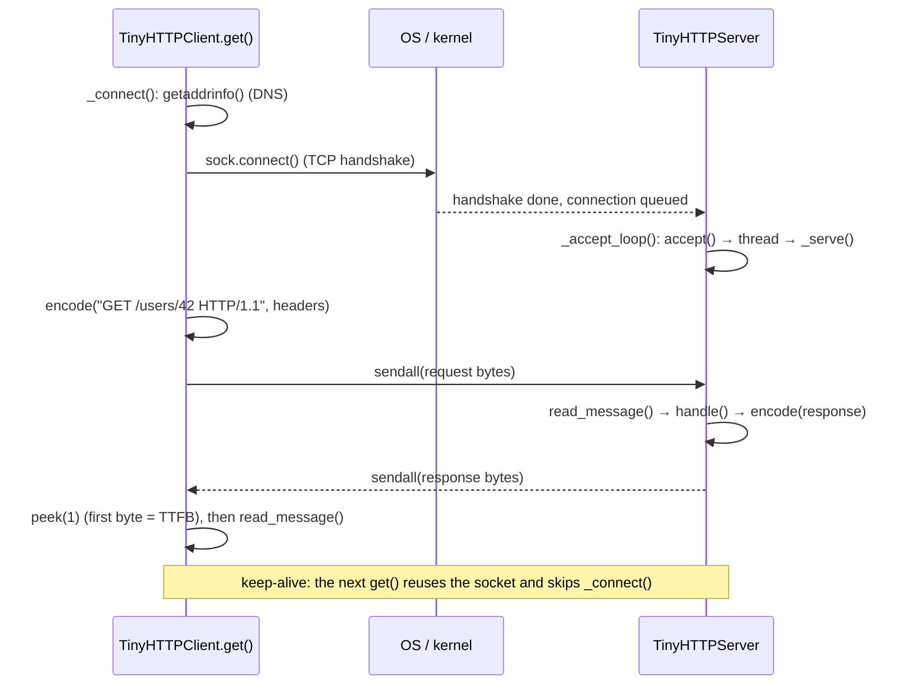

# Code walkthrough: Client-Server & the Request Lifecycle

> Companion to [README.md](README.md). The README explains the *concept*; this file explains the
> *code*, file by file, so you can read it, change it, and rebuild it yourself.
> Line links (e.g. `server.py#L74`) point at the exact code.

## File map

Read in the order a request travels: the wire format first, then the two ends of the connection.

| Read | File | Lines | Role |
|---|---|---|---|
| 1 | [`src/http11.py`](src/http11.py) | 65 | The wire format: build (`encode`) and parse (`read_message`) HTTP/1.1 messages. Shared by both ends |
| 2 | [`src/server.py`](src/server.py) | 100 | `TinyHTTPServer`: listen → accept → read → route → respond, on a raw TCP socket |
| 3 | [`src/client.py`](src/client.py) | 133 | `TinyHTTPClient`: DNS → TCP → TLS → send → wait → read, timing every phase, reusing its connection |
| 4 | [`src/fastapi_app.py`](src/fastapi_app.py) | 46 | The same endpoint on production software (FastAPI + uvicorn), for comparison |
| 5 | [`src/demo.py`](src/demo.py) | 172 | Four experiments that print the README's "Expected output" |
| 6 | [`tests/test_lifecycle.py`](tests/test_lifecycle.py) | 117 | Ten tests that pin down the lifecycle's properties |

Only `fastapi_app.py`, the demo and the tests import third-party code (FastAPI, uvicorn, httpx).
The lesson itself (`http11.py`, `server.py`, `client.py`) is pure standard library, so nothing is hidden.

## How the pieces fit

One `client.get()` against our server, function by function:



Two functions sit at the centre: **`encode`** (turns a message into bytes) and
**`read_message`** (finds where a message ends in a byte stream). Server and client both use them.
That's the point of a protocol: two programs that share nothing but a format.

## `src/http11.py`, the wire format

### `Message` ([L19](src/http11.py#L19))

```python
@dataclass
class Message:
    start_line: str          # "GET /users/42 HTTP/1.1" or "HTTP/1.1 200 OK"
    headers: dict[str, str]  # names lower-cased
    body: bytes
    raw: bytes               # every byte of this message exactly as it crossed the wire
```

**What it does:** holds one parsed request *or* response. They share a format, so one class covers both.

**Why this way:** `raw` isn't needed to *use* HTTP. It's kept so the demo can print the exact bytes
(section 1 of the output). Header names are lower-cased because HTTP says `Content-Length` and
`content-length` are the same header, so we normalize once and look up lower-case everywhere.

### `encode` ([L26](src/http11.py#L26))

```python
lines = [start_line, *(f"{name}: {value}" for name, value in headers.items())]
return ("\r\n".join(lines) + "\r\n\r\n").encode("latin-1") + body
```

**What it does:** start line, then `Name: value` lines, each ending in `\r\n`, then one extra `\r\n`
(the blank line), then the body.

**Line notes:**
- `"\r\n".join(...)` puts CRLF *between* lines, and `+ "\r\n\r\n"` ends the last header line and adds
  the blank line. Forget the second CRLF and the other side waits forever for the headers to end.
- `latin-1` maps every character 0–255 to exactly one byte. HTTP header bytes are defined that way,
  and it never raises on odd bytes the way `utf-8` decoding can.
- The body is appended as **bytes**, not encoded text, because a body can be anything (JSON, an image, gzip).

### `read_message` ([L31](src/http11.py#L31)), where does a message end?

This is the most important function in the lesson. TCP hands you a **stream** of bytes with no
boundaries, so HTTP needs rules for where each message stops. Otherwise one connection couldn't carry
a second request.

```python
def line() -> bytes:
    raw.append(stream.readline())
    return raw[-1]

start = line()
if not start:
    return None                       # peer closed the connection between messages
while (header := line()).strip():     # stop at the blank line
    name, _, value = header.decode("latin-1").partition(":")
    headers[name.strip().lower()] = value.strip()
```

**Step by step:**
1. **`line()`** ([L41](src/http11.py#L41)) is a tiny closure. It reads one line *and* records it in `raw`,
   so every byte consumed is kept for display.
2. **An empty read means the connection was closed.** `readline()` returns `b""` only at end of stream.
   Between kept-alive requests that's the normal goodbye, so the function returns `None` and the server's
   loop ends cleanly.
3. **The header loop** ([L49](src/http11.py#L49)) uses the walrus operator: read a line, keep going while
   it's non-blank. The blank line `b"\r\n"` strips to `b""`, which is falsy, so the loop stops exactly at
   the end of the headers.
4. **`partition(":")` splits at the *first* colon only.** `Host: localhost:8080` becomes
   `("Host", ":", " localhost:8080")`, so the port survives. `split(":")` would break it into three parts.

Then the body, in one of two framings:

```python
if headers.get("transfer-encoding", "").lower() == "chunked":
    while size := int(line().split(b";")[0], 16):     # hex size; 0 means "last chunk"
        raw.append(stream.read(size + 2))              # data + its trailing \r\n
        body += raw[-1][:-2]
    while line().strip():                              # optional trailers, then a blank line
        pass
else:
    raw.append(stream.read(int(headers.get("content-length", 0))))
```

| Framing | When | How the reader knows the end |
|---|---|---|
| `Content-Length: N` ([L63](src/http11.py#L63)) | The sender knows the size up front, as our server always does | Read exactly N bytes |
| `Transfer-Encoding: chunked` ([L53](src/http11.py#L53)) | The sender is streaming and doesn't know the size yet. Real servers and CDNs do this | Repeated `<hex size>\r\n<data>\r\n`, ending with a `0` chunk |
| Neither | A GET request, which has no body | `content-length` defaults to `0` |

**Line notes:** `int(..., 16)` parses hex (`A` = 10). `.split(b";")[0]` drops optional chunk
extensions (`1a;name=value`). `size + 2` because every chunk's data is followed by its own `\r\n`, which
`[:-2]` then trims off.

## `src/server.py`, the server's half

### `__init__` ([L34](src/server.py#L34)): socket, bind, listen

```python
self._listener = socket.create_server(("127.0.0.1", 0))   # port 0: the OS picks a free one
self.port: int = self._listener.getsockname()[1]
```

**What it does:** `create_server` performs the classic `socket()` → `bind()` → `listen()` in one call.

**Why port 0:** the OS picks any free port, so tests can start many servers without "address already in
use" clashes. `getsockname()` tells us which port we got, and the demo prints it in the `Host:` header.

**What happens from here on:** once listening, **the kernel completes TCP handshakes by itself** and
queues finished connections. The app only sees them when it calls `accept()`. That's why, in *Break it*,
`SEQUENTIAL=1` still shows an instant `TCP connect`: the kernel answered, even though the app was busy.

### `_accept_loop` ([L56](src/server.py#L56)): one connection at a time, or a thread each

```python
self._listener.settimeout(0.05)                 # wake up regularly to notice _stop
while not self._stop.is_set():
    try:
        conn, (ip, port) = self._listener.accept()
    except TimeoutError:
        continue
    self.connections += 1
    args = (conn, f"{ip}:{port}", self.connections)
    if self.threaded:
        threading.Thread(target=self._serve, args=args, daemon=True).start()
    else:
        self._serve(*args)                      # nobody else gets accepted until this returns
```

**What it does:** takes connections off the kernel's queue forever.

**Why this way:**
- **The 50 ms timeout** lets the loop check `_stop` regularly. Without it, `accept()` blocks until a
  client arrives, and `__exit__` could never stop the thread.
- **`(ip, port)` is the client's address.** The port is *ephemeral*: the client's OS picks a new one per
  connection. That's why "count distinct client ports" works as "count connections" in section 3.
- **The `threaded` switch is the whole concurrency lesson** ([L65](src/server.py#L65)). Threaded: each
  connection gets its own thread, and the loop immediately goes back to `accept()`. Sequential:
  `_serve()` runs inline, so the next client waits in the kernel's queue until this one is done.

### `_serve` ([L70](src/server.py#L70)): the keep-alive loop

```python
conn.settimeout(self.keep_alive_s)
with conn, conn.makefile("rb") as stream:
    try:
        while (request := read_message(stream)) is not None:
            status, body = self.handle(request.start_line)
            ...
            keep_alive = request.headers.get("connection", "").lower() != "close"
            conn.sendall(encode(f"HTTP/1.1 {status} {HTTPStatus(status).phrase}", {
                "Content-Type": "application/json",
                "Content-Length": str(len(body)),
                "Connection": "keep-alive" if keep_alive else "close",
            }, body))
            if not keep_alive:
                break
    except (TimeoutError, ConnectionError):
        pass
```

**What it does:** serves *many* requests on one connection, until the client says `Connection: close`,
hangs up, or goes quiet.

**Line notes:**
- **`makefile("rb")`** wraps the socket in a buffered file, which gives us `readline()`, `read(n)` and
  `peek()`. Raw sockets only have `recv()`, which returns whatever bytes happen to have arrived.
- **`settimeout(keep_alive_s)`** is the *idle timeout*. If no next request arrives within 5 s,
  `readline()` raises `TimeoutError`, and the `except` closes the connection. Real servers do the same
  to free resources. Exercise 3 shows what this does to clients.
- **HTTP/1.1 defaults to keep-alive** ([L80](src/server.py#L80)): the connection stays open *unless* the
  client sends `Connection: close`.
- **`Content-Length`** is what lets the client stop reading at exactly the end of this response, and
  read the *next* response from the same connection.
- `HTTPStatus(200).phrase` gives `"OK"`, and `404` gives `"Not Found"`. No hand-written table needed.

### `handle` ([L91](src/server.py#L91)): routing plus "the application"

```python
method, target, _version = request_line.split(" ")              # 3 parts, or 400
if method == "GET" and (match := re.fullmatch(r"/users/(\d+)", target)):
    time.sleep(self.work_ms / 1000)                               # stands in for a database query
    return 200, json.dumps({"id": int(match[1]), "name": f"user-{match[1]}"}).encode()
return 404, b'{"error": "not found"}'
```

**What it does:** this is everything a web *framework* does for you (routing, path parameters, error
codes), in seven lines.

**Line notes:** `re.fullmatch` must match the whole path, so `/users/42/extra` is a 404, not user 42.
`match[1]` is the first capture group (`"42"`). The `sleep` is what makes "wait for first byte" ≈
`work_ms` in section 1 and the tests: **TTFB = network round trip + server work**.

## `src/client.py`, the client's half

### `TinyHTTPClient` state ([L43](src/client.py#L43)): the smallest connection pool

```python
self._sock: socket.socket | None = None
self._stream: io.BufferedReader | None = None
self._origin: tuple[str, str, int] | None = None   # (scheme, host, port) of the open connection
```

A connection can be reused only for the **same origin**: the same scheme, host and port. Real pools
(httpx, urllib3, browsers) key their connections exactly this way. This one just holds a single
connection instead of a dict of them.

### `get` ([L59](src/client.py#L59)): one request, phase by phase

```python
new_connection = self._origin != (scheme, host, port)
if new_connection:
    self.close()
    self._connect(scheme, host, port, timings)        # dns, connect, (tls)
request = encode(f"GET {target} HTTP/1.1", {"Host": parts.netloc, ...})
clock = time.perf_counter()
self._sock.sendall(request)
clock = lap(timings, "send", clock)
self._stream.peek(1)                                  # blocks until the first byte arrives
clock = lap(timings, "wait", clock)
message = read_message(self._stream)
lap(timings, "read", clock)
```

**Step by step:**
1. **Reuse check** ([L64](src/client.py#L64)): same origin as the open connection means skip `_connect()`.
   That's why a reused request's `timings` has no `dns`/`connect`/`tls` keys (a test checks exactly that).
2. **`Host` header:** one IP can serve thousands of sites, so HTTP/1.1 *requires* the request to say
   which one it wants.
3. **`peek(1)`** ([L79](src/client.py#L79)) is the trick that separates *waiting* from *reading*. It blocks
   until at least one byte of the answer is buffered, without consuming it. The time up to that moment is
   **time to first byte (TTFB)**: network round trip + server work. `read_message` then reads the rest.
4. **`lap()`** ([L130](src/client.py#L130)) records `now - since` under a phase name and returns `now`,
   so phases chain without gaps and `sum(timings)` equals the total.

**The poisoned-connection guard** ([L83](src/client.py#L83)):

```python
except BaseException:
    self.close()
    raise
```

If a request times out, the server may *still* send its answer later. Reuse that connection, and the
**next** request would read the **old** response: a subtle, real-world bug. So any failure throws the
connection away. `BaseException` also catches Ctrl-C, for the same reason. The last test proves this
works.

### `_connect` ([L96](src/client.py#L96)): DNS → TCP → TLS

| Phase | Line | Code | What happens |
|---|---|---|---|
| DNS | [L100](src/client.py#L100) | `socket.getaddrinfo(host, port, AF_INET, SOCK_STREAM)[0]` | Name → IP. IPv4 only, because `localhost` may resolve to `::1` first while our server listens on `127.0.0.1` |
| TCP | [L110](src/client.py#L110) | `sock.connect(address)` | SYN → SYN-ACK → ACK. Returns after **one round trip**, which is why the demo uses connect time as its RTT estimate |
| TLS | [L115](src/client.py#L115) | `TLS_CONTEXT.wrap_socket(sock, server_hostname=host)` | Verifies the certificate *for that hostname* and agrees keys. TLS 1.3 adds one round trip |

**Line notes:**
- **`TCP_NODELAY`** ([L109](src/client.py#L109)) turns off Nagle's algorithm, which batches small writes. With
  it on, our small request can sit waiting for an ACK the server deliberately delays (~40 ms). Every
  serious HTTP client sets this. *Break it* (`NAGLE=1`) shows the cost.
- **`TLS_CONTEXT`** ([L22](src/client.py#L22)) is built once at import, because loading every trusted root
  CA certificate is slow.
- **`server_hostname`** does two jobs: it sends SNI (so a CDN knows which site's certificate to present)
  and it makes `ssl` check that the certificate is valid *for that name*.

## `src/fastapi_app.py`, the real-world comparison

```python
@app.get("/users/{user_id}")
async def get_user(user_id: int, request: Request) -> dict[str, int | str]:
    if request.client:
        app.state.client_ports.append(request.client.port)
    return {"id": user_id, "name": f"user-{user_id}"}
```

**What it does:** the same endpoint as `TinyHTTPServer.handle`, the framework way. Routing,
path-parameter parsing (`user_id: int`) and JSON encoding all happen for you. Compare it with `handle`
to see what a framework saves you.

**Why record client ports:** each TCP connection has its own client port, so
`len(set(client_ports))` counts connections *from the server's side*. That's how section 3 proves
`httpx.get()` opens 20 connections while one `httpx.Client()` opens 1.

**`run_uvicorn()`** ([L31](src/fastapi_app.py#L31)) is a `@contextmanager`. It binds a socket to port 0
(same trick as our server), starts uvicorn in a background thread, waits until `server.started`, and
yields the port. On exit it sets `should_exit` for a graceful shutdown and joins the thread.

## `src/demo.py`, making it visible

| Experiment | Line | What it does | What it proves |
|---|---|---|---|
| 1. Raw HTTP | [L55](src/demo.py#L55) | One request to our server, printed byte by byte with `\r\n` visible (`show_bytes`, [L49](src/demo.py#L49)). Then httpx → our server, and our client → FastAPI | HTTP is plain text, and different implementations interoperate |
| 2. Real internet | [L78](src/demo.py#L78) | 5 connections × 2 requests to `URL`, median per phase | What DNS + TCP + TLS really cost, and that request 2 skips them |
| 3. Keep-alive | [L113](src/demo.py#L113) | 20 requests: close vs keep-alive (tiny), and `httpx.get()` vs `httpx.Client()` (FastAPI) | N connections vs 1, counted by the server |
| 4. Concurrency | [L139](src/demo.py#L139) | 5 clients at once against a threaded or sequential server | Threads let requests overlap; one-at-a-time makes them queue |

**Details worth noticing:**
- **Environment knobs** ([L23–L25](src/demo.py#L23)): `URL`, `SEQUENTIAL` and `NAGLE` are how *Break it*
  changes behaviour without editing code.
- **Medians, not averages** ([L93](src/demo.py#L93)): one slow network blip would skew an average.
  `cell()` also prints `—` for phases a request skipped.
- **RTT estimate** ([L101](src/demo.py#L101)): `connect()` returns after exactly one round trip, so its
  median is a clean round-trip time.
- **Section 2 catches `OSError`**, so the demo still runs offline: it prints "skipped" instead of crashing.

## Tests: what each one proves

| Test | Property it proves | Why that property matters |
|---|---|---|
| [`test_request_is_plain_text_and_response_says_where_it_ends`](tests/test_lifecycle.py#L14) | The request starts with the request line, ends with `\r\n\r\n`, and `Content-Length` equals the body size | Framing is what makes HTTP over a stream work |
| [`test_server_routes_unknown_paths_to_404`](tests/test_lifecycle.py#L24) | Unknown path → 404 | Routing has a defined failure |
| [`test_real_world_client_and_server_speak_the_same_protocol`](tests/test_lifecycle.py#L29) | httpx ↔ our server, our client ↔ uvicorn | We implemented real HTTP, not a look-alike |
| [`test_keep_alive_carries_many_requests_over_one_connection`](tests/test_lifecycle.py#L38) | 10 requests: 1 connection with keep-alive, 10 without, counted on *both* sides | The core keep-alive claim |
| [`test_reused_connection_skips_dns_and_tcp_handshake`](tests/test_lifecycle.py#L50) | First timings are `dns, connect, send, wait, read`; second are `send, wait, read` | The lifecycle phases, in order, and what reuse skips |
| [`test_time_to_first_byte_includes_the_servers_work`](tests/test_lifecycle.py#L59) | With 50 ms of server work, TTFB ≥ 50 ms | TTFB = network + server time, so slow backends show up here |
| [`test_httpx_client_pools_connections_but_httpx_get_does_not`](tests/test_lifecycle.py#L66) | 5 × `httpx.get()` → 5 ports; one `httpx.Client` → 1 | A real-library habit that costs real latency |
| [`test_threaded_server_serves_concurrent_clients_in_parallel`](tests/test_lifecycle.py#L97) | 4 clients × 50 ms all finish in under 100 ms | Concurrency lets requests overlap |
| [`test_one_at_a_time_server_makes_concurrent_clients_queue`](tests/test_lifecycle.py#L101) | The k-th client waits at least ≈ k × 50 ms | Without concurrency, latency grows with the queue |
| [`test_timeout_gives_up_and_never_reuses_the_poisoned_connection`](tests/test_lifecycle.py#L108) | Times out at about 0.1 s, not 0.3 s. The next request gets *its own* 404, not the late 200 | Timeouts must discard the connection |

Timing tests use **lower bounds with slack** (`>= 0.050 * k * 0.9`, `< 0.050 * 2`) rather than exact
values, because thread scheduling and sleeps are never exact.

## Trace one run

All values below are real, printed by running the code.

**1. `encode()` builds the request** (101 bytes with `Host: localhost:8080` and keep-alive):

```text
b'GET /users/42 HTTP/1.1\r\nHost: localhost:8080\r\nUser-Agent: tiny-client/0.1\r\nConnection: keep-alive\r\n\r\n'
```

**2. Two `get()` calls on one client, against `TinyHTTPServer(work_ms=20)` on port 54817:**

| | `new_connection` | Phases (ms) | Server log |
|---|---|---|---|
| `GET /users/42` | `True` | dns 1.83 · connect 0.22 · send 0.09 · **wait 23.63** · read 0.01 | connection #1 from `127.0.0.1:54818`, handler 23.45 ms |
| `GET /users/43` | `False` | send 0.01 · **wait 22.66** · read 0.01 | connection #1 from `127.0.0.1:54818`, handler 22.51 ms |

Both requests show **the same connection number and the same client port**: that is keep-alive. In
each case "wait" is just the handler's time plus about 0.2 ms, so TTFB on localhost is almost entirely
server work. `client.connections_opened` = 1 and `server.connections` = 1.

**3. `read_message()` on two responses sent back to back** on one stream (what keep-alive looks like
to the reader):

| Call | Returns | `len(raw)` | Stream position after |
|---|---|---|---|
| 1st | `HTTP/1.1 200 OK`, body `{"id": 42, "name": "user-42"}` | 124 bytes | 124 |
| 2nd | `HTTP/1.1 404 Not Found`, body `{"error": "not found"}` | 68 bytes | 192 |
| 3rd | `None` (end of stream) | – | 192 |

`Content-Length` stopped the first read at exactly byte 124, so the second message parsed cleanly.
Without framing, the first read would have swallowed both.

**4. A chunked body:** `7\r\nuser-42\r\nA\r\n is online\r\n0\r\n\r\n` gives `b'user-42 is online'`.
`7` is 7 bytes, `A` (hex 10) is 10 bytes, and `0` ends it. All 79 bytes were consumed.

**5. `handle()` directly:**

```text
handle('GET /users/7 HTTP/1.1') → (200, b'{"id": 7, "name": "user-7"}')
handle('GET /nope HTTP/1.1')    → (404, b'{"error": "not found"}')
handle('garbage')               → (400, b'{"error": "malformed request line"}')
```

## Python techniques used

| Technique | Where | Why it's used here |
|---|---|---|
| `socket.create_server`, `accept`, `connect`, `sendall`, `settimeout` | `server.py`, `client.py` | The raw TCP API every HTTP library is built on |
| `sock.makefile("rb")` → `readline()`, `read(n)`, `peek(1)` | `_serve`, `_connect` | A buffered stream on top of a socket. `peek` measures TTFB without consuming bytes |
| `setsockopt(IPPROTO_TCP, TCP_NODELAY, 1)` | `_connect` | Disables Nagle's algorithm |
| `ssl.create_default_context()` + `wrap_socket(server_hostname=...)` | `client.py` | TLS with certificate and hostname verification |
| Walrus `:=` in `while` | `read_message`, `_serve`, `handle` | "Read, then test" in one expression |
| `str.partition(":")` | `read_message` | Splits at the first colon only, so `Host: x:8080` survives |
| `int(text, 16)` | chunked parsing | Chunk sizes are hexadecimal |
| Nested function as a closure (`line()`) | `read_message` | Read a line *and* record it in `raw`, without repeating that code |
| `@dataclass` | `Message`, `LogLine`, `Response` | Plain records with no boilerplate |
| `__enter__` / `__exit__` and `@contextmanager` | server, client, `run_uvicorn` | `with` guarantees sockets and threads are cleaned up, even on errors |
| `threading.Thread(daemon=True)`, `threading.Event` | `server.py` | Thread per connection, plus a stop flag the accept loop checks |
| `time.perf_counter()` | `lap`, `timed`, handler timing | A monotonic, high-resolution clock for measuring durations |
| `urllib.parse.urlsplit` | `get` | URL → scheme, host, port, path, query |
| `http.HTTPStatus(code).phrase` | `_serve` | `200` → `"OK"`, `404` → `"Not Found"` |
| `re.fullmatch` + `match[1]` | `handle` | Whole-path route matching, with the captured ID |
| `except BaseException: ...; raise` | `get` | Clean up, then let *any* error (even Ctrl-C) propagate |
| `statistics.median` | `demo.py` | Robust against one-off network spikes |

## Design decisions & alternatives

| Decision | Alternative | Why this one, for learning |
|---|---|---|
| Raw sockets | `http.server` / `http.client` / `requests` | Libraries hide exactly what this lesson is about: the bytes, the framing and the phases |
| One thread per connection | `asyncio`/`selectors` event loop (what uvicorn uses), or a thread pool | Simplest correct model of concurrency. The event-loop version comes later in the course |
| Server always sends `Content-Length` | Chunked responses | Our handler knows the whole body up front. The *client* still parses chunked, because real servers use it |
| A one-connection "pool" keyed by origin | A dict of pools, max size, idle eviction | Shows the essential idea (reuse per origin) in about 10 lines |
| Port 0 everywhere | Fixed ports | Tests and demos never collide, even in parallel |
| `latin-1` for header bytes | `utf-8` | Defined by HTTP, one byte per character, and decoding never fails |

## Change it yourself

### 1. Add a health check (easy)

**Goal:** add `GET /health` that returns `200 {"status": "ok"}` *without* the simulated database work.
Load balancers poll endpoints like this every few seconds, so they must be cheap.
**Change:** `handle()` in `src/server.py`.
**Check:** `client.get(f"http://127.0.0.1:{server.port}/health")` returns 200, and
`server.log[-1].handler_ms` is about 0, compared with about 20 for `/users/1`. Add a test for both.

<details><summary>Hint</summary>

Put the new route **before** the `/users` route, and don't `sleep`:

```python
if method == "GET" and target == "/health":
    return 200, b'{"status": "ok"}'
```
</details>

### 2. Send a request body: `POST /echo` (medium)

**Goal:** add `TinyHTTPClient.post(url, body: bytes)` and a server route `POST /echo` that returns the
body it received.
**Change:** `client.py` (build the request with a method and body) and `server.py` (pass the body to
`handle`).
**Check:** posting `b'{"hello": "server"}'` returns exactly those bytes, and `r.request` contains
`Content-Length: 19`. Note that the server needs no parsing changes, because `read_message` already
reads `Content-Length` bodies.

<details><summary>Hint</summary>

- Client: rename `get`'s body to `request(self, method, url, body=b"")`. Use `f"{method} {target} HTTP/1.1"`,
  add `headers["Content-Length"] = str(len(body))` when there's a body, and call `encode(..., headers, body)`.
  Then `get = request("GET", url)` and `post = request("POST", url, body)`.
- Server: change the call to `self.handle(request.start_line, request.body)`, give `handle` a
  `body: bytes = b""` parameter, and add `if method == "POST" and target == "/echo": return 200, body`.
- Without `Content-Length`, the server would read the body as the start of the *next* request.
  Framing again.
</details>

### 3. Survive a stale kept-alive connection (hard)

**Goal:** fix a bug every connection pool has to handle. Servers close idle connections (ours after
`keep_alive_s`), so a client that reuses one gets an error *for no fault of the request*.

See it fail first:

```python
with TinyHTTPServer(work_ms=0, keep_alive_s=0.1) as s, TinyHTTPClient() as c:
    c.get(f"http://127.0.0.1:{s.port}/users/1")   # 200
    time.sleep(0.3)                               # the server closes the idle connection
    c.get(f"http://127.0.0.1:{s.port}/users/2")   # ConnectionError: server closed the connection without answering
```

**Change:** `get()` in `src/client.py`. If a request fails with `ConnectionError` **on a reused
connection**, retry it once on a fresh one.
**Check:** the second `get` returns 200, `r.new_connection` is `True`, and `c.connections_opened == 2`.
All 10 existing tests still pass.

<details><summary>Hint</summary>

```python
def get(self, url: str) -> Response:
    try:
        return self._get(url)        # the current get() body, renamed
    except ConnectionError:
        if not self._reused:         # set in _get(): self._reused = not new_connection
            raise                    # a brand-new connection failed: a real error
        return self._get(url)        # stale pooled connection: retry once (close() already ran)
```

`BrokenPipeError` and `ConnectionResetError` are subclasses of `ConnectionError`, so this catches every
way a dead socket can fail. The thinking matters more than the code: **retrying is only safe because
GET is idempotent.** Repeating a `POST /payments` the server may already have processed could charge
someone twice. That's why urllib3 and httpx retry automatically only in narrow cases, and why the
course has a whole lesson on idempotency keys.
</details>
