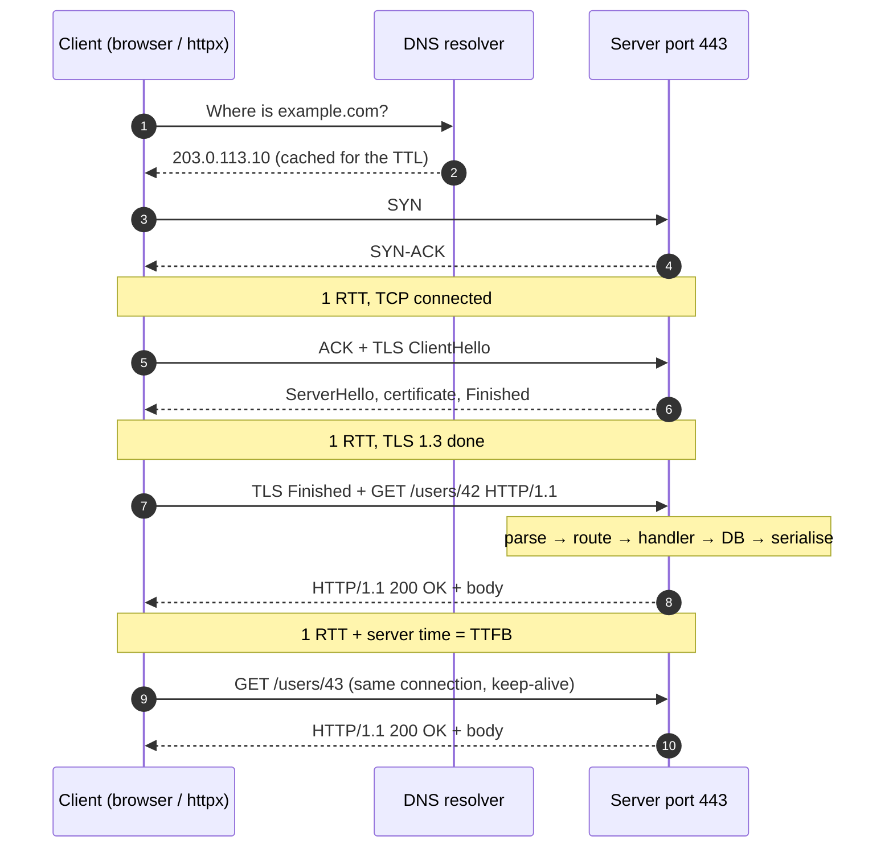

# Client-Server & the Request Lifecycle

> **Module:** 00 Foundations · **Difficulty:** ●○○○○ · **Time:** ~30 min · **Prereqs:** none

## TL;DR

A **client** starts every exchange by sending a request; a **server** listens, does the work and sends back
one response. Knowing each step of a request's life (DNS, TCP, TLS, HTTP, server work) tells you where the
milliseconds go, and why reusing connections is the cheapest speed-up there is.

## Explain like I'm 5

You want a pizza, so you **phone the pizza shop**:

1. You don't know the number, so you look it up in the **phone book**.
2. You dial. "Hello?" "Hi, can you hear me?" "Yes!" Now you're connected.
3. You agree on a **secret word**, so nobody listening in can understand your order.
4. You order: "One large margherita, please."
5. The kitchen cooks it while you wait on the line.
6. "Your pizza is on its way!" (or "Sorry, we're out of cheese").
7. Want a drink too? **Stay on the line** and ask. If you hang up, you have to dial, say hello and agree on
   the secret word all over again.

The shop never calls you first. It waits by the phone. And if only one person answers the phone, every
other caller hears ringing until that call ends.

| In the story | In the system |
|---|---|
| You | The **client**: a browser, a mobile app, a Python script using `httpx` |
| The shop, waiting by the phone | The **server**: a process **listening** on a port for connections |
| Phone book | **DNS**: turns `example.com` into an IP address such as `203.0.113.10` |
| Phone number + extension | **IP address + port**, e.g. `203.0.113.10:443` |
| "Hello?" "Can you hear me?" "Yes!" | **TCP handshake**: SYN → SYN-ACK → ACK, one round trip |
| Agreeing on a secret word | **TLS handshake**: check the server's certificate, agree on encryption keys |
| "One large margherita" | The **HTTP request**: method, path, headers |
| The kitchen cooking | **Server processing**: routing, your handler code, database queries |
| "On its way!" / "Out of cheese" | The **HTTP response**: status code (200, 404, 500…), headers, body |
| Staying on the line for a drink | **Keep-alive**: the next request reuses the open connection |
| Only one person answering | A server that handles **one connection at a time** |

**Real world:** every page you open in **Google Chrome** goes through these steps. Open DevTools → Network,
click any request, and the **Timing** tab shows them as bars: *DNS Lookup*, *Initial connection*, *SSL*,
*Waiting for server response*, *Content Download*. This lab's client measures the same phases.

## Technical deep dive

### The problem

Your code needs something that lives on another machine: rows in a database, an API across the internet.
The **client-server model** splits the roles. The **server** owns the data and logic and waits. **Clients**
start every exchange with a **request** and wait for its **response**.

The catch is distance. Every exchange crosses a network, and the network charges per **round trip** (**RTT**,
round-trip time: a packet there and an answer back). A new HTTPS connection needs several round trips before
the request can even be sent. In this lab, a server ~306 ms away took **949 ms** to answer on a new connection
and **348 ms** on a reused one (*Break it*, experiment 2). The server's own work was the same both times.

### How it works

A request on a new connection, step by step:

1. **Parse the URL.** `https://example.com/users/42` → scheme `https` (default port 443), host `example.com`,
   path `/users/42`.
2. **DNS lookup.** Ask a resolver for the host's **IP address**. Answers are cached (browser, OS, resolver) for
   the record's TTL, so this often takes ~1 ms. A cache miss costs round trips to the resolver. See
   [DNS](../02-dns/README.md).
3. **TCP connect.** The client's OS opens a **socket** (one end of a connection) on an **ephemeral port**, a
   port it picks for this connection only, and runs the **three-way handshake**: SYN → SYN-ACK → ACK. That's
   **1 RTT** before data can flow. On the server, the kernel completes the handshake by itself and queues the
   connection in the **accept queue** until the app calls `accept()`.
4. **TLS handshake** (https only). The client checks the server's certificate, and both sides agree on
   encryption keys. TLS 1.3 takes **1 RTT**, TLS 1.2 takes 2.
5. **Send the request.** Plain text (encrypted when https): a request line (`GET /users/42 HTTP/1.1`),
   headers (`Host: …`), a blank line, an optional body.
6. **Server work.** Parse the request, route it to a handler, run your code (database queries, calls to other
   services), serialise the response. Any time spent queued for a free worker also lands here.
7. **Response.** A status line (`HTTP/1.1 200 OK`), headers, a blank line, the body. `Content-Length` (or
   chunked encoding) tells the client where the body ends. The time from sending the request to the response's
   first byte is the **TTFB** (time to first byte): 1 RTT plus server time.
8. **Keep or close.** HTTP/1.1 keeps the connection open by default (**keep-alive**), so the next request to
   the same server starts at step 5. A **connection pool** (`httpx.Client`, `requests.Session`) is a set of open
   connections kept for reuse. `Connection: close` ends it after this response.



Round trips before the first byte of the response (plus server time on every row):

| Request | TCP | TLS | Request → first byte | Total RTTs |
|---|---|---|---|---|
| New connection, TLS 1.2 | 1 | 2 | 1 | 4 |
| New connection, TLS 1.3 | 1 | 1 | 1 | **3** |
| New connection, HTTP/3 (QUIC: transport + TLS in one handshake) | 1 | (included) | 1 | 2 |
| Reused connection (keep-alive) | 0 | 0 | 1 | **1** |

### Trade-offs

| Choice | Gain | Cost |
|---|---|---|
| Reuse connections (keep-alive, pools) vs a new connection per request | Skips DNS, TCP and TLS: 2–3 round trips saved per request | Idle connections hold server memory and file descriptors; the server may close one just as you reuse it |
| A thread (or async task) per connection vs one at a time | A slow request doesn't block everyone else | Concurrency bugs, locks around shared state, memory per thread |
| Client-server vs peer-to-peer | One place to own the data, check permissions and ship fixes | The server is a bottleneck and a single point of failure, so it must scale ([Vertical vs Horizontal Scaling](../../01-scaling-and-traffic/01-vertical-vs-horizontal/README.md)) |
| Request-response (client pulls) vs server push | Simple, cacheable, easy to retry | Clients only learn about changes when they ask ([Polling, SSE & WebSockets](../../08-observability-and-architecture/05-realtime-communication/README.md)) |
| Short vs long client timeouts | Fail fast, free resources, try elsewhere | Healthy-but-slow requests fail too |

### Failure modes & gotchas

- **A new connection per request.** `requests.get()` and `httpx.get()` build a throwaway client on every call,
  so nothing is reused. In section 3, 20 `httpx.get()` calls opened **20** connections and took **114 ms**; one
  `httpx.Client` used **1** connection and took **27 ms**, and that's on localhost. Across a network, add 2–3
  round trips per call. At high request rates, closed connections pile up in TIME_WAIT (60 s on Linux) on the
  side that closed first, and a client can run out of ephemeral ports.
- **No timeout.** `requests` waits forever by default (httpx gives up after 5 s). One stuck server can tie up
  every worker you have. See [Timeouts & Deadline Propagation](../../07-reliability/01-timeouts-deadlines/README.md).
- **Reusing a connection after a timeout.** The late response is still on its way, and the next request on that
  connection would read it as its own answer. Our client drops the connection on any error, and a test proves it.
- **Keep-alive race.** The server closes an idle connection at the moment the client sends on it, and the
  request fails with a reset (or a 502 from a load balancer). The backend's idle timeout must be *longer* than
  the load balancer's. Out of the box, uvicorn closes idle connections after 5 s and an AWS ALB keeps them for 60 s.
- **One connection at a time = head-of-line blocking.** In *Break it*, the 5th of 5 simultaneous clients waited
  **521 ms** for 100 ms of work, yet its TCP connect took 0.2 ms. "Connected" doesn't mean "being served".
- **Nagle's algorithm.** Without `TCP_NODELAY`, the first request on a new TLS connection waited **52 ms**
  instead of ~8 ms (*Break it*, experiment 3). curl, httpx and Python's `http.client` all disable Nagle.
- **`localhost` can mean `::1`.** Many systems resolve `localhost` to the IPv6 address first, and a server bound
  only to `127.0.0.1` refuses that connection. Our client asks for IPv4 explicitly.

### When NOT to use it

- **The server needs to push updates** (chat, live scores, shared documents): polling with requests wastes work
  and adds delay. Use WebSockets or Server-Sent Events, or pub/sub
  ([Message Queues vs Pub/Sub](../../04-messaging/01-queues-vs-pubsub/README.md)).
- **The work takes minutes** (video encoding, big reports): don't hold a request open. Return `202 Accepted`
  with a job ID and do the work from a queue.
- **Many peers share large files** and one server's bandwidth would be the bottleneck: peer-to-peer (BitTorrent).

## Implementation

Four small files in [`src/`](src/). The lesson code is pure standard library, and FastAPI is used only
for the comparison.

| File | What it shows |
|---|---|
| [`http11.py`](src/http11.py) | The wire format: build and parse HTTP/1.1 messages |
| [`server.py`](src/server.py) | `TinyHTTPServer`: listen, accept loop, keep-alive loop, routing |
| [`client.py`](src/client.py) | `TinyHTTPClient`: times every phase and reuses its connection |
| [`fastapi_app.py`](src/fastapi_app.py) | The same endpoint on FastAPI + uvicorn, in a background thread |

The key ideas in the code:

- **A message ends where its framing says.** Read to the blank line, then exactly `Content-Length` bytes.
- **The server is two loops:** `accept()` connections, then read requests on each connection until it closes.
- **The client times each phase**, and `peek(1)` marks the first byte of the answer (TTFB).

**Full explanation of the code, with a traced request, Python techniques and exercises:
[CODE_WALKTHROUGH.md](CODE_WALKTHROUGH.md).**

## Run it

```bash
cd modules/00-foundations/01-how-the-web-works
make up     # no infrastructure needed for this lesson
make run    # run the demo (section 2 needs internet)
make test   # prove the behaviour
make down
```

## Expected output

Your ports and milliseconds will differ, and section 2 depends on your network. The shape won't change.

```text
==============================================================================
 Client-server & the request lifecycle: raw HTTP, phases, keep-alive, concurrency
==============================================================================

1) HTTP is plain text over a TCP connection: one request, byte for byte
  client → server (97 bytes)
    │ GET /users/42 HTTP/1.1\r\n
    │ Host: localhost:52030\r\n
    │ User-Agent: tiny-client/0.1\r\n
    │ Connection: close\r\n
    │ \r\n
  server → client (119 bytes)
    │ HTTP/1.1 200 OK\r\n
    │ Content-Type: application/json\r\n
    │ Content-Length: 29\r\n
    │ Connection: close\r\n
    │ \r\n
    │ {"id": 42, "name": "user-42"}
  server log : connection #1 from 127.0.0.1:52031, "GET /users/42 HTTP/1.1" → 200, handler took 22.2 ms
  client view: DNS lookup 3.5 ms, TCP connect 0.3 ms, send request 0.1 ms, wait for first byte 22.4 ms, read response 0.0 ms

  Different code, same protocol:
  client           server              status  body
  ---------------  ------------------  ------  ---------------------------
  httpx 0.28.1     our tiny server     200     {"id": 7, "name": "user-7"}
  our tiny client  FastAPI on uvicorn  200     {"id":7,"name":"user-7"}
  → a request is a start line, headers and a blank line; Content-Length says where the body ends.

2) Over the real internet: GET https://example.com/ twice per connection (median of 5 connections)
  phase                request 1: new connection  request 2: reused connection
  -------------------  -------------------------  ----------------------------
  DNS lookup              1.1 ms                       —
  TCP connect             4.2 ms                       —
  TLS handshake          11.9 ms                       —
  send request            0.0 ms                     0.0 ms
  wait for first byte     7.6 ms                     8.0 ms
  read response           0.0 ms                     0.0 ms
  total                  33.9 ms                     8.1 ms
  HTTP 200, 577-byte body, TLSv1.3, server: cloudflare. One round trip (TCP connect) ≈ 4.2 ms.
  → request 1 spent 20.4 ms on DNS + TCP + TLS before it could even be sent; request 2 skipped all three.

3) Keep-alive on localhost: 20 requests, a new connection each time vs one reused connection
  client → server                               TCP connections the server saw  total      per request
  --------------------------------------------  ------------------------------  ---------  -----------
  tiny client, Connection: close → tiny server  20                                 5.4 ms     0.3 ms
  tiny client, keep-alive → tiny server         1                                  1.9 ms     0.1 ms
  httpx.get() in a loop → FastAPI               20                               114.1 ms     5.7 ms
  one httpx.Client() → FastAPI                  1                                 26.9 ms     1.3 ms
  → keep-alive turns N connections into 1. A handshake is cheap on localhost; section 2 shows its real price.

4) 5 clients arrive at once, each request needs 100 ms of server work (server: a thread per connection)
  client (by finish)  TCP connect  wait for first byte  total
  ------------------  -----------  -------------------  ---------
  #1                     0.2 ms     104.4 ms             104.6 ms
  #2                     0.3 ms     104.5 ms             104.9 ms
  #3                     0.4 ms     105.3 ms             105.8 ms
  #4                     0.4 ms     105.5 ms             106.0 ms
  #5                     0.5 ms     105.5 ms             106.1 ms
  → each connection gets its own thread, so all 5 finish in ≈100 ms. Break it: SEQUENTIAL=1 make run
```

```text
uv run python -m pytest tests
..........                                                               [100%]
10 passed in 1.79s
```

**What you're seeing:**

1. **Raw HTTP.** The request is 97 bytes of text: a request line, three headers, and a blank line (a `\r\n` on
   its own) that ends the headers. The response says `Content-Length: 29`, and the body is exactly 29 bytes.
   The server asked the OS for any free port and got 52030. The client's OS picked 52031 for its end of the
   connection: an ephemeral port. The client waited 22.4 ms for the first byte, almost all of it the
   handler's 20 ms "database query" (it took 22.2 ms; sleeps run a little long). httpx talks to our socket
   server, and our client talks to uvicorn: the protocol is the contract, not the code.
2. **The real internet.** One round trip to Cloudflare's nearby edge server takes ~4 ms. Request 1 spent
   20.4 ms on setup before it could be sent: DNS (1.1 ms, so it came from a cache), TCP (4.2 ms, one round
   trip) and TLS 1.3 (11.9 ms, one round trip plus cryptography). Request 2 reused the connection and skipped
   all of it: **33.9 → 8.1 ms**. The wait itself (~8 ms) is one round trip plus Cloudflare's processing.
3. **Keep-alive.** The server counted 20 connections vs 1. On localhost a handshake costs ~0.2 ms, so our
   client only drops from 5.4 to 1.9 ms. `httpx.get()` is still 4× slower than a shared `httpx.Client`
   (114 vs 27 ms) because every call also builds a new client. FastAPI counts connections by distinct client
   ports, since each connection has its own.
4. **Concurrency.** Five clients get five threads, so everyone is done in ~105 ms. *Break it* removes the
   threads.

## Break it

**Experiment 1: serve one connection at a time.**

```bash
SEQUENTIAL=1 make run
```

```text
4) 5 clients arrive at once, each request needs 100 ms of server work (server: ONE connection at a time)
  client (by finish)  TCP connect  wait for first byte  total
  ------------------  -----------  -------------------  ---------
  #1                     0.3 ms     104.9 ms             105.3 ms
  #2                     0.3 ms     209.3 ms             209.9 ms
  #3                     0.3 ms     314.5 ms             314.9 ms
  #4                     0.5 ms     416.2 ms             416.8 ms
  #5                     0.2 ms     520.9 ms             521.2 ms
```

Every client connected in under 1 ms, because the kernel completes the handshake and queues the connection even
while the app is busy. But client #5 waited **521 ms** for 100 ms of work. Its request sat in the accept queue
behind four others: **head-of-line blocking**. A Gunicorn *sync* worker handles one request at a time like
this, which is why you run several of them. It doesn't support keep-alive either, and this experiment shows why:
one idle kept-alive client would block the whole worker.

**Experiment 2: move the server to another continent.**

```bash
URL=https://ftp.funet.fi/ make run
```

```text
2) Over the real internet: GET https://ftp.funet.fi/ twice per connection (median of 5 connections)
  phase                request 1: new connection  request 2: reused connection
  -------------------  -------------------------  ----------------------------
  DNS lookup              4.5 ms                       —
  TCP connect           305.8 ms                       —
  TLS handshake         322.5 ms                       —
  send request            0.0 ms                     0.1 ms
  wait for first byte   324.3 ms                   348.0 ms
  read response           0.1 ms                     0.0 ms
  total                 948.5 ms                   348.1 ms
  HTTP 200, 968-byte body, TLSv1.3, server: Apache/2.4.68 (Unix) OpenSSL/3.5.7. One round trip (TCP connect) ≈ 305.8 ms.
```

`ftp.funet.fi` is the Finnish university network's mirror, served straight from Apache with no CDN. Now each
step costs one full round trip and you can see it: TCP 306 ms, TLS 323 ms, wait 324 ms. Same code, same kind of
request; only the distance changed. A new connection costs **949 ms**, a reused one **348 ms**. That's why CDNs end TCP
and TLS near the user ([CDNs & Edge Caching](../../01-scaling-and-traffic/05-cdn/README.md)), and why keep-alive
matters most for far-away clients.

**Experiment 3: turn Nagle's algorithm back on.**

```bash
NAGLE=1 make run
```

```text
2) Over the real internet: GET https://example.com/ twice per connection, Nagle's algorithm ON (median of 5 connections)
  phase                request 1: new connection  request 2: reused connection
  -------------------  -------------------------  ----------------------------
  DNS lookup              3.3 ms                       —
  TCP connect             4.3 ms                       —
  TLS handshake          10.4 ms                       —
  send request            0.0 ms                     0.0 ms
  wait for first byte    52.1 ms                     7.6 ms
  read response           0.1 ms                     0.1 ms
  total                  68.1 ms                     8.2 ms
```

Request 1 now waits **52 ms** for its first byte instead of ~8 ms, and request 2 is unaffected. Nagle's
algorithm holds back a small write while earlier data is still unacknowledged. Right after the TLS handshake,
the client's last handshake message is unacknowledged, and the server delays its ACK (~40 ms on Linux) hoping
to attach it to data. So the request sits in the client's kernel for ~40 ms. `TCP_NODELAY`, which our client
sets by default, sends it at once. The stall depends on timing, so run it a few times if you don't see it.

## Real-world systems

| System | How it uses this |
|---|---|
| Google Chrome DevTools | Network → Timing splits every request into DNS Lookup, Initial connection, SSL, Waiting for server response, Content Download |
| httpx / requests | `httpx.Client` and `requests.Session` pool connections. The module-level `httpx.get()` / `requests.get()` build a new client per call |
| Nginx | Keeps client connections open (`keepalive_timeout`, default 75 s) and can pool connections to backends (`keepalive` in an `upstream` block) |
| AWS Application Load Balancer | Closes connections idle for 60 s by default; AWS advises backends to keep idle connections open longer to avoid 502s |
| Cloudflare and other CDNs | End TCP and TLS at an edge server near the user, so setup round trips are short (example.com in section 2) |
| Gunicorn (sync worker) | One request at a time per worker process, no keep-alive: the server from *Break it*, scaled by running several workers |

## Interview angle

**Q1. What happens when you type a URL and press Enter?**
The browser parses the URL and resolves the host with DNS (browser, OS and resolver caches first). It opens
a TCP connection (1 RTT), does a TLS handshake (1 RTT with TLS 1.3) and sends the HTTP request. The server,
often behind a load balancer, routes it to a handler that may query databases or other services, then sends
a response with a status code, headers and body. The browser renders the HTML and fetches CSS, JS and images,
reusing open connections. Strong answers point out where caching happens (DNS, CDN, HTTP caches) and that
setup round trips dominate small requests.

**Q2. Users in Australia see 1 s page loads; users near the data centre see 100 ms. Server time is 20 ms.
Why, and what do you do?**
Round trips multiplied by distance. A new HTTPS connection costs ~3 RTTs before the first byte, and a page
usually needs several requests in a row. Fixes:

- keep connections alive and pooled
- end TCP and TLS at a CDN edge near the user
- use TLS 1.3 or HTTP/3 to cut handshake round trips
- cache static content at the edge
- make fewer sequential requests
- serve dynamic content from a region closer to those users

**Q3. Why use a connection pool, and what can go wrong?**
Each reuse skips DNS, TCP and TLS, and the pool caps how many connections you open to one server. What can go
wrong:

- **Pool exhaustion:** requests queue for a free connection, so size the pool and set a pool timeout.
- **Stale connections:** the server or load balancer closed the connection while it sat idle. That causes
  resets or 502s. Keep backend idle timeouts longer than the load balancer's, and retry idempotent requests.
- **Too many connections in total:** N processes × pool size can overwhelm one backend, a database
  especially ([Connection Pooling](../../03-databases/07-connection-pooling/README.md)).

## Self-check quiz

1. List the steps a request on a brand-new HTTPS connection goes through before the first byte of the
   response arrives, with the round trips each one costs under TLS 1.3.
2. TCP delivers a stream of bytes with no boundaries. How does an HTTP/1.1 client know where one response ends,
   so the next request can use the same connection?
3. A script calls `requests.get()` 1,000 times against an API 80 ms away (TLS 1.3). Roughly how much time goes
   on connection setup, and what's the fix?
4. A server handles one connection at a time, and each request needs 50 ms of work. 10 requests arrive together.
   When does the last one finish? What if the server uses 4 threads?
5. Your server keeps idle keep-alive connections open for 10 minutes. What do you gain and lose? What would you
   set behind a load balancer whose idle timeout is 60 s?

<details>
<summary>Answers</summary>

1. DNS lookup (0 round trips if cached, otherwise one or more to the resolver), then TCP handshake (1), then
   TLS 1.3 handshake (1), then the request travels and the first byte comes back (1, plus server time). That's
   **3 round trips** plus server time, before DNS.
2. The headers end at a blank line (`\r\n\r\n`). The body is exactly `Content-Length` bytes, or, with
   `Transfer-Encoding: chunked`, a series of sized chunks ending with a zero-size chunk. The client stops
   reading there, and the next bytes on the connection belong to the next response.
3. Every call opens a new connection: TCP (1 RTT) + TLS (1 RTT) = **160 ms** of setup each time, so about
   **160 s** in total. Use one `requests.Session` (or `httpx.Client`). Setup is then paid once (~0.16 s), and
   each call costs about one round trip plus server time.
4. The last request waits for the 9 ahead of it: about **500 ms** (10 × 50 ms). With 4 threads, the requests
   are served in waves of 4, 4 and 2, so the last one finishes in the third wave, at about **150 ms**.
5. **Gain:** returning clients skip DNS, TCP and TLS. **Lose:** every idle connection holds memory and a file
   descriptor (and a whole thread in a thread-per-connection server), so many idle or slow clients can exhaust
   the server. Behind a load balancer, set the backend's idle timeout a little *longer* than the load balancer's
   (e.g. 65–75 s for 60 s), so the load balancer always closes first and never sends on a connection the
   backend just closed. A server facing clients directly usually uses a few seconds.

</details>

## Further reading

- Ilya Grigorik, [*High Performance Browser Networking*](https://hpbn.co/) (O'Reilly, free online), ch. 1, 2 and 4:
  latency, TCP and TLS
- [RFC 9112, *HTTP/1.1*](https://www.rfc-editor.org/rfc/rfc9112), §6.3 (where a message body ends) and §9.3
  (persistent connections)
- Chrome DevTools, [Network features reference](https://developer.chrome.com/docs/devtools/network/reference):
  the request timing breakdown
