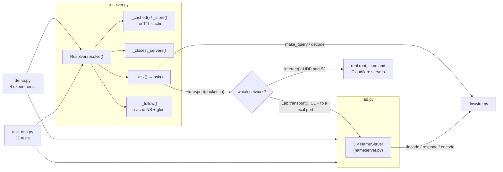

# Code walkthrough: DNS Resolution & TTLs

> Companion to [README.md](README.md). The README explains the *concept*; this file explains the
> *code*, file by file, so you can read it, change it, and rebuild it yourself.
> Line links (e.g. `resolver.py#L84`) point at the exact code.

## File map

| Read | File | Lines | Role |
|---|---|---|---|
| 1 | [`src/dnswire.py`](src/dnswire.py) | 136 | The wire format: `Record`, `Message`, `make_query`, `encode`, `decode` (with compression pointers) |
| 2 | [`src/nameserver.py`](src/nameserver.py) | 83 | `NameServer`: a UDP server for one zone that answers or refers |
| 3 | [`src/resolver.py`](src/resolver.py) | 178 | `Resolver`: the iterative walk, the TTL cache, query-ID checks |
| 4 | [`src/lab.py`](src/lab.py) | 62 | `Lab`: root, TLD and authoritative servers on localhost; `Clock`: simulated time |
| 5 | [`src/demo.py`](src/demo.py) | 209 | Four experiments that print the README's "Expected output" |
| 6 | [`tests/test_dns.py`](tests/test_dns.py) | 133 | Eleven tests, each pinning down one property of DNS |
| – | [`Makefile`](Makefile) | | `make run` = `uv run python -m src.demo`, `make test` = `uv run python -m pytest tests` |

Read the files in this order. `dnswire.py` is the vocabulary everything else uses; `resolver.py` is the heart of the lesson.

## How the pieces fit



Everything goes through two ideas. **`Resolver.resolve`** loops "ask, follow the referral, ask again", and
**`_cached`/`_store`** decide whether a question needs asking at all. The **transport** is just a function from
`(packet, ip)` to a reply packet, so the same resolver walks the real internet or the lab.

## `src/dnswire.py`, the wire format

### Constants and flags ([L18](src/dnswire.py#L18))

```python
TYPES = {"A": 1, "NS": 2, "CNAME": 5, "SOA": 6, "AAAA": 28, "OPT": 41}
QR = 0x8000  # this message is a response
AA = 0x0400  # authoritative answer
RD = 0x0100  # recursion desired
NXDOMAIN = 3  # response code (the flags' low 4 bits)
```

**What it does:** names the numbers DNS uses on the wire. A record type is a 16-bit code (`A` is 1), and the
16-bit flags field packs several yes/no bits plus a 4-bit response code.

**Why this way:** the code reads `response.flags & AA` instead of `response.flags & 0x0400`. Only the types this
lesson needs are listed; anything else decodes as `TYPE<n>` ([L54](src/dnswire.py#L54)), so an unexpected record
in a real reply never crashes the decoder.

### `Record` and `Message` ([L29](src/dnswire.py#L29), [L37](src/dnswire.py#L37))

```python
@dataclass
class Record:
    name: str  # absolute names end with a dot, which stands for the root: "shop.lab.test."
    type: str
    ttl: int
    data: str

@dataclass
class Message:
    id: int
    flags: int
    question: tuple[str, str]
    answers: list[Record] = field(default_factory=list)
    authority: list[Record] = field(default_factory=list)
    additional: list[Record] = field(default_factory=list)
```

**What it does:** one `Message` is one DNS packet, with the README's three record sections.

**Why this way:** keeping `data` as a string (`"10.0.0.1"`, `"ns.test."`) makes records easy to print and compare
in tests. The **trailing dot** matters: `shop.lab.test.` is absolute, and the empty label after the last dot is the
root of the tree. Every name in the code is normalised to that form.

### `encode_name` ([L58](src/dnswire.py#L58))

```python
labels = [label for label in name.split(".") if label]
return b"".join(bytes([len(label)]) + label.encode("ascii") for label in labels) + b"\x00"
```

**What it does:** `"shop.lab.test."` becomes `04 shop 03 lab 04 test 00`: each label after its length byte, then a
zero byte for the root.

**Why this way:** there are no dots on the wire. A length prefix tells the reader exactly how many bytes to take,
and `if label` drops the empty strings that `split(".")` produces around the dots. The root name `"."` becomes a
single `00`, which is what the EDNS record below uses as its name.

### `make_query` ([L64](src/dnswire.py#L64)): README step 2

```python
header = struct.pack("!6H", query_id, RD if recursion_desired else 0, 1, 0, 0, 1)
question = encode_name(name) + struct.pack("!2H", type_code(rtype), IN)
edns = encode_name(".") + struct.pack("!2HIH", TYPES["OPT"], 1232, 0, 0)
return header + question + edns
```

**What it does:** builds a whole query: a 12-byte header (six 16-bit numbers: ID, flags, then counts of 1 question,
0 answers, 0 authority and 1 additional), the question, and an EDNS pseudo-record.

**Why this way:**
- **`"!6H"`** means six unsigned 16-bit numbers in network byte order (big-endian). It's exactly the header
  layout in RFC 1035, so one call writes all of it.
- **RD is off by default.** Our resolver walks the tree itself; it only sets RD when it plays a stub talking to
  1.1.1.1 (section 4's TTL table).
- **EDNS** is an `OPT` record whose *class* field is reused to mean "I accept UDP replies up to 1232 bytes". Without
  it, the root's referral for `com.` (13 servers plus their addresses) wouldn't fit in classic DNS's 512 bytes and
  would arrive truncated.

### `encode` ([L73](src/dnswire.py#L73))

```python
out = struct.pack("!6H", msg.id, msg.flags, *counts) + encode_name(name) + struct.pack("!2H", type_code(rtype), IN)
for r in msg.answers + msg.authority + msg.additional:
    rdata = ipaddress.IPv4Address(r.data).packed if r.type == "A" else encode_name(r.data)
    out += encode_name(r.name) + struct.pack("!2HIH", type_code(r.type), IN, r.ttl, len(rdata)) + rdata
```

**What it does:** the name servers use it to turn a reply `Message` into bytes.

**Why this way:** each record is name, then `type, class, TTL, length` (`"!2HIH"`: two 16-bit, one 32-bit, one
16-bit), then the data itself. The length field comes before the data so a reader can skip record types it doesn't
understand. An A record's data is the 4 raw bytes of the address (`.packed`); NS data is a name. Names are written
in full: compression is optional when sending, so the server stays simple.

### `decode` and `decode_record` ([L84](src/dnswire.py#L84), [L122](src/dnswire.py#L122))

```python
query_id, flags, _qdcount, *counts = struct.unpack_from("!6H", packet)
name, offset = decode_name(packet, 12)
...
for count in counts:  # answer, authority, additional
    for _ in range(count):
        record, offset = decode_record(packet, offset)
```

**What it does:** the reverse of `encode`. It reads the header, then walks the packet with a moving `offset`, one
record at a time, using the counts to know where each section ends.

**Why this way:** a DNS packet has no section markers, only counts. Every reader function returns *the offset just
after what it read*, so the next call knows where to start. That's the same "framing" problem as HTTP's
`Content-Length` in lesson 1, solved with counts and length fields.

**Line notes:** [L133](src/dnswire.py#L133): NS and CNAME data are decoded with `decode_name(packet, offset)`, from
the *whole packet*, not from the sliced `rdata`. A name inside the data may contain a pointer to an earlier part of
the packet, which the slice wouldn't include.

### `decode_name` ([L99](src/dnswire.py#L99)): compression pointers

```python
for _ in range(255):
    length = packet[offset]
    if length & 0xC0 == 0xC0:
        if resume_at is None:
            resume_at = offset + 2
        offset = struct.unpack_from("!H", packet, offset)[0] & 0x3FFF
        continue
    if length == 0:
        return ".".join(labels) + ".", resume_at if resume_at is not None else offset + 1
    labels.append(packet[offset + 1:offset + 1 + length].decode("ascii"))
    offset += 1 + length
```

**What it does:** reads labels until the zero byte. A byte whose top two bits are set (`0xC0`, i.e. `11xxxxxx`)
isn't a length: together with the next byte it's a **pointer**, a 14-bit offset (`& 0x3FFF`) where the rest of the
name continues.

**Why this way:**
- **Compression is why real replies are small.** The root's referral names 13 servers that all end in
  `gtld-servers.net.`; with pointers, that suffix is written once. Our server never compresses, but every real
  server does, so the decoder must handle it (section 4 depends on it).
- **`resume_at`** remembers where the name *ended in the packet*: right after the first pointer (2 bytes), not
  wherever the pointer led. The caller continues reading there.
- **`range(255)`** caps the work. A forged packet can contain a pointer that points to itself, and a decoder without
  a limit would loop forever: a classic denial-of-service bug.

## `src/nameserver.py`, one zone's server

### `suffixes` ([L19](src/nameserver.py#L19))

```python
labels = [label for label in name.split(".") if label]
return [".".join(labels[i:]) + "." for i in range(len(labels))] + ["."]
```

**What it does:** `"shop.lab.test."` → `["shop.lab.test.", "lab.test.", "test.", "."]`, from the most specific zone
to the root. Both the server (to find delegations) and the resolver (to find the closest cached servers) need this.

### `_serve` ([L46](src/nameserver.py#L46)): the UDP loop

```python
packet, client = self._sock.recvfrom(4096)
...
if self.down:
    continue  # drop it: the asker hears nothing and times out
self.queries += 1
self._sock.sendto(encode(self.respond(decode(packet))), client)
```

**What it does:** receive one packet, send one packet back to whoever sent it. There's no connection and no
per-client state: UDP hands us `(packet, client address)`, and `sendto` replies to that address.

**Why this way:** compare lesson 1's TCP server, with its accept loop and per-connection keep-alive loop. A DNS
server is this simple because each question fits in one packet. **`down`** simulates an outage by staying silent
rather than closing the socket. Silence is what a dead or unreachable server looks like from far away: the asker
only learns about it by timing out.

### `respond` ([L58](src/nameserver.py#L58)): answer or refer (README step 4)

```python
for cut in suffixes(name):
    if cut == self.zone:
        break
    if delegation := self.find(cut, "NS"):
        hosts = {ns.data for ns in delegation}
        glue = [r for r in self.records if r.type == "A" and r.name in hosts]
        return Message(query.id, flags, query.question, authority=delegation, additional=glue)
else:
    return Message(query.id, flags | REFUSED, query.question)
exists = any(r.name == name for r in self.records)
return Message(query.id, flags | AA | (0 if exists else NXDOMAIN), query.question,
               answers=self.find(name, rtype))
```

**What it does:** walks from the asked name up towards this server's own zone. NS records found on the way are a
**zone cut**: that part of the tree was handed to someone else, so the server returns a referral with glue. Reaching
its own zone means the name is its to answer, authoritatively (AA), or with NXDOMAIN if no such name exists.

**Why this way:**
- **The most specific delegation wins**, because `suffixes` goes from longest to shortest. The root server holds only
  `test. NS ns.test.`, so for `shop.lab.test.` it skips `shop.lab.test.` and `lab.test.` and refers at `test.`.
- **Glue is filtered by name**: only A records for the hosts named in the NS records go in the additional section.
- **`for … else`**: the `else` runs only if the loop never hit `break`, meaning the name isn't under this zone at all.
  The server refuses instead of guessing.
- **The AA flag is the resolver's stop signal.** Referrals never set it ([L69](src/nameserver.py#L69) builds them
  without AA).

### `set_address` ([L80](src/nameserver.py#L80))

```python
self.records = [Record(r.name, r.type, r.ttl, ip) if (r.name, r.type) == (name, "A") else r
                for r in self.records]
```

**What it does:** the "operator changes the record" button for section 3.

**Why this way:** it builds a new list and swaps it in with one assignment, instead of editing the list in place.
The server thread reading `self.records` sees either the whole old list or the whole new one, never a half-edited
one. Notice what it does *not* do: notify anyone. Nothing in DNS pushes changes.

## `src/resolver.py`, the resolver

### `udp_exchange`, `internet` and `ask` ([L27](src/resolver.py#L27), [L36](src/resolver.py#L36), [L44](src/resolver.py#L44))

```python
with socket.socket(socket.AF_INET, socket.SOCK_DGRAM) as sock:
    sock.settimeout(timeout)
    sock.sendto(packet, address)
    return sock.recvfrom(4096)[0]
...
response = decode(transport(make_query(name, query_id=query_id, recursion_desired=recursion_desired), ip))
if response.id != query_id:
    raise ResolutionError("reply ignored: its ID doesn't match the query")
```

**What it does:** sends one query and waits (with a timeout) for one reply. `internet` aims at port 53 of a real IP;
`ask` adds the security check.

**Why this way:**
- **A new socket per query** means a new random source port from the OS. To forge a reply, an attacker has to guess
  both the port and the 16-bit ID before the real server answers. Before 2008 many resolvers used one fixed port,
  which is why the Kaminsky attack was so dangerous.
- **The ID check** ([L48](src/resolver.py#L48)) rejects any reply that doesn't echo our ID. The test with a forger
  proves nothing gets cached from it.
- **The timeout matters**: UDP never tells you a packet was lost. Silence until the timeout is the only signal.

### `Resolver.__init__` ([L72](src/resolver.py#L72))

```python
self.transport = transport
self.clock = clock  # injectable, so the demo can jump ahead in time
self._rng = random.Random(seed)
self.cache: dict[tuple[str, str], tuple[list[str], float]] = {}  # (name, type) → (values, expires at)
```

**What it does:** holds the resolver's only state: the cache and a few counters.

**Why this way:** three things are **injected** rather than hard-coded. The **transport** chooses the network (real
or lab). The **clock** lets `Clock()` stand in for `time.monotonic`, so 86,400 seconds of TTL pass in a moment. The
**RNG seed** makes query IDs reproducible for the trace below. A real resolver would use `secrets` instead, because
predictable IDs make forging easier.

### `resolve` ([L84](src/resolver.py#L84)): the whole algorithm

```python
if cached := self._cached(name, "A"):
    self.hits += 1
    addresses, expires_at = cached
    return Result(name, addresses, int(expires_at - self.clock()), from_cache=True)
self.misses += 1
servers = self._closest_servers(name, steps)
for _ in range(16):
    response = self._ask(servers, name, steps)
    if response.rcode == NXDOMAIN:
        raise ResolutionError(f"{name} does not exist (NXDOMAIN)")
    referral = [r for r in response.authority if r.type == "NS"]
    if response.answers or not referral or response.flags & AA:
        ... store and return the answer
    servers = self._follow(response, steps)
```

**What it does:** README steps 3–5 in one loop. Check the cache; otherwise start at the closest known servers, ask,
and either stop (an answer) or follow the referral one level down and ask again.

**Why this way:**
- **The cache hit returns the *remaining* TTL**, `expires_at - now`, not the original 300. That's what lets
  downstream caches respect the original expiry (README "TTLs").
- **The stop condition** is "has answers, or isn't a referral, or is authoritative". Checking `AA` matters: an
  authoritative "no records of that type" is a final answer even though it's empty.
- **`range(16)`** stops a delegation loop (A refers to B, B refers back to A) from spinning forever. Real trees are
  3–5 levels deep.

### `_ask` ([L106](src/resolver.py#L106))

```python
for server, ip in servers:
    self.queries_sent += 1
    try:
        response = ask(ip, name, query_id=self._rng.getrandbits(16), transport=self.transport)
    except (OSError, ResolutionError) as err:
        steps.append(Step(server, ip, "error", reason, ...))
        continue
    steps.append(Step(server, ip, *describe(response), ...))
    return response
raise ResolutionError(f"no name server replied for {name}")
```

**What it does:** tries each server for the zone in turn and records every attempt as a `Step`. The demo prints the
steps as tables.

**Why this way:** a zone has several name servers precisely so that one can fail. A timeout (`OSError`) or a
forged reply (`ResolutionError`) just moves on to the next server. Only when *all* of them fail does the lookup fail,
which is what *Break it* triggers: the lab zone has one name server, so its outage is total. `queries_sent` counts
every attempt, including the ones that timed out.

### `_follow` ([L121](src/resolver.py#L121)): learning from a referral

```python
delegation = [r for r in response.authority if r.type == "NS"]
zone = delegation[0].name
self._store(zone, "NS", [r.data for r in delegation], min(r.ttl for r in delegation))
glue: dict[str, list[Record]] = {}
for r in response.additional:
    if r.type == "A":
        glue.setdefault(r.name, []).append(r)
for host, records in glue.items():
    self._store(host, "A", [r.data for r in records], min(r.ttl for r in records))
return self._servers_for(zone, steps)
```

**What it does:** README step 5 for referrals. It caches "zone X → these NS names" and "NS name → these IPs", each
with the TTL the referral gave (2 days in the lab and on the real internet).

**Why this way:** caching the referral, and not just the final answer, is what makes the *next* lookup cheap.
`api.lab.test.` costs 1 query instead of 3 because of these two `_store` calls. Glue is grouped per host because one
server can have several addresses (`hera.ns.cloudflare.com.` has three).

### `_servers_for` and `_closest_servers` ([L135](src/resolver.py#L135), [L149](src/resolver.py#L149))

```python
for zone in suffixes(name):
    if self._cached(zone, "NS") and (servers := self._servers_for(zone, steps)):
        return servers
return list(self.root_hints.items())
```

**What it does:** `_closest_servers` picks the starting point: the most specific zone whose name servers (and their
addresses) are still cached, falling back to the root hints. `_servers_for` turns a zone into `(name, ip)` pairs.

**Why this way:** this is where caching pays off. For `api.lab.test.`, the suffix `lab.test.` has cached NS records,
so the walk starts at the authoritative server. **Line notes:** [L143–L146](src/resolver.py#L143): if a referral came
without glue (the NS name lives in another zone), the resolver resolves the name server's own address first, a lookup
inside the lookup, and merges its steps into the trace.

### `_cached` and `_store` ([L157](src/resolver.py#L157), [L163](src/resolver.py#L163)): the TTL cache

```python
def _cached(self, name, rtype):
    entry = self.cache.get((name, rtype))
    if entry and entry[1] > self.clock():
        return entry
    return None  # never cached, or its TTL ran out

def _store(self, name, rtype, values, ttl):
    self.cache[(name, rtype)] = (values, self.clock() + ttl)
```

**What it does:** stores each entry with an **absolute expiry time** (`now + ttl`) and treats any entry at or past its
expiry as missing.

**Why this way:**
- **Storing the expiry time, not the TTL,** means nothing has to count down. "How much is left" is one subtraction
  when needed.
- **`>` and not `>=`:** at exactly `now == expires_at` the entry is expired. That's why the section 3 lookup at
  300 s goes back to the name servers, while the one at 299 s gets "1 s left".
- **Expired entries are never deleted, just ignored.** That's simple, and it leaves the old value available for a
  "serve-stale" fallback (exercise 3). The cost is memory: a real resolver also evicts entries (LRU) to cap its size.

### `describe` ([L167](src/resolver.py#L167))

Turns a reply into the `(kind, summary)` the step tables print: `"ANSWER 10.0.0.1 (TTL 300)"`, or
`"referral: com. is served by l.gtld-servers.net. + 12 more"`. Tests check the `kind` (`"referral"`, `"answer"`), and
the demo shows the summary.

## `src/lab.py`, a DNS tree on localhost

### `Clock` ([L21](src/lab.py#L21))

```python
class Clock:
    def __init__(self) -> None:
        self.now = 0.0
    def __call__(self) -> float:
        return self.now
```

**What it does:** an object you can call like `time.monotonic()`, whose time only moves when you set `clock.now`.

**Why this way:** `__call__` makes `Clock()` a drop-in replacement for the `clock` parameter. The TTL logic doesn't
know it's being fooled, and the UDP queries are still real.

### `Lab` ([L31](src/lab.py#L31)) and `transport` ([L60](src/lab.py#L60))

```python
self.root_hints = {"lab-root": "198.51.100.1"}
self._ports = {"198.51.100.1": self.root.port, "198.51.100.2": self.tld.port, "198.51.100.3": self.auth.port}
...
return udp_exchange(packet, ("127.0.0.1", self._ports[ip]), timeout=0.2)
```

**What it does:** builds the three zones from the README's diagram, each with its own `NameServer`, and maps each
pretend IP to the server's real local port.

**Why this way:** real referrals carry IP addresses, and real DNS always uses port 53. Running three servers on one
machine would need three loopback IPs, which macOS doesn't have without admin rights. So the zone data uses
realistic IPs from the documentation range (RFC 5737), and only the transport knows they're local ports. The resolver
code is identical for the lab and the internet. The 0.2 s timeout keeps *Break it* fast; `internet()` uses 2 s.

## `src/demo.py`, making it visible

| Experiment | Line | Setup | What it measures | README output |
|---|---|---|---|---|
| 1. The wire format | [L59](src/demo.py#L59) | One `make_query` with a fixed ID (0x1A2B), sent to the lab's authoritative server; then dnspython parses our bytes and queries our server | The query's fields, byte by byte, and the reply | Hex table, "42 bytes out, 60 back" |
| 2. The tree walk | [L86](src/demo.py#L86) | A fresh `Resolver` on the lab, `Clock` at 0 | Steps for a cold lookup, a sibling name, a repeat | 3 / 1 / 0 queries |
| 3. TTL timeline | [L102](src/demo.py#L102) | Lookups at 0, 1, `CHANGE_AT`+1, `TTL`−1, `TTL`; at `CHANGE_AT` the record changes (or the server goes down with `OUTAGE=1`) | Which address the resolver returns, and from where | The six-row timeline |
| 3b. TTL sweep | [L139](src/demo.py#L139) | For each TTL, one lookup per simulated second; the address changes at t = 1,000 s | Queries in the first hour, hit ratio, stale lookups, delay until the change shows | The four-row TTL table |
| 4. The internet | [L166](src/demo.py#L166) | A `Resolver` with real root hints; then 3 queries (RD set) to each public resolver | Real referrals and timings; TTLs left in different caches | Steps table, TTL table |

**Details worth noticing:**
- **The sweep loop** ([L147](src/demo.py#L147)) runs `while t < 3_600 or noticed is None`: at least an hour (for the
  query count), and for long TTLs until the change finally shows. For the 1-day TTL that's 86,400 iterations. They
  take well under a second, because all but 3 of them are cache hits that never touch the network.
- **The "← old address!" marker** compares the resolver's answer with what the authoritative server holds *right
  now* (`lab.auth.find(...)`). The demo can see both sides; a real user can't.
- **Section 4 reuses the internet resolver's last step** ([L185](src/demo.py#L185)) to learn which server was
  authoritative, then asks it directly. That's how the TTL table gets its full-TTL baseline.
- **Fixed seed, varying IDs**: the resolver uses `seed=7`, so the lab steps are identical on every run. Only the
  section 1 printout uses a hand-picked ID, so the hex stays readable.

## Tests: what each one proves

| Test | Property it proves | Why that property matters |
|---|---|---|
| [`test_query_is_a_small_binary_message…`](tests/test_dns.py#L17) | Our bytes start with the ID and contain the length-prefixed name; dnspython parses them | Our encoder speaks real DNS, not a look-alike |
| [`test_compressed_names_from_real_servers…`](tests/test_dns.py#L25) | A dnspython reply (under 80 bytes, with pointers) decodes to the full names | Real servers compress; section 4 depends on this |
| [`test_our_name_server_answers_a_real_dns_library`](tests/test_dns.py#L33) | dnspython gets `10.0.0.1`, TTL 300, with the AA flag | Interop in the other direction: our server serves real clients |
| [`test_resolution_follows_referrals…`](tests/test_dns.py#L40) | A cold lookup asks root → TLD → authoritative: referral, referral, answer | The defining shape of iterative resolution |
| [`test_cached_referrals_let_a_sibling_name…`](tests/test_dns.py#L48) | `api.lab.test.` takes 1 query; root and TLD each saw just 1 query in total | Caching referrals is what keeps the root from being flooded |
| [`test_cached_answer_costs_no_queries…`](tests/test_dns.py#L58) | 0 queries at 299 s (TTL left 1), exactly 1 query at 300 s | TTL semantics, to the second |
| [`test_changed_record_stays_invisible…`](tests/test_dns.py#L72) | Old address at 299 s after a change at 60 s; new one at 300 s | Changes reach users only when caches expire |
| [`test_ttl_bounds_staleness…`](tests/test_dns.py#L99) | Stale lookups ≤ TTL; 30 s TTL is fresher but sends more queries than 300 s | The central trade-off, as an inequality |
| [`test_cache_hides_an_authoritative_outage…`](tests/test_dns.py#L106) | The cache answers at 299 s with the server down; at 300 s the lookup fails | A TTL is also how long you survive an outage |
| [`test_nonexistent_name_is_nxdomain`](tests/test_dns.py#L119) | A missing name raises with "NXDOMAIN" | "Doesn't exist" is an answer, not a timeout |
| [`test_reply_with_the_wrong_id…`](tests/test_dns.py#L124) | A forged reply with a different ID raises, and the cache stays empty | The basic defence against cache poisoning |

The time-based tests use the simulated `Clock`, so they're exact (`hit.ttl == 1`) and instant, with no `sleep`
anywhere. The one real wait is the outage test's 0.2 s timeout.

## Trace one run

Real values, printed by running `Resolver(lab.root_hints, transport, clock=Clock(), seed=7).resolve("shop.lab.test")`
against `Lab(300)` with a wrapped transport.

| Step | Code | Value |
|---|---|---|
| 1 | `resolve`, [L85](src/resolver.py#L85) | `"shop.lab.test"` → `"shop.lab.test."` |
| 2 | `_cached(name, "A")` | `None`: the cache is empty, so `misses` = 1 |
| 3 | `_closest_servers` | No NS records cached for any suffix → root hints `[('lab-root', '198.51.100.1')]` |
| 4 | `_ask` → `ask` | Query ID **21222** (first draw from `Random(7)`), 42 bytes to 198.51.100.1 |
| 5 | root `respond` | Suffixes `shop.lab.test.`, `lab.test.` have no NS; `test.` does → referral. Flags `0x8000` (QR only), 79 bytes: authority `test. NS ns.test.` (TTL 172800), additional `ns.test. A 198.51.100.2` |
| 6 | `resolve` [L98](src/resolver.py#L98) | No answers, a referral, no AA → `_follow`: caches `('test.', 'NS')` and `('ns.test.', 'A')` until t = 172,800 |
| 7 | `_ask` → TLD | ID **62119**, reply 93 bytes, flags `0x8000`: `lab.test. NS ns1.lab.test.` + glue `198.51.100.3` |
| 8 | `_follow` | Caches `('lab.test.', 'NS')` and `('ns1.lab.test.', 'A')` |
| 9 | `_ask` → authoritative | ID **9886**, reply 60 bytes, flags **`0x8400`** (QR + AA): `shop.lab.test. A 10.0.0.1`, TTL 300 |
| 10 | `resolve` [L101](src/resolver.py#L101) | Answer → `_store('shop.lab.test.', 'A', ['10.0.0.1'], 300)` → `Result(['10.0.0.1'], ttl=300, from_cache=False, 3 steps)` |

The cache afterwards (expiry times are absolute, on the simulated clock):

```text
('test.', 'NS')          ['ns.test.']        expires 172800.0
('ns.test.', 'A')        ['198.51.100.2']    expires 172800.0
('lab.test.', 'NS')      ['ns1.lab.test.']   expires 172800.0
('ns1.lab.test.', 'A')   ['198.51.100.3']    expires 172800.0
('shop.lab.test.', 'A')  ['10.0.0.1']        expires 300.0
```

Then:
- `_closest_servers("api.lab.test.")` now returns `[('ns1.lab.test.', '198.51.100.3')]`, so the walk would start at
  the authoritative server.
- At `clock.now = 1`, the same lookup is a cache hit: TTL **299**, `queries_sent` still **3**, `hits` 1, `misses` 1.
- At `clock.now = 300`, `_cached('shop.lab.test.', 'A')` returns **`None`** (`300 > 300` is false), so the next
  lookup asks the name server again.

**Compression, decoded.** dnspython's 64-byte reply from the compression test (it may put `a` and `b` in either order):

```text
9a f4 81 00 00 01 00 02 00 00 00 00        header: ID, flags, 1 question, 2 answers
07 65 78 61 6d 70 6c 65 03 63 6f 6d 00     offset 12: "example" "com" 0  → example.com.
00 02 00 01                                type NS, class IN
c0 0c 00 02 00 01 00 00 01 2c 00 07        answer 1: name = pointer to 12; NS; IN; TTL 300; 7 data bytes
01 61 02 6e 73 c0 0c                       offset 41: "a" "ns" + pointer to 12  → a.ns.example.com.
c0 0c 00 02 00 01 00 00 01 2c 00 04        answer 2: same, 4 data bytes
01 62 c0 2b                                "b" + pointer to 43, where "ns" + pointer to 12 sit  → b.ns.example.com.
```

`decode_name(wire, 41)` returned `('a.ns.example.com.', 48)`: the full name, and 48 as the offset to continue from,
just past the pointer. The second name is a pointer to a pointer: 4 bytes standing in for 18.

## Python techniques used

| Technique | Where | Why it's used here |
|---|---|---|
| `struct.pack("!6H", …)`, `struct.unpack_from(fmt, buf, offset)` | `dnswire.py` | Fixed-size big-endian fields (`!` = network byte order); `unpack_from` reads at an offset without slicing |
| Bit masks `& 0x000F`, `& 0xC0 == 0xC0`, `& 0x3FFF` | `rcode`, `decode_name` | Pull flags, response codes and pointer offsets out of packed bits |
| `bytes([n])`, `str.encode("ascii")`, `bytes.hex()` | `encode_name`, `decode_record` | Length-prefixed labels; hex for record types we don't decode |
| `ipaddress.IPv4Address(...).packed` / `IPv4Address(b)` | `encode`, `decode_record` | Dotted string ↔ 4 raw bytes, with validation for free |
| `@dataclass` + `field(default_factory=list)` | `Message` | Each message gets its *own* empty lists (a shared `[]` default would be a bug) |
| Walrus `:=` | `respond`, `resolve`, `_closest_servers` | Test and keep a value in one line: `if delegation := self.find(cut, "NS")` |
| `for … else` | `respond` | The `else` runs only when the loop finishes without `break`: the name isn't in this zone |
| `random.Random(seed)` | `Resolver.__init__` | A private RNG: reproducible IDs without touching the global `random` state |
| `Callable[[bytes, str], bytes]` alias, injected functions | `Transport`, `transport=`, `clock=` | Swap the network or the clock without changing the resolver |
| `__call__` | `Clock` | An object that can be called like a function, standing in for `time.monotonic` |
| UDP sockets: `SOCK_DGRAM`, `sendto`, `recvfrom`, `settimeout` | `udp_exchange`, `NameServer._serve` | One packet each way, no connection; a timeout is the only way to notice a loss |
| `threading.Event` + a 50 ms socket timeout | `NameServer._serve` | A blocking `recvfrom` loop that still notices "stop" quickly |
| `dict.setdefault(k, []).append(v)` | `_follow` | Group glue records by host in one pass |
| `while t < 3_600 or noticed is None`, and `3_600`-style digit separators | `experiment_ttl_sweep` | Keep looping until both goals are met, without knowing the run length up front; `_` makes big numbers readable |
| dnspython: `message.from_wire`, `make_query`, `query.udp`, `rrset.from_text`, `to_wire` | demo, tests | A real DNS implementation to check ours against, in both directions |

## Design decisions & alternatives

| Decision | Alternative | Why this one, for learning |
|---|---|---|
| Hand-written wire format | dnspython for everything | The bytes are the lesson. dnspython stays as an independent checker |
| A lab tree on localhost, documentation IPs mapped to ports | Only the real internet | Offline and reproducible, and lets the demo change records and kill servers. Section 4 still shows the real thing |
| Injected simulated clock | Real `time.sleep` and short TTLs | A day of TTL in milliseconds; tests are exact to the second |
| Expiry timestamps, expired entries ignored lazily | A background sweeper, or an LRU with a size cap | The simplest correct TTL semantics. Real resolvers add eviction; it isn't the lesson |
| Names written uncompressed | Compress like real servers | Sending compressed is optional, decoding it isn't, so the complexity goes where it's required |
| IPv4 only, no CNAME chasing, no negative caching | A complete resolver | Keeps `resolve` to one readable loop. Two of these are exercises below |

## Change it yourself

### 1. Enforce a minimum TTL (easy)

**Goal:** some resolvers raise very short TTLs to a floor (Unbound's `cache-min-ttl`, for example). Add
`Resolver(min_ttl=60)` and see what it does to freshness.
**Change:** `Resolver.__init__` and `_store` in `src/resolver.py`.
**Check:** add a test. Use `Lab(ttl=30)`, resolve at t = 0, change the address at t = 10, and resolve at t = 30. Without
the floor you get `10.0.0.2`; with `min_ttl=60` you still get `10.0.0.1` until t = 60. Also try the sweep in
`demo.py` with `min_ttl=60`: the 30 s row drops from 122 to 62 queries an hour.

<details><summary>Hint</summary>

In `_store`: `ttl = max(ttl, self.min_ttl)`. It also stretches the cached referrals, which already have long TTLs.
This is the README's "some resolvers enforce a minimum TTL" gotcha: the domain owner set 30 s, and this resolver
quietly gives some users 60.
</details>

### 2. Follow CNAMEs (medium)

**Goal:** add `www.lab.test. CNAME shop.lab.test.` to the lab, and make `resolve("www.lab.test")` return `10.0.0.1`.
**Change:** the zone in `src/lab.py`, `NameServer.respond` in `src/nameserver.py`, and `Resolver.resolve` in
`src/resolver.py`.
**Check:** a new test asserting the address, and that the result's TTL is the smaller of the CNAME's TTL and the
target's.

<details><summary>Hint</summary>

Server: when there's no record of the asked type, answer with the name's CNAME record instead:
`answers = self.find(name, rtype) or self.find(name, "CNAME")`. `encode` already handles CNAME data (it's a name).
Resolver: if the answers contain only a CNAME, call `self.resolve(cname.data)` for the target and combine the TTLs.
Guard against CNAME loops (`a → b → a`) with a depth limit. Real servers often include the target's A record in the
same reply when they own it. You can add that as an optimisation, and then the resolver must use it instead of
asking again.
</details>

### 3. Serve stale answers during an outage (hard)

**Goal:** implement RFC 8767 "serve-stale". If every name server fails, return the expired cached answer (with a TTL
of 30 s) instead of failing, and mark the result as stale.
**Change:** `Resolver.resolve` (and `Result`, to carry a `stale` flag) in `src/resolver.py`. Update the outage row in
`demo.py` to show it.
**Check:** `OUTAGE=1 make run`: the 300 s row should answer `10.0.0.1 (stale)` instead of `FAILED`. Add a test next to
`test_cache_hides_an_authoritative_outage_until_the_ttl_expires`.

<details><summary>Hint</summary>

The expired entry is still in `self.cache`, because `_cached` ignores old entries but never deletes them. Wrap the
loop in `try: … except ResolutionError:` and, on failure, look at `self.cache.get((name, "A"))` directly. Store the
stale reply with a fresh 30 s expiry, so you don't hammer a dead server every second. Then think about the trade-off.
If the owner deleted or moved the record *on purpose* just before their servers died, serve-stale keeps handing out
the wrong answer. That's why RFC 8767 also caps how long stale data may be served (it suggests 1 to 3 days).
</details>
