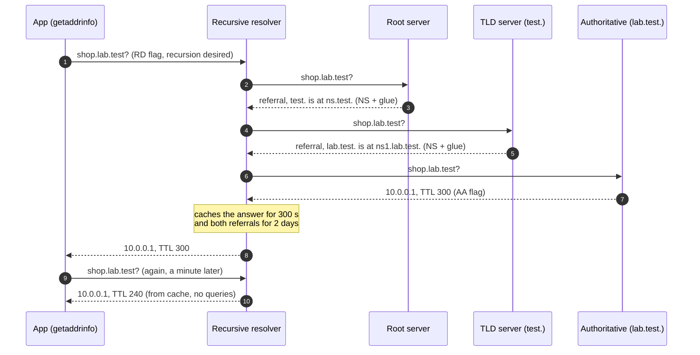

# DNS Resolution & TTLs

> **Module:** 00 Foundations · **Difficulty:** ●○○○○ · **Time:** ~30 min · **Prereqs:** [Client-Server & the Request Lifecycle](../01-how-the-web-works/README.md)

## TL;DR

DNS turns a name like `example.com` into an IP address by walking a tree of servers: root, then `.com`, then
the domain's own name servers. Every answer carries a **TTL** (time to live) that says how long anyone may
cache it. Caching makes almost every lookup free, and it's also why a DNS change takes up to one TTL to reach
everyone.

## Explain like I'm 5

You want to visit your friend Mia, but you only know her name. You ask the **school secretary**:

1. The secretary doesn't know where Mia lives either, so she phones the **world office**: "Who knows about
   Mia's country?" The world office says: "Call the **country office**."
2. The country office says: "Mia's town? Call the **town hall**."
3. The town hall knows: "Mia lives at **42 Oak Street**."
4. The secretary tells you, and writes a **sticky note**: "Mia → 42 Oak Street, **good until Friday**." Next
   time anyone asks, she just reads the note. No phone calls.
5. If Mia's family moves on Wednesday, the note is wrong until Friday, and anyone who asks gets sent to the
   old house. On Friday she throws the note away and phones again.

She keeps notes about the offices too ("for Mia's town, call that town hall"), so next time she can skip the
world office and the country office.

| In the story | In DNS |
|---|---|
| Mia's name | A **domain name**: `shop.lab.test.` |
| 42 Oak Street | An **IP address**, stored in an **A record**: `10.0.0.1` |
| The school secretary | A **recursive resolver**: your ISP's, or a public one like 1.1.1.1 or 8.8.8.8 |
| The world office | The **root servers**: they only know who runs each top-level domain |
| The country office | A **TLD server** (top-level domain: `.com`, `.in`, here `test.`): knows who runs each domain under it |
| The town hall | The domain's **authoritative name server**: the one place that has the real answer |
| "Call that office instead" | A **referral**: NS (name server) records, plus that server's address (**glue**) |
| The sticky note | A **cache** entry |
| "Good until Friday" | The **TTL**, in seconds |
| The family moved, the note didn't | A **stale** answer after a record changes |
| Notes about the offices | Cached referrals: later lookups skip the root and the TLD |

**Real world:** when you open github.com, your laptop asks a recursive resolver, such as your ISP's or
**Cloudflare's 1.1.1.1**. If anyone using that resolver asked recently, the answer comes straight from its
cache. Otherwise the resolver does the walk that section 4 of the demo does for example.com: a root server,
then a `.com` server, then the domain's own name servers.

## Technical deep dive

### The problem

Programs connect to IP addresses (step 2 of the [request lifecycle](../01-how-the-web-works/README.md)), but
people and config files use names. And the IP behind a name changes: servers get replaced, traffic fails over
to another region, a CDN hands each user its nearest edge. The directory that maps names to IPs has to:

- answer an enormous number of lookups, fast,
- let each domain's owner change their own records without asking a central admin,
- keep working when parts of it are down.

A single central server fails all three. DNS uses **delegation** (a tree in which each level hands off to the
next) and **caching** (every answer may be reused until its TTL runs out).

### How it works

A lookup with nothing cached, step by step:

1. Your app calls `getaddrinfo("shop.lab.test")`. The OS's **stub resolver** checks its own cache and
   `/etc/hosts`.
2. On a miss it sends one UDP packet to port 53 of a **recursive resolver**, with the **RD** (recursion
   desired) flag set: "do the whole walk for me". The query is tiny: 42 bytes in this lab.
3. The resolver checks its cache. A hit is answered at once, with the **remaining** TTL.
4. On a miss it resolves **iteratively**, starting at the closest servers it knows. With nothing cached that's
   a **root server**, whose IP addresses are built into every resolver as **root hints**.
   1. The root replies with a **referral**: "`test.` is served by `ns.test.`". That's NS records in the
      *authority* section, plus **glue** in the *additional* section: the A record of `ns.test.`, so the
      resolver can reach it without a separate lookup.
   2. The TLD server replies with another referral, to the domain's authoritative server.
   3. The authoritative server answers with the **AA** (authoritative answer) flag:
      `shop.lab.test. 300 IN A 10.0.0.1`.
5. The resolver **caches every piece for its own TTL**: the answer (300 s), the referrals and their glue
   (2 days, the same as real `.com` referrals). The next lookup for any name in `lab.test.` goes straight to
   its server.
6. The answer goes back to the stub, which may cache it too, and your app connects to the IP.



**TTLs.** The domain's owner sets a TTL on each record. Every cache counts it down and hands out the
*remaining* TTL, so no copy anywhere outlives the original TTL (as long as caches obey it). Changing a record
pushes nothing to anyone. "DNS propagation" is just caches expiring, each at its own time. That's why the
standard move before a planned change is to lower the TTL at least one old TTL ahead, make the change, then
raise it again.

| Record type | Holds | Example |
|---|---|---|
| A / AAAA | An IPv4 / IPv6 address | `shop.lab.test. A 10.0.0.1` |
| NS | The name servers for a zone (a referral) | `lab.test. NS ns1.lab.test.` |
| CNAME | An alias: "look up this other name instead" | `www.example.com. CNAME example.com.` |
| MX / TXT | Mail servers / free text (domain verification, SPF) | `example.com. MX 10 mail.example.com.` |

### Trade-offs

| Choice | Gain | Cost |
|---|---|---|
| Long TTL (hours or days) | Few queries and fast lookups; survives a name-server outage for up to a TTL | A change or a failover takes up to a TTL to reach everyone (85,400 stale lookups with a 1-day TTL in section 3) |
| Short TTL (30–60 s) | Changes and failovers show up fast; lets DNS steer traffic | Many more queries (122 per hour instead of 3 in section 3; managed DNS bills per query), and lookups pay the full walk more often |
| A tree of delegations vs one central directory | Each owner controls their own zone; load spreads over many servers | A cold lookup costs several round trips (110 ms in section 4); a broken delegation takes out everything below it |
| UDP vs TCP | One packet each way, no handshake (compare the [TCP + TLS setup](../01-how-the-web-works/README.md)) | Lost packets mean retries after a timeout; big answers need EDNS or a TCP retry; replies are easier to forge |

### Failure modes & gotchas

- **Stale answers after a change.** In section 3 the resolver kept handing out `10.0.0.1` for 240 s after the
  record moved. With a 1-day TTL, 85,400 lookups went to the old address. Lower the TTL *before* a planned
  change, and keep the old server running until the old TTL has passed.
- **Name-server outage.** Caches hide it only until each copy's TTL runs out (*Break it*). On 4 October 2021,
  Facebook's authoritative DNS servers became unreachable during a roughly six-hour outage; as cached answers
  expired, facebook.com stopped resolving for everyone.
- **Clients that never ask again.** DNS is only consulted when a new connection opens. A kept-alive connection
  or a pool built at startup keeps using the old IP whatever the TTL says, and some runtimes cache longer than
  the TTL.
- **Negative caching.** "No such name" (NXDOMAIN) is cached too, for a time set in the zone's SOA record. Look
  a name up before you create it and you may keep getting NXDOMAIN for minutes after it exists.
- **A cold lookup costs round trips.** Section 4 took 3 queries and 110 ms before any TCP connection could even
  start. In [lesson 1](../01-how-the-web-works/README.md) the DNS phase took 1.1 ms because the OS cache answered.
- **Forged replies (cache poisoning).** UDP has no handshake, so an attacker can race the real server with a
  fake reply. The defences are unpredictable query IDs and source ports (our resolver rejects a wrong ID, and a
  test proves it) and DNSSEC signatures.
- **One resolver IP, many caches.** In section 4, three queries in a row to 1.1.1.1 returned three different
  TTLs. After a change, users see old and new answers mixed for up to a TTL.

### When NOT to use it

- **Failover that must happen in seconds.** TTLs, resolvers and clients that cache stretch it to minutes. Put a
  load balancer or an anycast IP in front and let it health-check the servers
  ([Load Balancing](../../01-scaling-and-traffic/02-load-balancing/README.md)).
- **Fine-grained load balancing.** DNS round robin (several A records) can't see server load, and caches pin
  clients to one answer.
- **Discovery of fast-changing instances** (containers coming and going every few seconds). DNS can do it with
  very short TTLs, but a registry that pushes changes (Consul, etcd) reacts faster
  ([Service Discovery](../../08-observability-and-architecture/04-service-discovery/README.md)).

## Implementation

Four files in [`src/`](src/), plus [`demo.py`](src/demo.py). The lesson code is standard library only;
dnspython is used just to check that real DNS software understands it.

| File | What it holds |
|---|---|
| [`dnswire.py`](src/dnswire.py) | The wire format: build queries, encode and decode messages, follow compression pointers |
| [`nameserver.py`](src/nameserver.py) | `NameServer`: a UDP server for one zone that gives answers or referrals |
| [`resolver.py`](src/resolver.py) | `Resolver`: the iterative walk plus the TTL cache |
| [`lab.py`](src/lab.py) | A root, a TLD and an authoritative server on localhost, plus a simulated clock |

The key ideas in the code:

- **A referral is just NS records plus glue.** The resolver follows them until a reply carries the AA flag.
- **The cache is a dict** from `(name, type)` to `(values, expiry time)`, and an expired entry counts as missing.
- **The clock is injected**, so the demo can jump a day ahead in milliseconds. The queries are still real UDP.

**Full explanation of the code, with a traced lookup, Python techniques and exercises:
[CODE_WALKTHROUGH.md](CODE_WALKTHROUGH.md).**

## Run it

```bash
cd modules/00-foundations/02-dns
make up     # no infrastructure needed for this lesson
make run    # run the demo (section 4 needs internet)
make test   # prove the behaviour
make down
```

## Expected output

Sections 1–3 are identical on every run. Section 4 talks to real servers, so its timings and TTLs will differ.

```text
==============================================================================
 DNS resolution & TTLs: the wire format, the tree walk, caching, the real internet
==============================================================================

1) A DNS query is a tiny binary message, sent in a single UDP packet
  query for shop.lab.test. A (42 bytes):
  bytes                                         meaning
  --------------------------------------------  ------------------------------------------------------------------
  1a 2b                                         ID 6699: the reply must carry the same ID
  00 00                                         flags: a query; recursion not desired (we walk the tree ourselves)
  00 01 00 00 00 00 00 01                       counts: 1 question, 0 answers, 0 authority, 1 additional
  04 73 68 6f 70 03 6c 61 62 04 74 65 73 74 00  the name, as length-prefixed labels: 4 "shop" 3 "lab" 4 "test" 0
  00 01 00 01                                   type 1 = A (IPv4 address), class 1 = IN (internet)
  00 00 29 04 d0 00 00 00 00 00 00              EDNS: "I accept UDP replies up to 1232 bytes"
  reply from ns1.lab.test. (60 bytes, ID 6699, flags: response, authoritative):
    shop.lab.test.  TTL 300  A  10.0.0.1
  dnspython 2.9.0 reads our query as : shop.lab.test. IN A
  dnspython asks our server, gets : shop.lab.test. 300 IN A 10.0.0.1
  → 42 bytes out, 60 back, no connection to set up: that's why DNS runs over UDP.

2) Resolution walks the tree: root → test. → lab.test. (three name servers on localhost)
  shop.lab.test. with an empty cache: 3 queries
  step  asked          IP            it replied
  ----  -------------  ------------  ----------------------------------------------
  1     lab-root       198.51.100.1  referral: test. is served by ns.test.
  2     ns.test.       198.51.100.2  referral: lab.test. is served by ns1.lab.test.
  3     ns1.lab.test.  198.51.100.3  ANSWER 10.0.0.1 (TTL 300)
  api.lab.test. next  : 1 query, straight to ns1.lab.test. (the referrals are cached) → 10.0.0.7
  shop.lab.test. again: 0 queries, from the cache → 10.0.0.1 (300 s of TTL left)
  → each server only knows the next step down; caching every step lets later lookups skip the walk.

3) TTL: how long anyone may reuse an answer (simulated clock, record TTL 300 s)
  time   what happens                                  resolver answers          from               queries
  -----  --------------------------------------------  ------------------------  -----------------  -------
  0 s    lookup shop.lab.test.                         10.0.0.1                  name servers       3
  1 s    lookup shop.lab.test.                         10.0.0.1                  cache, 299 s left  0
  60 s   !! operator moves shop.lab.test. to 10.0.0.2
  61 s   lookup shop.lab.test.                         10.0.0.1  ← old address!  cache, 239 s left  0
  299 s  lookup shop.lab.test.                         10.0.0.1  ← old address!  cache, 1 s left    0
  300 s  lookup shop.lab.test.                         10.0.0.2                  name servers       1
  → the change reached this resolver 240 s after it was made. Nothing is pushed: the cached copy just expires.

   Picking a TTL: one lookup per second; the address changes at t = 1,000 s
  record TTL  queries to name servers, 1st hour  cache hit ratio  lookups given the OLD address  change visible after
  ----------  ---------------------------------  ---------------  -----------------------------  --------------------
  30 s        122                                96.67%           20                             20 s
  5 min       14                                 99.67%           200                            3.3 min
  1 h         3                                  99.97%           2,600                          43.3 min
  1 day       3                                  99.97%           85,400                         23.7 h
  → a short TTL shows changes fast but multiplies the queries; with a long one, changes take hours.

4) The real internet: resolve example.com starting at a root server, the way 1.1.1.1 would
  step  asked                    IP               took      it replied
  ----  -----------------------  ---------------  --------  --------------------------------------------------------------------
  1     a.root-servers.net.      198.41.0.4        54.5 ms  referral: com. is served by l.gtld-servers.net. + 12 more
  2     l.gtld-servers.net.      192.41.162.30     49.7 ms  referral: example.com. is served by hera.ns.cloudflare.com. + 1 more
  3     hera.ns.cloudflare.com.  108.162.192.162    5.4 ms  ANSWER 104.20.23.154, 172.66.147.243 (TTL 300)
  cold: 3 queries, 109.7 ms. Asked again: 0 queries, answered from the cache.
  dnspython, through your computer's usual resolver: 104.20.23.154, 172.66.147.243: the same ✓

  The same record, asked three times at each public resolver:
  asked                                    TTL left         age of each copy
  ---------------------------------------  ---------------  -------------------------------
  hera.ns.cloudflare.com. (authoritative)  300              the source: always the full TTL
  1.1.1.1 (Cloudflare)                     110 · 31 · 173   190 s, 269 s, 127 s
  8.8.8.8 (Google)                         176 · 166 · 288  124 s, 134 s, 12 s
  9.9.9.9 (Quad9)                          139 · 139 · 139  161 s, 161 s, 161 s
  → one resolver IP is many caches, each counting down its own copy. That's "DNS propagation":
    no push, just copies expiring at different times.
```

```text
uv run python -m pytest tests
...........                                                              [100%]
11 passed in 1.41s
```

**What you're seeing:**

1. **The wire format.** A query is 42 bytes: a 12-byte header (ID 6699, flags 0 for "a query, no recursion",
   then four counts), the name as length-prefixed labels ending in a zero byte, the type and class, and an
   11-byte EDNS record. The 60-byte reply echoes ID 6699 and has the authoritative flag. dnspython parses our
   bytes, and our server answers dnspython: the same protocol, different code.
2. **The tree walk.** With an empty cache, the root and the TLD server only gave referrals, and only the
   authoritative server knew the address. `api.lab.test.` then took 1 query, because the referral to
   `ns1.lab.test.` was cached for 2 days. Asking for `shop.lab.test.` again took 0 queries.
3. **TTLs.** The record moved at 60 s, but the resolver kept answering `10.0.0.1` until its copy expired at
   300 s. In the sweep, the "change visible after" column is the TTL that was left on the cached copy when the
   change happened. A 30 s TTL costs 122 queries an hour and leaves 20 stale lookups. A 1-day TTL costs 3
   queries an hour, but 85,400 lookups (23.7 hours of them) went to the old address.
4. **The real internet.** The root (54.5 ms) and `.com` (49.7 ms) servers only referred us onwards, and
   Cloudflare's name server answered in 5.4 ms. A cold lookup took 110 ms, and a repeat took 0 queries.
   dnspython, through your computer's own resolver, got the same two addresses. Three queries to 1.1.1.1
   returned three different TTLs (copies 190, 269 and 127 s old): one IP, several caches. Quad9 answered 139
   three times, so all three queries hit the same cache. To watch a real resolver do the same walk, run
   `dig +trace example.com`.

## Break it

**Experiment 1: take the authoritative name server down.**

```bash
OUTAGE=1 make run
```

```text
3) TTL: how long anyone may reuse an answer (simulated clock, record TTL 300 s)
  time   what happens                                resolver answers                               from               queries
  -----  ------------------------------------------  ---------------------------------------------  -----------------  -------
  0 s    lookup shop.lab.test.                       10.0.0.1                                       name servers       3
  1 s    lookup shop.lab.test.                       10.0.0.1                                       cache, 299 s left  0
  60 s   !! the name server for lab.test. goes down
  61 s   lookup shop.lab.test.                       10.0.0.1  ← server is down; the cache answers  cache, 239 s left  0
  299 s  lookup shop.lab.test.                       10.0.0.1  ← server is down; the cache answers  cache, 1 s left    0
  300 s  lookup shop.lab.test.                       FAILED: no name server replied                                    1
  → the cache hid the outage for 240 s, then the name stopped resolving.
```

For 240 s nobody noticed: every lookup was a cache hit. At 300 s the copy expired, the resolver asked the dead
server, timed out and gave up. In real life the user sees a "server not found" error (the resolver returns
SERVFAIL), even though the web servers themselves are fine. This is the Facebook outage of October 2021 in
miniature.

**Experiment 2: the same outage with a short TTL.**

```bash
OUTAGE=1 TTL=30 make run
```

```text
3) TTL: how long anyone may reuse an answer (simulated clock, record TTL 30 s)
  time  what happens                                resolver answers                               from              queries
  ----  ------------------------------------------  ---------------------------------------------  ----------------  -------
  0 s   lookup shop.lab.test.                       10.0.0.1                                       name servers      3
  1 s   lookup shop.lab.test.                       10.0.0.1                                       cache, 29 s left  0
  6 s   !! the name server for lab.test. goes down
  7 s   lookup shop.lab.test.                       10.0.0.1  ← server is down; the cache answers  cache, 23 s left  0
  29 s  lookup shop.lab.test.                       10.0.0.1  ← server is down; the cache answers  cache, 1 s left   0
  30 s  lookup shop.lab.test.                       FAILED: no name server replied                                   1
  → the cache hid the outage for 24 s, then the name stopped resolving.
```

The short TTL that made changes fast in the sweep also makes the site disappear 10× sooner when its name servers
die. **It's the same number seen from two sides:** the TTL is both how long a change takes to reach users and how
long the cache can cover for a dead name server. Production systems hedge with several name servers on separate
networks (or two DNS providers), and resolvers like Unbound can serve expired answers while the source is
unreachable ("serve-stale", RFC 8767).

## Real-world systems

| System | How it uses this |
|---|---|
| Cloudflare 1.1.1.1, Google 8.8.8.8, Quad9 9.9.9.9 | Public recursive resolvers: fleets of caches behind one anycast IP (section 4 saw three TTLs from one IP) |
| Unbound, BIND, PowerDNS Recursor | Open-source recursive resolvers that do this walk and cache; Unbound and BIND can serve stale answers during an outage |
| AWS Route 53, Cloudflare DNS | Authoritative DNS as a service: you set records and their TTLs; health-checked failover records depend on short TTLs |
| macOS mDNSResponder, Linux systemd-resolved | The stub resolver's cache on your own machine (the 1.1 ms DNS phase in lesson 1) |
| Facebook, October 2021 | Its authoritative servers became unreachable; once caches expired, the domain vanished for about six hours |
| `dig +trace` | Prints the same root → TLD → authoritative walk as section 4 |

## Interview angle

**Q1. Walk me through resolving `www.example.com` for the first time.**
The app asks the OS stub resolver, which checks its cache and `/etc/hosts`, then sends a UDP query (RD set) to a
recursive resolver. On a cache miss, the resolver starts at a root server (from its root hints). It gets a
referral to the `.com` servers (NS records plus glue), asks one, gets a referral to example.com's authoritative
servers, and asks those. The authoritative answer (AA flag) comes back with a TTL. The resolver caches the answer
and each referral for its own TTL and returns the address. The app then opens its TCP connection. Strong answers
mention that most lookups are cache hits at some layer, and that a CNAME restarts the lookup for the target name.

**Q2. You're moving a site to a new IP tomorrow. The A record's TTL is 24 hours. How do you avoid sending users to
a dead server?**
Today, at least 24 hours ahead, lower the TTL to 60–300 s, so every cached copy soon carries the short TTL.
Tomorrow, bring up the new server, change the record, and keep the old server running (or forwarding to the new
one) for at least the old short TTL, plus a margin for clients that cache too long. Check traffic on both, then
raise the TTL again.

**Q3. Why is DNS a poor tool for fast failover, and when is it good enough?**
A change only reaches users as cached copies expire. Some resolvers enforce a minimum TTL, some clients cache longer
than the TTL, and open connections never re-resolve at all. So "30 s" can mean minutes for some users. It's fine
for coarse failover, such as moving a region with health-checked DNS records and short TTLs, where a few minutes
are acceptable. For seconds, use anycast or a load balancer in front of the servers, and make clients retry another
endpoint.

## Self-check quiz

1. What's the difference between a recursive resolver and an authoritative name server? Which one decides a
   record's TTL?
2. What does a referral contain, and why does it usually include glue records?
3. A record with a 1-hour TTL changes at 10:00. Resolver X cached it at 09:30 and resolver Y at 09:59. When do
   users of each resolver first see the new address?
4. Your DNS provider goes down at 12:00, and your records have a 300 s TTL. What do users experience over the next
   10 minutes? What would change with a 1-day TTL?
5. Your API must fail over to a second region within a minute. Would you rely on DNS with a 30 s TTL? What are the
   risks, and what would you add?

<details>
<summary>Answers</summary>

1. A **recursive resolver** (your ISP's, 1.1.1.1) does the walk for clients and caches results. It owns no data.
   An **authoritative name server** holds a zone's records and answers for that zone only (with the AA flag). The
   **zone's owner** sets the TTL on the authoritative server; caches only count it down.
2. NS records naming the servers responsible for the next zone down, in the authority section. Glue gives their IP
   addresses in the additional section. Without glue, the resolver would have to look up the name server's own name
   first. When that name is inside the zone being delegated (`ns1.lab.test.` for `lab.test.`), that's impossible
   without glue: you'd need the answer to get the answer.
3. X's copy expires at 10:30, so its users see the new address from **10:30**. Y's copy expires at **10:59**. Until
   then both keep handing out the old address. That's why users see a change at different times.
4. Resolvers that have the records cached keep answering until each copy expires, so everything looks fine at first.
   By **12:05** every cached copy has expired, and lookups fail (SERVFAIL). New visitors fail straight away. With a
   1-day TTL, most cached copies would last for hours, so most existing users wouldn't notice a short outage. The
   price is that every planned change takes up to a day too.
5. Not on its own. Some resolvers enforce minimum TTLs, some clients and runtimes cache longer, and kept-alive
   connections never re-resolve. Some users would follow in 30 s and others in many minutes. Add health-checked
   failover behind a stable entry point (anycast or a global load balancer), and make clients retry a second
   endpoint. Use DNS as a coarse second layer, and test the failover regularly.

</details>

## Further reading

- [RFC 1034](https://www.rfc-editor.org/rfc/rfc1034) (concepts: zones, delegation, resolvers) and
  [RFC 1035](https://www.rfc-editor.org/rfc/rfc1035) (the message format this lab's `dnswire.py` implements)
- Julia Evans, [*Implement DNS in a weekend*](https://implement-dns.wizardzines.com/): a toy resolver in Python,
  step by step
- Facebook Engineering, [*More details about the October 4 outage*](https://engineering.fb.com/2021/10/05/networking-traffic/outage-details/):
  what happens when authoritative DNS disappears
