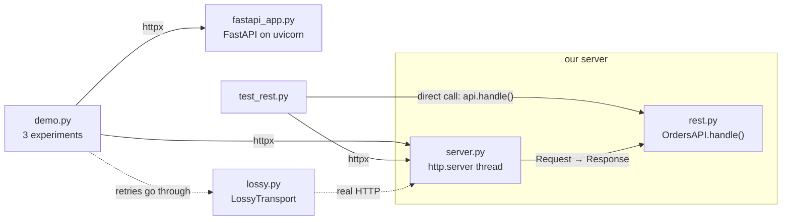

# Code walkthrough: HTTP, REST & Status Codes

> Companion to [README.md](README.md). The README explains the *concept*; this file explains the
> *code*, file by file, so you can read it, change it, and rebuild it yourself.
> Line links (e.g. `rest.py#L55`) point at the exact code.

## File map

| Read | File | Lines | Role |
|---|---|---|---|
| 1 | [`src/rest.py`](src/rest.py) | 139 | The concept: `OrdersAPI`, a pure function from `Request` to `Response` that follows HTTP's rules |
| 2 | [`src/server.py`](src/server.py) | 58 | `serve()`: puts an `OrdersAPI` on a real port with the standard library's `http.server` |
| 3 | [`src/lossy.py`](src/lossy.py) | 41 | `LossyTransport` (loses responses) and `send_with_retries` (what clients do about it) |
| 4 | [`src/fastapi_app.py`](src/fastapi_app.py) | 93 | The same API on FastAPI, for comparison |
| 5 | [`src/demo.py`](src/demo.py) | 147 | Three experiments that print the README's "Expected output" |
| 6 | [`tests/test_rest.py`](tests/test_rest.py) | 119 | Ten tests, each pinning down one promise of HTTP |
| – | [`Makefile`](Makefile) | | `make run` = `uv run python -m src.demo`, `make test` = `uv run python -m pytest tests` |

Read `rest.py` first: every status-code decision in the lesson is in that one file.

## How the pieces fit



The design choice that makes this lesson easy to test: **`OrdersAPI.handle()` knows nothing about sockets.** It
takes a `Request` dataclass and returns a `Response` dataclass. Tests call it directly; `server.py` adapts it to
real HTTP; the demo talks to it over the network with httpx.

## `src/rest.py`, the concept

### `Request`, `Response`, `json_response`, `problem` ([L24](src/rest.py#L24)–[L44](src/rest.py#L44))

```python
@dataclass
class Request:
    method: str
    path: str
    headers: dict[str, str] = field(default_factory=dict)  # names lower-cased
    body: bytes = b""

def problem(status: int, detail: str, **headers: str) -> Response:
    return json_response(status, {"error": detail}, **headers)
```

**What it does:** HTTP reduced to the parts REST cares about. `problem()` builds every error response.

**Why this way:**
- **Header names are lower-cased** on the way in, because HTTP header names are case-insensitive. `If-Match`,
  `if-match` and `IF-MATCH` all have to work.
- **Errors carry a JSON body.** The status code is for machines ("412: re-read and retry"); the body is for the
  human debugging it ("order 1 is at v2, you sent v1").
- **`**headers`** lets callers write `problem(405, "...", Allow="GET, PUT")`, so the header that a status code
  needs sits right next to it.

### `handle` ([L55](src/rest.py#L55)): routing, and the 404 vs 405 split

```python
if req.path == "/orders":
    routes, args = {"GET": self.list, "POST": self.create}, ()
elif match := re.fullmatch(r"/orders/([\w-]+)", req.path):
    routes, args = {"GET": self.read, "PUT": self.replace, "DELETE": self.delete}, (match[1],)
else:
    return problem(404, f"no resource at {req.path}")
if req.method not in routes:
    return problem(405, f"{req.method} not allowed here", Allow=", ".join(routes))
with self._lock:
    return routes[req.method](req, *args)
```

**What it does:** README "How it works" step 1. The path picks the **resource**, and the method picks the
**handler**.

**Why this way:**
- **Two lookups give two different errors.** An unknown path is `404` (no such resource); a known path with an
  unknown method is `405` (the resource exists, the verb doesn't apply). The same dict of routes produces the
  `Allow` header, so it can never drift out of sync with what's implemented.
- **`re.fullmatch`**, not `match`: `/orders/1/extra` must not count as order `1`. `[\w-]+` allows client-chosen
  ids like `op-001`.
- **One lock around every handler.** `http.server` runs each request on its own thread, and the read-check-write
  in `replace` (check the ETag, then save) must not interleave with another request's. Otherwise two `If-Match: v1`
  writes could both pass the check: the very lost update the ETag exists to prevent.

### `read` ([L73](src/rest.py#L73)): ETags and 304

```python
etag = self.etag(oid)
if req.headers.get("if-none-match") == etag:
    return Response(304, {"ETag": etag})  # "your copy is still current": no body sent
return json_response(200, {"id": oid, **self.orders[oid]}, ETag=etag)
```

**What it does:** README step 4, first bullet. If the client already holds the current version, answer `304` with
no body. Otherwise send the full representation and its ETag.

**Why this way:** the server still does the lookup either way. What `304` saves is **transfer**: the body bytes on
the network and the client's parsing. A `304` still carries the ETag, so the client can keep using it.

### `create` ([L82](src/rest.py#L82)): POST, not idempotent

```python
oid = str(self.next_id)
self.next_id += 1
self._save(oid, data)
return json_response(201, {"id": oid, **data}, Location=f"/orders/{oid}", ETag=self.etag(oid))
```

**What it does:** the server picks the id, so every call creates a new order. `201` + `Location` tells the client
where it went.

**Why this way:** this is *why* POST isn't idempotent. **Line notes:** [L87](src/rest.py#L87): `next_id += 1` runs
on every call, including a retry whose first attempt actually succeeded. The server can't tell the difference. That
single line is responsible for the 52 duplicates in section 2.

### `replace` ([L92](src/rest.py#L92)): PUT, idempotent

```python
if failed := self._precondition_failed(req, oid):
    return failed
created = oid not in self.orders
self._save(oid, data)
headers = {"ETag": self.etag(oid), **({"Location": f"/orders/{oid}"} if created else {})}
return json_response(201 if created else 200, {"id": oid, **data}, **headers)
```

**What it does:** "make `/orders/{oid}` exactly this". It creates the order (`201`) if it doesn't exist and replaces
it (`200`) if it does.

**Why this way:** the **client** names the resource, so a retry targets the same key and overwrites it with the
same data. The state after N attempts equals the state after one. Notice that the *response* differs (`201`, then
`200`): idempotency is about state, not identical responses. The precondition check comes first, so a stale write
changes nothing.

### `delete` ([L104](src/rest.py#L104))

Returns `404` if the order is gone, `204 No Content` after deleting. Calling it twice gives `204` then `404`, and
the order is absent after both, which is why DELETE counts as idempotent.

### `etag`, `_save` and `_precondition_failed` ([L112](src/rest.py#L112)–[L128](src/rest.py#L128))

```python
def etag(self, oid):
    return f'"v{self.versions[oid]}"'

def _save(self, oid, data):
    self.orders[oid] = data
    self.versions[oid] = self.versions.get(oid, 0) + 1

def _precondition_failed(self, req, oid):
    expected = req.headers.get("if-match")
    if not self.check_preconditions or expected is None:
        return None
    current = self.etag(oid) if oid in self.orders else None
    if current is None or expected not in ("*", current):
        return problem(412, f"order {oid} is at {current}, you sent If-Match {expected}")
```

**What it does:** every write goes through `_save`, which bumps the version. The ETag is that version in quotes.
`_precondition_failed` compares the client's `If-Match` with it.

**Why this way:**
- **One write path means the ETag can't go stale.** Nothing writes `self.orders` without `_save`, so every change
  gets a new ETag (README gotcha: "ETags that don't change").
- **The quotes are part of the value.** The spec writes ETags as quoted strings (`"v2"`), and clients send them back
  byte for byte.
- **`If-Match: *`** means "only if it exists at all". **No `If-Match` header** means "no precondition": the write
  goes ahead. A stricter API would answer `428 Precondition Required` instead (exercise 2).
- **`check_preconditions`** is the *Break it* switch. Turn it off, and every client that carefully sends `If-Match`
  is silently ignored.

### `parse_order` ([L131](src/rest.py#L131)): 400 vs 422

```python
try:
    data = json.loads(body)
except ValueError:
    return problem(400, "body is not valid JSON")
if (not isinstance(data, dict) or set(data) != set(FIELDS)
        or any(type(data[k]) is not t for k, t in FIELDS.items()) or data["qty"] < 1):
    return problem(422, 'expected {"item": string, "qty": integer >= 1}')
```

**What it does:** two different failures, two different codes. If the body can't be parsed at all, that's a
malformed request (`400`). If it's valid JSON with the wrong content, that's unprocessable (`422`).

**Line notes:** `type(data[k]) is not t` rather than `isinstance`: in Python, `True` is an instance of `int`, so
`isinstance` would accept `{"qty": true}`. **Returning a `Response` instead of raising** keeps callers short:
`if isinstance(data, Response): return data`.

## `src/server.py`, putting it on the wire

```python
class _Handler(BaseHTTPRequestHandler):
    protocol_version = "HTTP/1.1"  # keep connections alive between requests

    def _dispatch(self) -> None:
        body = self.rfile.read(int(self.headers.get("Content-Length", 0)))
        headers = {name.lower(): value for name, value in self.headers.items()}
        resp = self.server.api.handle(Request(self.command, self.path, headers, body))
        self.send_response(resp.status)
        ...
        if resp.status not in NO_BODY:
            self.send_header("Content-Length", str(len(resp.body)))

    do_GET = do_POST = do_PUT = do_DELETE = do_PATCH = _dispatch
```

**What it does:** `http.server` parses the request ([lesson 1](../01-how-the-web-works/README.md) did that by hand)
and calls `do_<METHOD>`. Every method goes to the same `_dispatch`, which converts to our `Request`, calls the API,
and writes the `Response` back.

**Why this way:**
- **`do_PATCH` is wired too,** even though the API doesn't support PATCH. Otherwise `http.server` would answer
  `501 Not Implemented` by itself, and the API would never get to say `405` + `Allow`. Routing decisions stay in
  `rest.py`.
- **`protocol_version = "HTTP/1.1"`** turns on keep-alive. The default `HTTP/1.0` would close every connection.
- **`NO_BODY = {204, 304}`** ([L16](src/server.py#L16)): those responses can't have a body, and a `204` must not
  carry `Content-Length` at all.
- **`serve()`** ([L48](src/server.py#L48)) binds port 0 (any free port), runs `serve_forever` on a daemon thread,
  and calls `shutdown()` on exit. Unlike lesson 1's servers, `http.server` provides a clean shutdown.

## `src/lossy.py`, a network that loses responses

```python
def handle_request(self, request):
    self.sent += 1
    response = self._inner.handle_request(request)
    response.read()  # the server has fully answered...
    if self._rng.random() < self.drop:
        response.close()
        raise httpx.ReadTimeout("response lost on the way back", request=request)  # ...but we never hear it
    return response
```

**What it does:** an httpx **transport** is the layer that actually sends requests. This one wraps the normal
transport, lets the request complete, and then sometimes pretends the response never arrived.

**Why this way:**
- **It loses responses, not requests.** That's the dangerous case. A lost request is harmless to retry; a lost
  response means the work happened and the client doesn't know.
- **`ReadTimeout`** is exactly what httpx raises when a real server's reply doesn't arrive, so `send_with_retries`
  ([L34](src/lossy.py#L34)) can't tell this simulation from the real thing.
- **`random.Random(seed)`** makes the same responses get lost on every run, and for both methods in section 2. That's
  why POST and PUT both show 152 requests.

`send_with_retries` is the naive client most code really contains: catch the timeout, try again, up to 10 times.

## `src/fastapi_app.py`, the comparison

```python
class Order(BaseModel):
    item: str
    qty: int = Field(ge=1)

@app.put("/orders/{oid}")
def replace(oid: str, order: Order, if_match: str | None = Header(None)) -> Response:
    if if_match is not None and (oid not in orders or if_match not in ("*", etag(oid))):
        return JSONResponse({"error": "precondition failed"}, 412)
```

**What it does:** the same routes and rules. FastAPI parses the path (`{oid}`), the body (into `Order`) and the
headers (`if_match` reads the `If-Match` header).

**Why this way:** it shows what a framework does for you and what it doesn't. It gives you validation (`422` from
`Field(ge=1)`) and `405` for free. ETags, `304` and `412` are still lines you write. That's also where the one
disagreement in section 1 comes from: FastAPI reports unparsable JSON as `422`, because it treats every bad body as
a validation error.

**Line notes:** `build_app()` keeps its state in local variables (closures) rather than module globals, so the demo
and each test get a fresh, empty API. `run_uvicorn` is the same background-thread helper as lesson 1's.

## `src/demo.py`, making it visible

| Experiment | Line | Setup | What it measures | README output |
|---|---|---|---|---|
| 1. The conversation | [L63](src/demo.py#L63) | `SCRIPT`'s 11 requests, sent to our server and to FastAPI | Status code and key headers per request; where the two disagree | The 11-row table |
| 2. Retries | [L80](src/demo.py#L80) | 100 orders through `LossyTransport(DROP, seed=42)`: once as POST, once as PUT to `/orders/op-NNN` | Requests that reached the server, orders stored, duplicates | 152 / 152 / 52 vs 152 / 100 / 0 |
| 3a. Polling | [L97](src/demo.py#L97) | 8 GETs sending the last ETag; one edit after poll 4 | Status sequence, body bytes downloaded | `200 304 304 304 \|edit\| 200 …` |
| 3b. Lost update | [L97](src/demo.py#L97) | Alice and Bob both read v1 and both write, with and without `If-Match` | Each PUT's status, Bob's retry, the final order | `pencil × 1 LOST` vs `pencil × 5 kept` |

**Details worth noticing:**
- **ETags in `SCRIPT` are hard-coded** (`'"v1"'`). That works because both servers number versions the same way.
  A real client would take the value from the previous response's `ETag` header, as section 3 does.
- **`send()`** ([L50](src/demo.py#L50)) sends `bytes` raw (for the malformed `{oops` body) and dicts as JSON.
- **Bob's retry** ([L129](src/demo.py#L129)) re-reads, then re-applies *only his own change* (the item name) on top
  of the fresh copy, keeping Alice's quantity. That's the merge a real client must do after a `412`.

## Tests: what each one proves

| Test | Property it proves | Why that property matters |
|---|---|---|
| [`test_post_creates_with_201_location_and_etag`](tests/test_rest.py#L20) | POST answers `201`, `Location: /orders/1`, `ETag: "v1"`; a GET returns what was stored | The client learns where the new resource lives without guessing |
| [`test_get_is_safe_it_changes_nothing`](tests/test_rest.py#L27) | Ten GETs leave orders and versions untouched | Caches, crawlers and prefetchers may call GET freely |
| [`test_matching_if_none_match_gets_304…`](tests/test_rest.py#L37) | Current ETag → `304` with empty body; after an edit → `200` | Revalidation saves transfer but never serves stale data |
| [`test_stale_if_match_is_refused_with_412…`](tests/test_rest.py#L46) | A write with an old ETag gets `412` and the stored qty stays 2 | Optimistic concurrency: a stale writer can't overwrite |
| [`test_wrong_method_is_405…`](tests/test_rest.py#L54) | `PATCH` → `405`, `Allow: GET, PUT, DELETE` | The client learns which verbs would work |
| [`test_unreadable_body_is_400…`](tests/test_rest.py#L59) | Bad JSON → `400`; wrong fields or `qty 0` → `422`; nothing created | Clients can tell "fix the encoding" from "fix the data" |
| [`test_put_and_delete_are_idempotent_post_is_not`](tests/test_rest.py#L67) | 3 PUTs → 1 order (`201, 200, 200`); 3 POSTs → 3 orders; DELETE twice → `204, 404`, still gone | The definition of idempotency, checked on state |
| [`test_retries_after_lost_responses…`](tests/test_rest.py#L78) | Over a lossy network, POST stores more than 50 orders and PUT exactly 50 | Why idempotency matters in practice |
| [`test_if_match_prevents_the_lost_update`](tests/test_rest.py#L105) | Final qty: 1 without `If-Match`, 5 with it, 1 again if the server doesn't check | The lost update, its fix, and who must enforce it |
| [`test_fastapi_version_gives_the_same_answers…`](tests/test_rest.py#L111) | Both servers answer `201`, `304`, `412`, `404`, `204` over real HTTP | The rules are the protocol's, not our framework's |

Most tests call `api.handle()` directly through the `call()` helper ([L12](tests/test_rest.py#L12)): no server, no
threads, instant. Only the retry and FastAPI tests need real HTTP.

## Trace one run

Real values, printed by calling `OrdersAPI.handle()` directly, then by running the lossy client.

**A stale write, step by step:**

| Step | Call | Result |
|---|---|---|
| 1 | `POST /orders {"item": "book", "qty": 1}` | `201`, `Location: /orders/1`, `ETag: "v1"`; `next_id` → 2, `versions` → `{'1': 1}` |
| 2 | `PUT /orders/1 {…qty 2}`, `if-match: "v1"` | `handle` → `re.fullmatch` gives `match[1] = '1'` → `replace`. The precondition passes (`"v1"` is current) → `_save` → `200`, `ETag: "v2"`, `versions` → `{'1': 2}` |
| 3 | `PUT /orders/1 {…qty 3}`, `if-match: "v1"` | `_precondition_failed`: `expected = '"v1"'`, `current = '"v2"'` → `412`, body `{"error": "order 1 is at \"v2\", you sent If-Match \"v1\""}`. State still `{'1': {'item': 'book', 'qty': 2}}` |
| 4 | `PATCH /orders/1` | `'PATCH' not in routes` → `405`, `Allow: GET, PUT, DELETE` |
| 5 | `GET /orders/1`, `if-none-match: "v2"` | matches `etag('1')` → `304`, headers `{'ETag': '"v2"'}`, body `b''` |

**The lossy network, first five operations** (`LossyTransport(0.3, seed=42)`). The generator's first eight draws
are `0.639, 0.025, 0.275, 0.223, 0.736, 0.677, 0.892, 0.087`. Every draw below 0.3 loses a response:

| Operation | Requests sent | POST stored | PUT stored |
|---|---|---|---|
| `item-0` | 1 (0.639: delivered) | order `1` | `op-000` (version 1) |
| `item-1` | **4** (0.025, 0.275, 0.223 lost; 0.736 delivered) | orders `2`, `3`, `4`, `5`: four copies | `op-001`, written four times: **version 4** |
| `item-2` | 1 | order `6` | `op-002` |
| `item-3` | 1 | order `7` | `op-003` |
| `item-4` | 2 (0.087 lost, then delivered) | orders `8`, `9` | `op-004` (version 2) |

After five operations, POST holds **9** orders and PUT holds **5**. Look at PUT's versions: `op-001` was rewritten
four times with identical data, so its ETag went from `"v1"` to `"v4"`. The state is idempotent; this ETag scheme
isn't. A client that cached `"v1"` would re-download an unchanged body. Exercise 1 fixes that.

## Python techniques used

| Technique | Where | Why it's used here |
|---|---|---|
| `@dataclass` + `field(default_factory=dict)` | `Request`, `Response` | Plain data holders; each instance gets its own headers dict |
| `**headers` keyword arguments | `json_response`, `problem` | `problem(405, "...", Allow="GET")`: the header right where the code is chosen |
| Walrus `:=` | `handle`, `replace`, `delete` | `elif match := re.fullmatch(...)` and `if failed := self._precondition_failed(...)` test and keep a value in one line |
| A dict of bound methods as a router | `handle` | `{"GET": self.read, ...}`: the same dict routes requests and builds `Allow` |
| `re.fullmatch` with a capture group | `handle` | Matches the whole path; `match[1]` is the id |
| `type(x) is int` vs `isinstance` | `parse_order` | Rejects `True`, which `isinstance(True, int)` would accept |
| `threading.Lock` as a context manager | `handle` | Makes check-then-write atomic across request threads |
| `BaseHTTPRequestHandler`, `do_GET = do_POST = … = _dispatch` | `server.py` | One method serves every verb; the standard library does the parsing |
| Subclassing `httpx.BaseTransport` | `lossy.py` | Inject failures under a real client, without mocks |
| `random.Random(seed)` | `LossyTransport` | Reproducible "random" losses |
| `@contextmanager` | `serve`, `run_uvicorn` | `with serve(api) as base:` starts and stops a server around a block |
| Closures over local state | `build_app` | Each FastAPI app gets its own private store |
| pydantic `BaseModel`, `Field(ge=1)`, FastAPI `Header(None)` | `fastapi_app.py` | Declarative validation and header parsing, for comparison |

## Design decisions & alternatives

| Decision | Alternative | Why this one, for learning |
|---|---|---|
| A pure `handle(Request) -> Response` core | Write the logic inside the HTTP handler | Testable without a network; the HTTP plumbing can't hide a semantics bug |
| Version-counter ETags (`"v3"`) | A hash of the representation (content ETags) | Easy to read in traces. The cost: an identical rewrite still changes the ETag (the trace above). Exercise 1 |
| PUT creates or replaces | PUT only replaces (404 if missing), creation via POST only | Shows the retry-safe way to create, which is the point of section 2 |
| No `If-Match` header = write allowed | Require it: `428 Precondition Required` | Simpler for clients. Exercise 2 makes the API strict |
| `http.server` for our side | Lesson 1's raw sockets | Parsing was lesson 1; here the focus stays on semantics |

## Change it yourself

### 1. Content-based ETags (easy)

**Goal:** derive the ETag from the content (e.g. the first 8 hex digits of a SHA-256 of the canonical JSON), so
identical rewrites keep the same ETag.
**Change:** `OrdersAPI.etag` (and `_save`, if you drop `versions`) in `src/rest.py`.
**Check:** `make test` still passes, apart from tests that assert `"v1"`; update those to read the ETag from the
response. In the trace above, `op-001` should keep a single ETag across its four identical writes.

<details><summary>Hint</summary>

`hashlib.sha256(json.dumps(self.orders[oid], sort_keys=True).encode()).hexdigest()[:8]`, wrapped in quotes.
`sort_keys=True` matters: `{"a":1,"b":2}` and `{"b":2,"a":1}` are the same representation and must get the same
ETag. Then think about the trade-off. Content ETags can repeat: change qty 1 → 2 → 1, and the ETag returns to an
old value. That's fine for `If-None-Match`, but it means `If-Match` can't tell "unchanged" from "changed and
changed back" (the classic ABA problem).
</details>

### 2. Require preconditions: 428 (medium)

**Goal:** refuse PUT and DELETE on an *existing* order unless the request carries `If-Match`, answering
`428 Precondition Required`. Creating a new order with PUT stays allowed.
**Change:** `_precondition_failed` in `src/rest.py`, plus a test.
**Check:** in section 3b's no-`If-Match` row, *both* PUTs now fail with `428`: nobody can write blind, so nobody
can silently overwrite anyone. Add a test asserting `428` for a PUT without `If-Match` on an existing order.

<details><summary>Hint</summary>

When `expected is None and oid in self.orders`, return `problem(428, "send If-Match with the ETag you last read")`.
This is the server enforcing optimistic concurrency for every client, rather than trusting each one to opt in. It's
what *Break it*, experiment 2, argues for.
</details>

### 3. Idempotency keys for POST (hard)

**Goal:** make section 2's POST row show 0 duplicates *without* switching to PUT. The client sends
`Idempotency-Key: <uuid>` with each logical order; the server remembers each key's response and replays it for
any retry.
**Change:** `OrdersAPI.create` in `src/rest.py`; in `demo.py`, send a key per operation (the same key on every
retry of that operation).
**Check:** `make run`, section 2: POST stores 100 orders. Add a test that sends the same key twice and gets the
same `Location` back both times.

<details><summary>Hint</summary>

Keep `self.seen: dict[str, Response] = {}`. In `create`, if the key is present and in `seen`, return the stored
response; otherwise create as usual, store the response under the key, and return it. Questions a real
implementation must answer, and that the [Idempotency Keys](../../04-messaging/04-idempotency/README.md) lesson
covers:

- What if the same key arrives with a *different* body? Reject it with `422`.
- What if two retries with the same key arrive at the same moment? You need the lock, which you already have.
- How long do you keep keys? Stripe keeps them for 24 hours.
</details>
