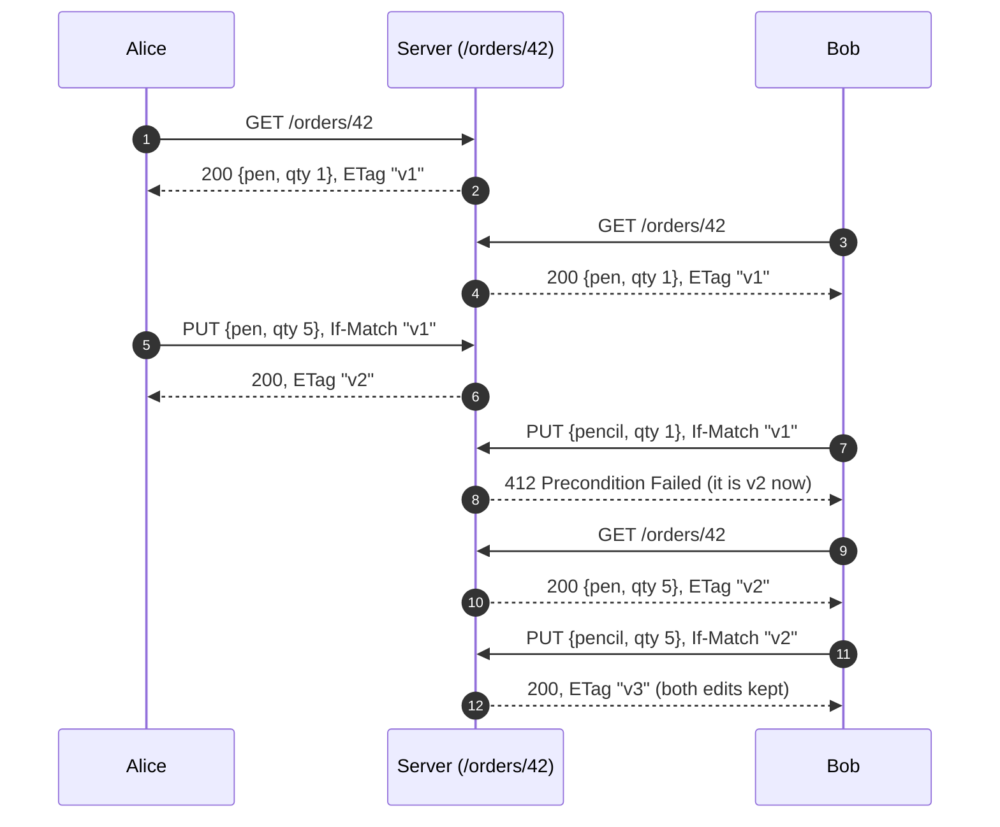

# HTTP, REST & Status Codes

> **Module:** 00 Foundations · **Difficulty:** ●○○○○ · **Time:** ~40 min · **Prereqs:** [Client-Server & the Request Lifecycle](../01-how-the-web-works/README.md)

## TL;DR

REST models an API as **resources** (nouns at URLs) acted on by a few HTTP **methods** (verbs) whose meaning
everyone agrees on, with **status codes** that say what happened. Those shared rules let clients, caches and
proxies know what's safe to retry, what's safe to cache, and whose fault an error is, without reading your docs.

## Explain like I'm 5

Your classroom has **cubbies with name labels**, and a teacher who looks after them.

- You can ask the teacher to **look** in cubby 7, or **put this exact thing** in cubby 7, or **empty** cubby 7,
  or **add a new thing in any free cubby**.
- The teacher answers with a **coloured card**. **Green**: done. **Blue**: "you already have the newest one" or
  "it moved over there". **Yellow**: "you asked wrong, fix it". **Red**: "sorry, my mistake".
- If you shout "put my drawing in cubby 7!" twice because you weren't sure she heard, there's still **one**
  drawing in cubby 7. If you shout "add my drawing to a free cubby!" twice, you end up with **two** drawings.
- Every drawing has a **sticker number** that changes whenever someone swaps it. Say "swap it, but only if
  it's still sticker 3", and you'll never throw away a friend's new drawing by mistake.

| In the story | In HTTP and REST |
|---|---|
| A cubby with a label | A **resource** at a **URI** (uniform resource identifier): `/orders/7` |
| The thing inside | Its **representation**: here, JSON `{"item": "lamp", "qty": 1}` |
| Look / put this exact thing / empty / add a new one | **GET** / **PUT** / **DELETE** / **POST** |
| Green / blue / yellow / red card | Status code classes **2xx** / **3xx** / **4xx** / **5xx** |
| "Put it in cubby 7" twice, still one drawing | **PUT is idempotent**: repeating it gives the same state |
| "Add to a free cubby" twice, two drawings | **POST is not idempotent**: each one creates something new |
| The sticker number | The **ETag**: a version tag for the representation |
| "Only if it's still sticker 3" | **If-Match**: a precondition, refused with **412** if the version changed |
| "You already have the newest one" | **304 Not Modified**, the answer to **If-None-Match** |

**Real world:** **GitHub's REST API** works exactly like this. Every repository, issue and pull request is a
resource at its own URL, and responses carry ETags. A client that polls with `If-None-Match` and gets a `304`
doesn't download the body again, and GitHub doesn't count that request against the client's rate limit.

## Technical deep dive

### The problem

An API is a contract between programs written by people who never meet. If every API invents its own verbs
("doCreateOrder", "getOrderNow") and reports errors its own way (`200 OK` with `{"ok": false}`), every client
needs custom code. Worse, generic infrastructure (browsers, caches, proxies, retry libraries, monitoring) can't
tell a read from a write, or a typo from an outage.

HTTP already defines the vocabulary. REST (Roy Fielding, 2000) is the style of using it as intended:

- name things with URIs,
- use methods for what they mean,
- keep each request self-contained (**stateless**: the server keeps no per-client session between requests),
- say what happened with the status code.

### How it works

1. **Resources and URIs.** `/orders` is the collection; `/orders/42` is one order. URIs are nouns. The verb is
   the method.
2. **Methods carry promises** ([RFC 9110](https://www.rfc-editor.org/rfc/rfc9110)). A **safe** method changes
   nothing, so anyone may call it any time. An **idempotent** method has the same effect whether it's sent once
   or many times, so it may be retried blindly:

   | Method | Meaning | Safe | Idempotent | Typical success |
   |---|---|---|---|---|
   | GET | Read a representation | ✅ | ✅ | 200 (or 304) |
   | PUT | Make this URI hold exactly this | ❌ | ✅ | 200, or 201 if it created it |
   | DELETE | Remove it | ❌ | ✅ | 204 (a repeat gets 404, but the state is the same) |
   | POST | Process this, often "create a new child" | ❌ | ❌ | 201 + `Location` |
   | PATCH | Apply this partial change | ❌ | not guaranteed | 200 |

3. **The status code is the first thing a client reads.** It tells the client what to do next:

   | Code | Meaning | What the client should do |
   |---|---|---|
   | 200 OK / 201 Created / 204 No Content | It worked (201: the new URI is in `Location`; 204: no body) | Carry on |
   | 304 Not Modified | Your cached copy is current | Use the cached copy |
   | 301 / 308, 302 / 307 | Moved permanently / temporarily (307 and 308 keep the method) | Follow `Location` |
   | 400 Bad Request | Can't parse the request | Fix it; never retry as is |
   | 401 Unauthorized / 403 Forbidden | Who are you? (no or bad credentials) / I know who you are, and no | Log in / give up |
   | 404 Not Found / 405 Method Not Allowed | No such resource / wrong verb (`Allow` lists the right ones) | Fix the URI or the method |
   | 409 Conflict / 412 Precondition Failed | Clashes with the current state / your `If-Match` version is stale | Re-read, then decide |
   | 422 Unprocessable Content | Parsed fine, but the data is invalid | Fix the fields |
   | 429 Too Many Requests | Slow down | Wait for `Retry-After`, then retry |
   | 500 Internal Server Error | The server broke | Maybe retry, if the method is idempotent |
   | 502 / 503 / 504 | A proxy got a bad answer / server overloaded or down / a proxy timed out waiting | Retry later with backoff, if idempotent |

4. **ETags and conditional requests.** The server tags each version of a representation (`ETag: "v2"`). Clients
   send it back:
   - `If-None-Match: "v2"` on a GET means "only send it if it changed". Unchanged → **304** with no body.
   - `If-Match: "v2"` on a PUT or DELETE means "only apply this if it's still v2". Changed → **412**, and nothing
     is written. This is **optimistic concurrency**: no locks, just a version check at write time.



### Trade-offs

| Choice | Gain | Cost |
|---|---|---|
| REST resources and methods vs RPC-style endpoints (`POST /createOrder`) | Caches, proxies and retry logic understand GET/PUT/DELETE without your docs | Actions that aren't create/read/update/delete (cancel, refund) need a convention, such as `POST /orders/42/cancel` |
| PUT to a client-chosen URI vs POST to a collection | Creation becomes retry-safe (0 duplicates in section 2) | The client must generate unique IDs (UUIDs), and the URI scheme becomes part of the contract |
| POST plus an idempotency key | Retry-safe POST while the server keeps choosing IDs | The server must store keys and their responses ([Idempotency Keys](../../04-messaging/04-idempotency/README.md)) |
| ETag + `If-Match` vs locking the record while someone edits | No lock held across requests; works with stateless servers | Clients must handle 412 by re-reading; a heavily edited record means many retries |
| Precise status codes vs `200` with an error inside the body | Clients, caches and dashboards see the real outcome | Teams must agree on the edge cases (400 vs 422: we and FastAPI disagree in section 1) |

### Failure modes & gotchas

- **Retrying POST after a timeout.** A lost response looks exactly like a lost request. In section 2, with 30% of
  responses lost, 100 intended orders became **152**. Retry only idempotent requests, or make POST idempotent
  with a key. Payment APIs (Stripe's `Idempotency-Key`) exist because of this.
- **Lost updates.** Two clients read v1 and both write. Without `If-Match` the second write silently erases the
  first (section 3: Alice's `qty 5` was lost). The fix only works if the **server** checks the precondition
  (*Break it*, experiment 2).
- **Errors disguised as `200 OK`.** Caches store them, monitoring counts them as successes, and clients can't tell
  "retry" from "give up". Use the status code; put the details in the body.
- **GET with side effects.** Crawlers, link prefetchers and caches call GET freely because it's supposed to be
  safe. In 2005, Google's Web Accelerator prefetched links in web apps that used plain GET links for "delete", and
  deleted users' data.
- **Retrying the wrong failures.** Retrying a `400` or a `422` will fail forever. Giving up on a `503` turns a brief
  blip into an error for the user. 4xx means "change the request"; 429 and 5xx mean "the same request may work
  later" (back off: [Retries & Backoff](../../07-reliability/02-retries-backoff/README.md)).
- **ETags that don't change.** If an ETag stays the same after an edit (say it's derived from a field you forgot to
  include), clients keep getting `304` and show stale data. Bump it on *every* change, as `_save` does here.

### When NOT to use it

- **A screen needs data from many resources at once.** Many round trips, or over-fetching whole representations.
  GraphQL lets the client ask for exactly the fields it needs ([REST vs gRPC vs GraphQL](../04-rest-grpc-graphql/README.md)).
- **Internal, high-volume service-to-service calls** with strict schemas or streaming: gRPC is faster and typed.
- **The server must push updates** (live prices, chat): use SSE or WebSockets
  ([Polling, SSE & WebSockets](../../08-observability-and-architecture/05-realtime-communication/README.md)).
- **The operation isn't resource-shaped** ("run this report", "transfer money between accounts"): forcing it into
  CRUD verbs makes it harder to read. A clearly named `POST` endpoint is fine.

## Implementation

Five small files in [`src/`](src/). The REST rules are hand-written in plain Python; the standard library's
`http.server` puts them on the wire, and FastAPI is the real-framework comparison.

| File | What it holds |
|---|---|
| [`rest.py`](src/rest.py) | `OrdersAPI`: routing, methods, status codes, ETags and preconditions, as a pure function of the request |
| [`server.py`](src/server.py) | `serve()`: runs an `OrdersAPI` behind `http.server` on a free port |
| [`fastapi_app.py`](src/fastapi_app.py) | The same API on FastAPI and uvicorn |
| [`lossy.py`](src/lossy.py) | `LossyTransport`: an httpx transport that delivers requests but loses some responses |
| [`demo.py`](src/demo.py) | The three experiments below |

The key ideas in the code:

- **`handle()` maps (method, path) to a handler.** A known path with an unknown verb becomes `405` + `Allow`.
- **Idempotency lives in the data model:** PUT writes to a client-chosen key, and POST mints a new one.
- **Every write bumps a version.** The ETag is that version, and `If-Match` compares against it.

**Full explanation of the code, with a traced request, Python techniques and exercises:
[CODE_WALKTHROUGH.md](CODE_WALKTHROUGH.md).**

## Run it

```bash
cd modules/00-foundations/03-http-rest
make up     # no infrastructure needed for this lesson
make run    # run the demo
make test   # prove the behaviour
make down
```

## Expected output

```text
==============================================================================
 HTTP, REST & status codes: the conversation, retries, ETags
==============================================================================

1) A REST conversation: the status code says what happened and what to do next
  request                                                  our server                 headers that matter              FastAPI
  -------------------------------------------------------  -------------------------  -------------------------------  --------------
  POST /orders {"item":"book","qty":1}                     201 Created                Location: /orders/1, ETag: "v1"  201
  GET /orders/1                                            200 OK                     ETag: "v1"                       200
  GET /orders/1  [If-None-Match: "v1"]                     304 Not Modified           ETag: "v1"                       304
  PUT /orders/1 {"item":"book","qty":2}  [If-Match: "v1"]  200 OK                     ETag: "v2"                       200
  PUT /orders/1 {"item":"book","qty":3}  [If-Match: "v1"]  412 Precondition Failed                                     412
  PATCH /orders/1 {"qty":4}                                405 Method Not Allowed     Allow: GET, PUT, DELETE          405
  POST /orders {oops                                       400 Bad Request                                             422  ← differs
  POST /orders {"item":"pen","qty":0}                      422 Unprocessable Content                                   422
  GET /orders/99                                           404 Not Found                                               404
  DELETE /orders/1                                         204 No Content                                              204
  DELETE /orders/1                                         404 Not Found                                               404
  → 2xx: it worked. 3xx: use what you have, or look elsewhere. 4xx: fix the request. 5xx: the server failed.

2) Retrying over a lossy network: 100 orders, 30% of responses lost, the client retries
  method                          orders meant  requests that reached the server  orders stored  duplicates
  ------------------------------  ------------  --------------------------------  -------------  ----------
  POST /orders                    100           152                               152            52
  PUT /orders/{client-chosen id}  100           152                               100            0
  → a lost response looks like a lost request, so clients retry. POST isn't idempotent: every retry
    that follows a lost response creates another order. PUT to a named URI just rewrites the same one.

3) ETags, part 1: polling an order 8 times with If-None-Match (it changes after poll 4)
  statuses: 200 304 304 304 |edit| 200 304 304 304
  body bytes downloaded: 74 (without ETags: 8 × 37 = 296)
  → 304 Not Modified means "the copy you have is current": the body is skipped, only headers travel.

   ETags, part 2: Alice and Bob edit the same order at once (the server checks If-Match)
  clients send   Alice's PUT  Bob's PUT  Bob's retry           final order  Alice's qty change
  -------------  -----------  ---------  --------------------  -----------  ------------------
  no If-Match    200          200        —                     pencil × 1   LOST
  with If-Match  200          412        200 after re-reading  pencil × 5   kept
  → without a precondition, the last writer silently wins. 412 turns that into an error Bob can handle.
```

```text
uv run python -m pytest tests
..........                                                               [100%]
10 passed in 1.72s
```

Every number above is the same on every run: the lost responses come from a seeded random generator.

**What you're seeing:**

1. **The conversation.** Each step gets the code a generic client can act on:
   - The create returns `201` with `Location` (where the new order lives) and its first ETag.
   - The repeat GET with `If-None-Match` gets `304`, with no body.
   - The PUT carrying the *old* ETag `"v1"` gets `412`, because the order is at `"v2"` by then.
   - `PATCH` gets `405`, and `Allow` lists the verbs that would work.
   - The second DELETE gets `404`, yet the state is identical to after the first: idempotent.

   FastAPI agrees on every code except unparsable JSON: we say `400` (we couldn't even read it), FastAPI says
   `422` (any request it can't validate).
2. **Retries.** The same seeded network lost the same 52 responses for both methods, so both clients sent 152
   requests. Every POST retry created a new order: **52 duplicates**. Every PUT retry rewrote the order it had
   already written: **0 duplicates**.
3. **ETags.** Polling sent 2 full bodies in 8 polls: the first, and the one after the edit. Everything else was
   `304`. With bigger bodies (KBs of JSON, images), that's most of the bandwidth saved. In part 2, without
   `If-Match`, Bob's write erased Alice's `qty 5`. With it, Bob got `412`, re-read v2, and re-applied his change
   on top: `pencil × 5`, so both edits survive.

## Break it

**Experiment 1: a worse network.**

```bash
DROP=0.6 make run
```

```text
2) Retrying over a lossy network: 100 orders, 60% of responses lost, the client retries
  method                          orders meant  requests that reached the server  orders stored  duplicates
  ------------------------------  ------------  --------------------------------  -------------  ----------
  POST /orders                    100           262                               262            162
  PUT /orders/{client-chosen id}  100           262                               100            0
```

The duplicates grow with the loss rate (52 → **162**: more orders created by accident than on purpose), but PUT
stays at exactly 100 however bad the network gets. That's the practical meaning of "idempotent": a client can
retry until it hears back, and nothing goes wrong.

**Experiment 2: a server that ignores preconditions.**

```bash
PRECONDITIONS=off make run
```

```text
   ETags, part 2: Alice and Bob edit the same order at once (the server IGNORES If-Match)
  clients send   Alice's PUT  Bob's PUT  Bob's retry  final order  Alice's qty change
  -------------  -----------  ---------  -----------  -----------  ------------------
  no If-Match    200          200        —            pencil × 1   LOST
  with If-Match  200          200        —            pencil × 1   LOST
```

The clients did everything right, but the server accepted Bob's stale write with a `200`, and Alice's change is
gone. **Optimistic concurrency is enforced by the server, not requested by the client.** If an API documents
ETags but doesn't check `If-Match`, you get lost updates with no error anywhere.

## Real-world systems

| System | How it uses this |
|---|---|
| GitHub REST API | Resources at URLs, ETags on responses; a `304` to a conditional request isn't counted against your rate limit |
| Stripe API | `Idempotency-Key` header on POST, so a retried payment is never charged twice |
| Kubernetes API server | Every object has a `resourceVersion`; an update based on a stale version is rejected (`409 Conflict`), the same idea as `If-Match` |
| Amazon S3 | ETags on objects, `If-None-Match` for caching, and conditional writes (`If-Match` / `If-None-Match` on PUT) |
| CDNs and browsers | Revalidate cached copies with `If-None-Match` and serve the cached body on `304` ([CDNs & Edge Caching](../../01-scaling-and-traffic/05-cdn/README.md)) |
| FastAPI / Starlette | Generates `405` with `Allow` for you and `422` for invalid bodies; ETags and preconditions are up to you |

## Interview angle

**Q1. What's the difference between PUT, POST and PATCH, and why does it matter for retries?**
PUT replaces the resource at a known URI with the full representation you send. It's idempotent, so retrying it
is harmless. POST asks the server to process something, usually to create a new resource whose URI the server
picks. It isn't idempotent, so a retry after a lost response creates a duplicate. PATCH applies a partial change
and is idempotent only if the patch is ("set qty to 5" is, "add 1 to qty" isn't). Since timeouts make clients
retry, idempotency decides whether retries are safe. For POST, add an idempotency key.

**Q2. Explain 401 vs 403, 400 vs 422, and 502 vs 503 vs 504.**
- **401** means you're not authenticated (send credentials); **403** means you are, and you still aren't allowed.
- **400** means the request couldn't be parsed; **422** means it parsed, but the content is invalid.
- **502**: a gateway or proxy got an invalid answer from the server behind it. **503**: the server is overloaded
  or down for maintenance, often with `Retry-After`. **504**: the gateway timed out waiting for the server.

The 5xx codes are worth retrying with backoff if the request is idempotent; 400, 403 and 422 are not.

**Q3. Two users edit the same record through your REST API. How do you stop one silently overwriting the other?**
Optimistic concurrency. Return an `ETag` (or a version field) with every read. Require writes to send
`If-Match` with that value, and have the server reject a mismatch with `412`. You can also refuse writes that have
no precondition at all, with `428 Precondition Required`. The losing client re-reads, merges or asks the user, and
retries. The alternative, holding a lock while someone edits, needs server-side session state and lock timeouts.
It breaks the stateless model, so it's only worth it when conflicts are frequent and expensive.

## Self-check quiz

1. What does "idempotent" mean? Which of GET, PUT, DELETE, POST and PATCH are idempotent, and how can DELETE be
   idempotent when a second DELETE returns 404?
2. What does a client have to send to get a `304`, and what does the server send back with it?
3. A mobile app sends `POST /payments`, the request times out, the app retries, and the customer is charged twice.
   What happened, and what are two ways to fix it?
4. Your client gets `503` with `Retry-After: 30` on one call, and `422` on another. What should it do in each case?
5. You're designing an API for editing shared documents. Compare ETags with `If-Match` against locking a document
   while someone has it open. When would you pick each?

<details>
<summary>Answers</summary>

1. Sending it once or several times leaves the server in the same state. GET, PUT and DELETE are idempotent; POST
   isn't; PATCH depends on the patch. Idempotency is about the **effect on state**, not the response: after the
   first DELETE the order is gone, and after the second it's still gone. The 404 just reports that.
2. The `ETag` from an earlier response, in `If-None-Match`. If the representation hasn't changed, the server sends
   `304 Not Modified` with headers (including the ETag) and **no body**, and the client reuses its cached copy.
3. The first request reached the server and charged the card, but the response was lost, so the app couldn't tell
   it had succeeded. Its retry was a second POST, a second charge. Fixes: send an **idempotency key** (a UUID per
   payment attempt) that the server remembers along with its first response, or make creation idempotent with
   `PUT /payments/{client-generated-id}`.
4. `503` is temporary ("I'm overloaded right now"): wait at least 30 s, then retry, but only if the request is
   idempotent or carries an idempotency key. `422` means the data is invalid: retrying the same request will
   always fail, so fix the fields (or show the user the error).
5. **ETags + If-Match** hold no state between requests, scale well and suit rare conflicts. The cost is that a user
   can lose their edit at save time and must merge. **Locking** prevents conflicts up front and suits long, costly
   edits where conflicts are common. But it needs lock state on the server, expiry for abandoned locks, and a UI
   for "locked by Bob". Most web APIs use ETags. Collaborative editors avoid both and merge changes instead
   (operational transforms or CRDTs).

</details>

## Further reading

- [RFC 9110, *HTTP Semantics*](https://www.rfc-editor.org/rfc/rfc9110): §9.2 (safe and idempotent methods), §13
  (conditional requests) and §15 (status codes)
- Roy Fielding, [*Architectural Styles and the Design of Network-based Software Architectures*](https://ics.uci.edu/~fielding/pubs/dissertation/rest_arch_style.htm),
  ch. 5: where REST comes from
- Brandur Leach (Stripe), [*Designing robust and predictable APIs with idempotency*](https://stripe.com/blog/idempotency)
