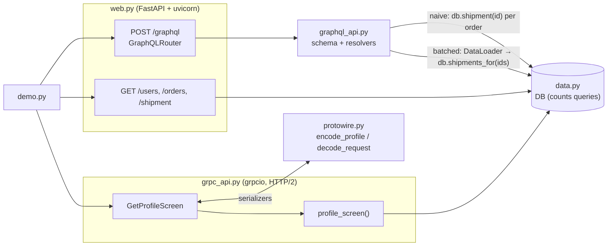

# Code walkthrough: REST vs gRPC vs GraphQL

> Companion to [README.md](README.md). The README explains the *concept*; this file explains the
> *code*, file by file, so you can read it, change it, and rebuild it yourself.
> Line links (e.g. `protowire.py#L24`) point at the exact code.

## File map

| Read | File | Lines | Role |
|---|---|---|---|
| 1 | [`src/protowire.py`](src/protowire.py) | 99 | The from-scratch part: varints, field tags, and this schema's encode/decode functions |
| 2 | [`src/data.py`](src/data.py) | 75 | `DB`: seeded users, orders, shipments and friendships; every method counts one query |
| 3 | [`src/grpc_api.py`](src/grpc_api.py) | 56 | The gRPC service and client stub, using `protowire` as the serializer |
| 4 | [`src/graphql_api.py`](src/graphql_api.py) | 101 | The Strawberry schema, resolvers and DataLoaders |
| 5 | [`src/web.py`](src/web.py) | 61 | REST endpoints and the GraphQL router on one FastAPI app, plus `run_uvicorn` |
| 6 | [`src/demo.py`](src/demo.py) | 151 | Four experiments that print the README's "Expected output" |
| 7 | [`tests/test_api_styles.py`](tests/test_api_styles.py) | 80 | Seven tests, one per defining property |
| – | [`Makefile`](Makefile) | | `make run` = `uv run python -m src.demo`, `make test` = `uv run python -m pytest tests` |

## How the pieces fit



One database, three front doors. Because `DB` counts every query, each style's database cost is measured on the
same data.

## `src/protowire.py`, the binary format

### `encode_varint` / `decode_varint` ([L24](src/protowire.py#L24), [L36](src/protowire.py#L36))

```python
out = bytearray()
while True:
    low7, n = n & 0x7F, n >> 7
    out.append(low7 | 0x80 if n else low7)
    if not n:
        return bytes(out)
```

**What it does:** writes an integer 7 bits at a time, lowest bits first. Every byte except the last has its top
bit (`0x80`) set, meaning "another byte follows".

**Why this way:** small numbers are common (ids, counts, lengths, field tags), and a varint spends 1 byte on 0–127
and 2 bytes on 128–16,383. JSON spends one byte per *decimal digit* plus quotes or commas. **Line notes:** take 150:
its low 7 bits are `0010110` (22). There's more to come, so the first byte is `22 | 0x80 = 0x96`, and then `150 >> 7
= 1` gives `0x01`. That's the `96 01` printed by the demo and asserted by the first test. The decoder reverses it:
`result |= (byte & 0x7F) << shift` until it reads a byte without the top bit.

### `encode_field` ([L47](src/protowire.py#L47)): the tag

```python
if isinstance(value, int):
    return encode_varint(number << 3 | VARINT) + encode_varint(value)
data = value.encode() if isinstance(value, str) else value
return encode_varint(number << 3 | LEN) + encode_varint(len(data)) + data
```

**What it does:** every field starts with a **key**: the field number shifted left 3 bits, OR the wire type (0 for
varint, 2 for length-delimited). Field 1, length-delimited, is `1 << 3 | 2 = 0x0a`, which is the first byte of
every profile message in the demo.

**Why this way:** the wire type tells a reader how to *skip* a field it doesn't understand (read a varint, or read a
length and jump that far), without knowing the schema. That's what makes unknown-field skipping, and so schema
evolution, possible.

### `decode_fields` ([L54](src/protowire.py#L54))

**What it does:** the reverse. It reads a key, splits it into `number = key >> 3` and `wire_type = key & 0x7`, reads
the value, and returns `(number, raw value)` pairs in wire order. It knows nothing about the schema: strings and
nested messages both come back as raw `bytes`.

### The schema functions ([L73](src/protowire.py#L73)–[L99](src/protowire.py#L99))

```python
def encode_profile(screen: dict) -> bytes:
    out = encode_field(1, screen["name"])
    for order in screen["orders"]:
        nested = encode_field(1, order["item"]) + encode_field(2, order["status"])
        out += encode_field(2, nested)
    return out
```

**What it does:** this is what `protoc` would generate from the `.proto` in the module docstring. A **nested message**
is encoded on its own, then embedded as length-delimited bytes. A **repeated** field is the same field number
written once per element.

**Why this way:**
- **There are no lists on the wire.** "Repeated" is just field 2 appearing three times. That's why `decode_profile`
  ([L90](src/protowire.py#L90)) *appends* each field-2 value, instead of using `dict(decode_fields(...))`, which would
  keep only the last one.
- **Defaults are free.** `decode_request` returns `0` for a missing field, which is protobuf's rule. Senders may omit
  default values entirely.
- **Line notes:** [L98](src/protowire.py#L98): the decoder silently ignores any field number it doesn't recognise.
  The third test appends fields 3 and 4 to a message and checks that the decoded result is unchanged.

## `src/data.py`, a database that counts

```python
def shipment(self, oid: int) -> dict:
    self.queries += 1
    return self.shipments[oid]

def shipments_for(self, oids: list[int]) -> list[dict]:
    self.queries += 1  # one "WHERE id IN (...)" query, however many ids
    return [self.shipments[o] for o in oids]
```

**What it does:** stores the seeded data, and offers one-at-a-time and batched versions of each lookup, each
counting as one query.

**Why this way:** "1 query for 60 shipments" versus "60 queries" is the whole N+1 story, and it only becomes visible
when the batched method exists and both are counted. `make_db` ([L54](src/data.py#L54)) uses `random.Random(7)`, so
every run builds the same orders and friendships and the README numbers stay true. User rows are deliberately wide
(8 fields) to make REST's over-fetching visible.

## `src/grpc_api.py`, gRPC with our serializer

### `profile_screen` ([L22](src/grpc_api.py#L22))

```python
user = db.user(user_id)
orders = db.orders_of(user_id, limit)
shipments = db.shipments_for([o["id"] for o in orders])
return {"name": user["name"], "orders": [{"item": o["item"], "status": s["status"]} for o, s in zip(orders, shipments)]}
```

**What it does:** builds exactly what the screen needs on the server, in 3 queries, with the shipments batched by hand.

**Why this way:** this is the RPC mindset: a **purpose-built procedure** for one use case, instead of generic resources.
It's efficient, but every new screen needs a new method (or a change to this one).

### `serve_grpc` ([L32](src/grpc_api.py#L32)) and `profile_stub` ([L50](src/grpc_api.py#L50))

```python
method = grpc.unary_unary_rpc_method_handler(handle, request_deserializer=decode_request,
                                             response_serializer=encode_profile)
server.add_generic_rpc_handlers((grpc.method_handlers_generic_handler("shop.Profiles", {"GetProfileScreen": method}),))
...
return channel.unary_unary(METHOD, request_serializer=encode_request, response_deserializer=deserialize)
```

**What it does:** registers `GetProfileScreen` under the service `shop.Profiles`, and creates a client callable for
`/shop.Profiles/GetProfileScreen`.

**Why this way:**
- **grpcio only needs functions that turn objects into bytes and back.** Normally those are generated protobuf
  classes. Here they're our `encode_*`/`decode_*`, which shows that gRPC is a *transport* (HTTP/2, method paths,
  status codes, deadlines) and protobuf is a separate *encoding* layer.
- **"Unary-unary"** means one request, one response. The other three kinds are unary-stream, stream-unary and
  stream-stream (exercise 3 adds one).
- **`on_bytes`** wraps the deserializer to record each response's size. That's how the demo measures gRPC's 63
  bytes: exactly the bytes our serializer produced, without HTTP/2 framing.

## `src/graphql_api.py`, schema, resolvers, DataLoader

### The types ([L21](src/graphql_api.py#L21)–[L59](src/graphql_api.py#L59))

```python
@strawberry.type
class Order:
    id: int
    item: str
    ...
    @strawberry.field
    async def shipment(self, info: Info) -> Shipment:
        ctx = info.context
        row = await ctx["shipments"].load(self.id) if ctx["batched"] else ctx["db"].shipment(self.id)
```

**What it does:** plain fields (`item`) are read straight off the object. Fields with a resolver (`shipment`,
`orders`, `friends`) run a function, and only if the query asks for them.

**Why this way:** **a resolver per field is what makes "ask for exactly what you need" work.** The server never
computes `shipment` unless the query names it. It's also exactly where N+1 comes from: `Order.shipment` runs once for
each order in the response.

**Line notes:** [L38](src/graphql_api.py#L38): one flag picks the loading strategy. Naive calls `db.shipment(id)`
directly, 60 queries for 60 orders. Batched calls `loader.load(id)`, which doesn't query immediately. It parks the key
and returns an awaitable.

### `make_context` and the DataLoaders ([L84](src/graphql_api.py#L84))

```python
async def shipments(oids: list[int]) -> list[dict]:
    return db.shipments_for(oids)
...
return {"db": db, "batched": batched, "shipments": DataLoader(shipments), "orders": DataLoader(orders), ...}
```

**What it does:** each DataLoader wraps a *batch function* that takes many keys and returns results in the same order.
When all the resolvers at one level have called `.load(key)` and are waiting, the event loop hands the batch
function every collected key at once.

**Why this way:**
- **Async is what makes batching possible.** The resolvers for 60 orders all start, each awaits `load()`, and
  nothing has run yet. DataLoader sees all 60 keys in one tick, then issues **one** query. With synchronous resolvers
  there would be no moment to collect them.
- **Fresh loaders per request.** A DataLoader also caches `key → value`. Shared across requests, that cache would
  serve stale data, or one user's data to another.
- **The cache explains *Break it*.** Friends overlap among only 50 users, so by depth 5 every user is already
  cached, and the database queries stop at 10 even though the response keeps growing.
- **Line notes:** [L91](src/graphql_api.py#L91): the orders loader is keyed by `(user_id, limit)`, and a batch uses
  the first key's limit. That's safe here because one query uses one limit, but it's a simplification worth noticing.

## `src/web.py`, REST and GraphQL on one app

```python
@app.get("/users/{uid}")
def get_user(uid: int) -> dict:
    return db.user(uid)
...
app.include_router(GraphQLRouter(schema, context_getter=context), prefix="/graphql")
```

**What it does:** three resource endpoints, each returning a whole row, plus the GraphQL endpoint, all on the same
FastAPI app and the same `DB`.

**Why this way:** with the same server, data and serialization library, the differences in section 2 come only from
the API style. `context_getter` runs per request, which is what gives every GraphQL request its fresh DataLoaders.

## `src/demo.py`, making it visible

| Experiment | Line | Setup | What it measures | README output |
|---|---|---|---|---|
| 1. Encodings | [L48](src/demo.py#L48) | The screen as compact JSON and as protobuf; an extra field 3 appended | Sizes, an annotated first field, varint examples, unknown-field skipping | 137 vs 63 bytes |
| 2. Three styles | [L76](src/demo.py#L76) | One `DB`; REST and GraphQL over uvicorn, gRPC over grpcio | Requests, dependent round trips, body bytes, fields, DB queries | The six-column table |
| 3. N+1 | [L112](src/demo.py#L112) | The screen for 20 users, run naive and batched in-process | Fields returned, DB queries | 81 vs 3 |
| 4. Fan-out | [L132](src/demo.py#L132) | `friends_query(depth)` for depth 1..`DEPTH` | Users in the response, bytes, DB queries | ×5 per level |

**Details worth noticing:**
- **`rest_screen`** ([L66](src/demo.py#L66)) runs in two stages with a thread pool: user and orders together, then
  all shipments together. That's the best a REST client can do. The "2 dependent round trips" in the table is the
  number of stages.
- **`leaves()`** ([L39](src/demo.py#L39)) counts scalar values in a JSON-like structure, which is how "fields
  received" is measured for every style.
- **Sections 3 and 4 run the schema in-process** (`schema.execute`, through `run_query`), with no HTTP. Database
  queries are the point there, and calling in-process makes them exact and fast.
- **The latency column is computed**, not measured: dependent round trips × `RTT`. On localhost a round trip is about
  0.1 ms, which would hide the difference that matters on a phone.

## Tests: what each one proves

| Test | Property it proves | Why that property matters |
|---|---|---|
| [`test_varints_match_the_protobuf_spec`](tests/test_api_styles.py#L26) | Field 1 = 150 encodes to `08 96 01`; varints round-trip from 0 to 2⁶³−1; 127 is 1 byte, 128 is 2 | Our bytes are real protobuf, checked against the spec's own example |
| [`test_protobuf_round_trips_and_is_smaller…`](tests/test_api_styles.py#L33) | Decode(encode(screen)) == screen, at under 60% of the JSON size | Binary with numbered fields beats text with names |
| [`test_unknown_fields_are_skipped…`](tests/test_api_styles.py#L40) | Appending fields 3 and 4 doesn't change what an old decoder returns | Schema evolution without breaking clients |
| [`test_graphql_returns_exactly_the_requested_fields`](tests/test_api_styles.py#L47) | 7 leaf fields; `user` has only `name` and `orders` | No over-fetching: the response mirrors the query |
| [`test_rest_needs_more_requests_and_bytes…`](tests/test_api_styles.py#L54) | REST takes 5 requests and over 35 fields; gRPC bytes < GraphQL bytes < REST bytes | The section 2 comparison, as inequalities |
| [`test_naive_resolvers_cause_n_plus_one…`](tests/test_api_styles.py#L67) | Same data either way; naive = 1 + 20 + 60 queries, batched = 3 | N+1 and its fix, exactly |
| [`test_nested_queries_grow_exponentially…`](tests/test_api_styles.py#L76) | Users 6 → 31 → 156 while DB queries go 3 → 5 → 7 | Fan-out is exponential even when the database cost isn't |

## Trace one run

Real values from one `GetProfileScreen` call, printed while writing this.

| Step | Code | Value |
|---|---|---|
| 1 | `encode_request({"user_id": 1, "limit": 3})` | `08 01 10 03`: key `08` (field 1, varint) value `01`; key `10` (field 2 = `2<<3\|0`) value `03`. **4 bytes** |
| 2 | Server: `decode_request` | `{'user_id': 1, 'limit': 3}` |
| 3 | `profile_screen(db, 1, 3)` | `db.user(1)`, `db.orders_of(1, 3)`, `db.shipments_for([...])`: **3 queries** |
| 4 | Result | `{'name': 'user-1', 'orders': [{'item': 'desk', 'status': 'packed'}, {'item': 'lamp', 'status': 'in transit'}, {'item': 'lamp', 'status': 'delivered'}]}` |
| 5 | `encode_profile(...)` | **63 bytes**, which `decode_fields` splits back into four fields: |

```text
field 1  75 73 65 72 2d 31                                     → "user-1"
field 2  0a 04 64 65 73 6b 12 06 70 61 63 6b 65 64             → [(1, "desk"), (2, "packed")]
field 2  0a 04 6c 61 6d 70 12 0a 69 6e 20 74 72 61 6e 73 69 74 → [(1, "lamp"), (2, "in transit")]
field 2  0a 04 6c 61 6d 70 12 09 64 65 6c 69 76 65 72 65 64    → [(1, "lamp"), (2, "delivered")]
```

On the wire, each field 2 is preceded by its key `12` (`2 << 3 | 2`) and its length: `12 0e` for the first order
(14 bytes), `12 12` for the second (18) and `12 11` for the third (17). You can find all three in the hex dump in
section 1 of the output. A last example of a two-byte varint: `encode_varint(300)` = `ac 02`.

## Python techniques used

| Technique | Where | Why it's used here |
|---|---|---|
| Bit operations `& 0x7F`, `\| 0x80`, `>> 7`, `<< 3` | `protowire.py` | Varints and field keys are bit-packed |
| `bytearray` → `bytes` | `encode_varint` | Grow a buffer cheaply, then freeze it |
| `@strawberry.type`, `@strawberry.field` resolvers | `graphql_api.py` | Python classes define the GraphQL schema; methods become resolvers |
| `async def` resolvers + `DataLoader` | `graphql_api.py` | Awaiting `load()` is what lets the loader collect keys and batch them |
| `info.context` | resolvers | Per-request state (db, loaders, flags) without globals |
| A forward reference (`-> list[User]` inside `User`) | `User.friends` | A type that refers to itself; works with `from __future__ import annotations` |
| `grpc.unary_unary_rpc_method_handler`, `method_handlers_generic_handler` | `grpc_api.py` | Register a gRPC method without generated code |
| Closures capturing `db` | `serve_grpc`, `make_context`, `build_app` | Each server or request uses the `DB` it was built with |
| `ThreadPoolExecutor.map` | `rest_screen` | Make independent REST calls in parallel |
| `asyncio.run(schema.execute(...))` | `run_query`, tests | Run the async GraphQL engine from ordinary code |
| `@contextmanager` servers | `serve_grpc`, `run_uvicorn` | `with ... as target:` starts and stops servers around a block |

## Design decisions & alternatives

| Decision | Alternative | Why this one, for learning |
|---|---|---|
| Hand-written protobuf encoder | `.proto` + `grpcio-tools` generated classes | The bytes are the lesson. Generated code would hide the varints and tags |
| One FastAPI app for REST and GraphQL | Separate servers | Same process, data and JSON library, so section 2 compares only the API styles |
| A per-request flag for naive vs batched | Two separate schemas | One schema, one switch: the difference is visibly just the loading strategy |
| Computed latency (round trips × RTT) | Measured latency on localhost | Localhost round trips are about 0.1 ms and would hide the effect; the formula is stated in the output |
| `friends` with 5 per user among 50 users | Unique users at every level | The overlap shows DataLoader's cache effect, the plateau in *Break it* |

## Change it yourself

### 1. Evolve the protobuf schema (easy)

**Goal:** add `int32 total_orders = 3;` to `ProfileScreen`, and show that both old and new clients still work.
**Change:** `encode_profile`, `decode_profile` and `profile_screen`.
**Check:** a test with a *new* encoder and the *old* decoder logic (copy it as `decode_profile_v1`) still returns name
and orders. In section 1, the protobuf size should grow by 2 bytes (key `18` plus a one-byte varint).

<details><summary>Hint</summary>

`out += encode_field(3, screen["total_orders"])`, and in the decoder `elif number == 3: screen["total_orders"] = value`.
Field 3 is a varint, so its key is `3 << 3 | 0 = 0x18`. The opposite direction works too: a new decoder reading an old
message gets the default `0`. Then try the forbidden move: reuse field number 2 for a different type, and watch the
old decoder crash or misread.
</details>

### 2. Limit query depth (medium)

**Goal:** reject deeply nested GraphQL queries before they run.
**Change:** add `QueryDepthLimiter` from `strawberry.extensions` to the `schema` in `src/graphql_api.py`, and make
`experiment_depth` print "rejected" instead of crashing when a query returns errors.
**Check:** with `max_depth=4`, `DEPTH=6 make run` answers depths 1–3 and rejects 4–6. The root `user` field counts
as a level, so friends-depth 3 is total depth 4. The section 2 screen query (depth 3) must still pass, and so must
`make test`.

<details><summary>Hint</summary>

`strawberry.Schema(query=Query, extensions=[lambda: QueryDepthLimiter(max_depth=4)])`. Pass a factory, not an
instance: Strawberry warns that instances are deprecated, because each request should get a fresh extension.
Depth limits are crude: a shallow query with huge lists is still expensive. That's why GitHub and Shopify compute a
**cost** (multiplying list sizes) instead. For extra credit, write a tiny cost estimator for `friends_query(d)` that
returns 5^d before running it.
</details>

### 3. A server-streaming RPC (hard)

**Goal:** add `rpc WatchOrders(ProfileRequest) returns (stream OrderSummary)`, which sends one message per order
instead of a single combined response.
**Change:** `src/grpc_api.py` (a new handler and a client callable) and `src/protowire.py` (encode/decode for a
single `OrderSummary`).
**Check:** a test that iterates over the stream and gets 3 `OrderSummary` messages for user 1, matching
`profile_screen(...)["orders"]`.

<details><summary>Hint</summary>

Server: `grpc.unary_stream_rpc_method_handler(watch, request_deserializer=decode_request, response_serializer=encode_order)`,
where `watch` is a generator that `yield`s one dict per order. Client:
`channel.unary_stream("/shop.Profiles/WatchOrders", request_serializer=encode_request, response_deserializer=decode_order)`.
Calling it returns an iterator. Streaming is what REST can't do natively. A real `WatchOrders` would keep the stream
open and push each status change, like Envoy's xDS or Kubernetes watches.
</details>
