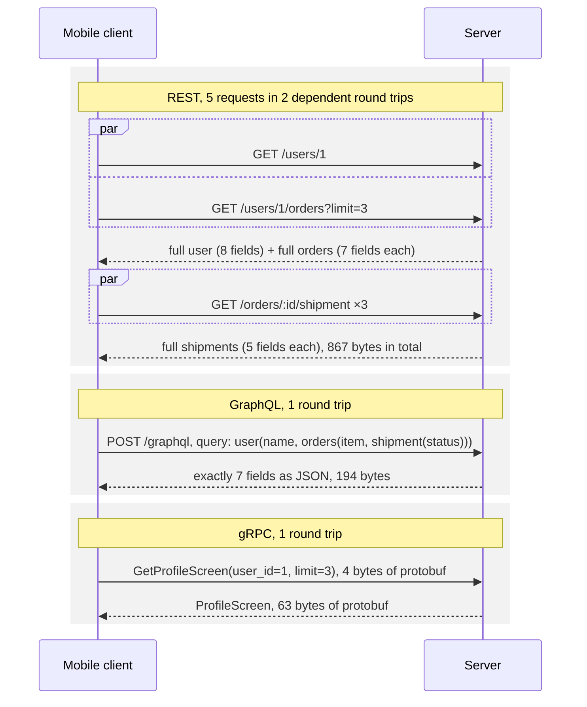

# REST vs gRPC vs GraphQL

> **Module:** 00 Foundations · **Difficulty:** ●●○○○ · **Time:** ~60 min · **Prereqs:** [HTTP, REST & Status Codes](../03-http-rest/README.md)

## TL;DR

Three ways for programs to call each other over the network. **REST** exposes resources and is simple and
cacheable, but a screen often needs several calls that each return too much. **GraphQL** lets the client ask for
exactly the fields it needs, in one request, at the cost of server-side complexity. **gRPC** calls typed procedures
with compact binary messages over HTTP/2, at the cost of needing a shared schema and tooling.

## Explain like I'm 5

You're hungry, and there are three kinds of restaurant:

- **The cafeteria (REST).** There's a separate counter for each thing: drinks, mains, desserts. You walk to each
  one, and each hands you a full standard tray, even if you only wanted the chips. Easy to understand, and
  popular trays can be pre-made (cached).
- **The waiter with a checklist (GraphQL).** You tick exactly what you want ("chips, cola, no salad") and hand over
  one sheet. The waiter fetches it all and brings back only that. One trip for you, but the kitchen does more
  thinking, and a greedy sheet ("everything, for all my friends, and their friends") can swamp it.
- **The drive-through with numbered combos (gRPC).** You say "number 3". It's fast and short, because you and the
  kitchen both have the same numbered menu card. Without the card, "number 3" means nothing.

| In the story | In the system |
|---|---|
| A counter per food type | REST **resources**: `/users/1`, `/users/1/orders`, `/orders/7/shipment` |
| A full standard tray | **Over-fetching**: the whole resource, every field, needed or not |
| Walking to several counters | Several **round trips**; some must wait for others (you need order ids before shipments) |
| Pre-made trays | **HTTP caching** of GET responses by URL |
| The checklist | A GraphQL **query**: a selection of exactly the fields wanted |
| The waiter fetching each item | **Resolvers**: one function per field, run by the GraphQL server |
| "For all my friends and their friends" | **Nested fan-out**: query cost that multiplies at each level |
| "Number 3" | A gRPC **method** with protobuf messages: fields are numbers, not names |
| The menu card | The **`.proto` schema** that both client and server compile in |

**Real world:** **GitHub** offers its data both ways: a REST API (v3), and a GraphQL API (v4) that it built because
clients needed many REST calls to assemble one view. GitHub rate-limits the GraphQL API by each query's computed
cost, not by request count, because one query can do the work of hundreds. gRPC is what **Kubernetes** components use
to talk to **etcd**, and it grew out of Google's internal RPC system.

## Technical deep dive

### The problem

A mobile profile screen needs a user's name and their last three orders, with each order's shipping status. The
data lives in three places (users, orders, shipments). How should the client ask for it?

- **Too fine-grained** (one endpoint per resource) means many round trips, and on a phone each one may cost 100 ms
  or more.
- **Too coarse** (each endpoint returns everything) wastes bandwidth and battery.
- **Too custom** (one endpoint per screen) means a new backend endpoint for every screen and app version.

REST, GraphQL and gRPC sit at different points in that space.

### How it works

**REST** (from the [previous lesson](../03-http-rest/README.md)) is resources at URLs, standard methods, and JSON
bodies.

1. The client composes the screen. In parallel it calls `GET /users/1` and `GET /users/1/orders?limit=3`, which
   returns order ids. Only then can it make three `GET /orders/{id}/shipment` calls, in parallel.
2. That's **2 dependent round trips** and 5 requests. Every response is a full resource: 44 fields arrive, and the
   screen uses 7.
3. GET responses are cacheable by URL: browsers, CDNs and ETags all just work.

**GraphQL** has one endpoint (`POST /graphql`) and a typed **schema** of types and fields.

1. The client sends a **query** describing the shape it wants:
   `{ user(id: 1) { name orders(limit: 3) { item shipment { status } } } }`.
2. The server walks the query and calls a **resolver** for each field: `user` → `orders` → each order's `shipment`.
3. The response mirrors the query's shape exactly: 1 round trip and 7 fields.
4. **The N+1 problem:** a per-order `shipment` resolver runs once per order. For 20 users that's
   1 + 20 + 60 = **81 database queries**. A **DataLoader** collects every `load(id)` call made in the same tick and
   runs one batched query per level: **3**.

**gRPC** is RPC (remote procedure call) over HTTP/2, with **Protocol Buffers** (protobuf) for the messages.

1. A `.proto` file defines services, methods and messages:
   `rpc GetProfileScreen(ProfileRequest) returns (ProfileScreen)`. A compiler (`protoc`) generates client and
   server code from it.
2. The client calls `stub.GetProfileScreen(user_id=1, limit=3)` like a local function. Under the hood that's an
   HTTP/2 POST to `/shop.Profiles/GetProfileScreen`.
3. Messages are binary. Each field is a **tag** (`field_number << 3 | wire_type`) plus a value. Integers are
   **varints**: 7 bits per byte, with the top bit meaning "more follows", so 150 becomes `96 01`. Field names never
   travel, so the screen is **63 bytes** instead of JSON's 137.
4. **Schema evolution:** a decoder skips field numbers it doesn't know. Old clients keep working when the server
   adds fields, as long as numbers are never reused.
5. gRPC also has **streaming**, with many messages either way on one call, and **deadlines** that propagate across
   service hops.



### Trade-offs

| | REST | GraphQL | gRPC |
|---|---|---|---|
| Shape of the response | Fixed per resource: over-fetching (44 fields for 7) | Exactly what the client asked for | Fixed per method, but methods can be purpose-built |
| Round trips for a composite screen | Several, some dependent (2 here) | 1 | 1 (with a purpose-built method) |
| Payload | JSON text with field names (867 B) | JSON, only the asked-for fields (194 B) | Binary protobuf (63 B) |
| HTTP caching | Excellent: GET by URL, ETags, CDNs | Poor by default: everything is `POST /graphql` (persisted queries can bring back GET) | None at the HTTP layer |
| Contract and types | Optional (OpenAPI) | A typed schema, introspectable | A required `.proto`, compiled into code |
| Browsers | Native | Native | Need gRPC-Web and a proxy |
| Streaming | No (SSE or WebSockets separately) | Subscriptions (usually over WebSockets) | Built in, in both directions |
| Server-side risk | Simple to reason about | N+1 resolvers, unbounded query cost | Field-number discipline; HTTP/2 load balancing |
| Debugging | `curl` and read it | `curl`, plus tools like GraphiQL | Binary: needs `grpcurl` or generated clients |

### Failure modes & gotchas

- **Chatty REST on slow networks.** Two dependent round trips at a 300 ms RTT is 600 ms before the screen can draw,
  plus over-fetched bytes (`RTT=300 make run`). Teams answer with ad-hoc "screen endpoints", or with a BFF (backend
  for frontend): a server-side layer per client that composes the calls.
- **GraphQL N+1.** Naive per-field resolvers turned one query into **81** database queries for 20 users. DataLoader
  (or a join in the parent resolver) brought it to **3**.
- **Unbounded GraphQL queries.** A 126-character nested query returned **19,531 users (457 KB)** (*Break it*).
  Public GraphQL APIs need depth limits, cost analysis or pre-approved (persisted) queries. GitHub and Shopify both
  rate-limit by computed query cost.
- **GraphQL errors arrive as `200 OK`.** Failures go in an `errors` array next to partial `data`, so HTTP-level
  monitoring and retries (last lesson's status codes) see success. Your client and dashboards must read the body.
- **Reusing a protobuf field number.** If field 3 used to mean `tier` and now means `discount`, old clients
  misread new data silently. Never reuse numbers; mark deleted ones `reserved`.
- **gRPC behind a connection-level load balancer.** HTTP/2 keeps one long-lived connection and multiplexes every call
  over it. A layer-4 (connection-level) balancer then pins all of a client's traffic to one backend. Use a
  request-aware (L7) balancer or client-side load balancing
  ([Reverse Proxy & L4/L7 Load Balancers](../../01-scaling-and-traffic/03-reverse-proxy/README.md)).

### When NOT to use it

- **Not GraphQL** for simple CRUD or public read-heavy data that benefits from CDN caching, or when you can't invest
  in query-cost limits and resolver batching. REST is simpler and caches better.
- **Not gRPC** for public APIs called from browsers or by third parties with arbitrary tooling, or when humans
  need to read payloads easily. Use it inside your system, between services you control.
- **Not REST** for screens that need many related resources over high-latency mobile links, unless you add
  composite endpoints or a BFF. And not for internal high-volume calls where every byte and millisecond counts.

## Implementation

Six small files in [`src/`](src/). The protobuf wire format is written from scratch; FastAPI, Strawberry
(GraphQL) and grpcio supply the real servers.

| File | What it holds |
|---|---|
| [`protowire.py`](src/protowire.py) | Varints, field tags, and the encode/decode functions `protoc` would generate for this schema |
| [`data.py`](src/data.py) | A seeded in-memory database whose methods count queries |
| [`web.py`](src/web.py) | The REST endpoints and the GraphQL router on one FastAPI app |
| [`graphql_api.py`](src/graphql_api.py) | The Strawberry schema, its resolvers, and the DataLoaders |
| [`grpc_api.py`](src/grpc_api.py) | The gRPC service, with `protowire` plugged in as its serializer |
| [`demo.py`](src/demo.py) | The four experiments below |

The key ideas in the code:

- **Protobuf is about 30 lines:** `encode_varint`, `encode_field` and `decode_fields`. Everything else is the schema.
- **gRPC doesn't care how messages are encoded:** grpcio accepts any serializer functions, so ours slot in where
  generated classes would.
- **Resolvers choose naive or batched loading** with one flag, which is how section 3 compares them on the same query.

**Full explanation of the code, with a traced gRPC call, Python techniques and exercises:
[CODE_WALKTHROUGH.md](CODE_WALKTHROUGH.md).**

## Run it

```bash
cd modules/00-foundations/04-rest-grpc-graphql
make up     # no infrastructure needed for this lesson
make run    # run the demo
make test   # prove the behaviour
make down
```

## Expected output

```text
==============================================================================
 REST vs gRPC vs GraphQL: encodings, round trips, N+1 and fan-out
==============================================================================

1) The same data, two encodings: JSON (text, with names) vs protobuf (binary, numbered fields)
  JSON     137 bytes  {"name":"user-1","orders":[{"item":"desk","status":"packed"},{"item":"lamp","status":"in transit"},{"item":"lamp","status":"delivered"}]}
  protobuf  63 bytes  0a 06 75 73 65 72 2d 31 12 0e 0a 04 64 65 73 6b 12 06 70 61 63 6b 65 64 12 12 0a 04 6c 61 6d 70 12 0a 69 6e 20 74 72 61 6e 73 69 74 12 11 0a 04 6c 61 6d 70 12 09 64 65 6c 69 76 65 72 65 64
  how the first field reads: 0a = field 1, wire type 2 (length-delimited) · 06 = 6 bytes follow · 75 73 65 72 2d 31 = 'user-1'
  varints: 150 → 96 01 (7 bits per byte, top bit = "more"); 5 → 05
  an old client reads a newer message with an extra field 3: True (unknown fields are skipped)
  → protobuf is 46% of the JSON size here, and both sides need the schema to read it.

2) One profile screen (name + 3 orders with their shipping status), three API styles
  style                             requests  dependent round trips  body bytes  fields received (used: 7)  DB queries  latency @ 100 ms RTT
  --------------------------------  --------  ---------------------  ----------  -------------------------  ----------  --------------------
  REST (5 resource endpoints)       5         2                      867         44                         5           200 ms
  GraphQL (1 query, POST /graphql)  1         1                      194         7                          3           100 ms
  gRPC (1 call, GetProfileScreen)   1         1                      63          7                          3           100 ms
  → REST over-fetches whole resources and needs two dependent round trips; GraphQL and gRPC return
    just the screen in one. Latency column = dependent round trips × RTT (server time left out).

3) GraphQL's N+1 problem: the same screen for 20 users in one query
  resolvers                       fields returned  DB queries
  ------------------------------  ---------------  ----------
  naive resolvers                 140              81
  DataLoader (batched resolvers)  140              3
  → naive: 1 query for the users, then 1 per user for orders, then 1 per order for its shipment.
    DataLoader collects the calls each level makes and runs one batched query per level.

4) Nested queries multiply: friends of friends of ... (5 friends each, DataLoader on)
  depth  query                                                       users in response  response bytes  DB queries
  -----  ----------------------------------------------------------  -----------------  --------------  ----------
  1      { user(id: 1) { name friends { name } } }                   6                  144             3
  2      { user(id: 1) { name friends { name friends { name } } } }  31                 731             5
  3      …                                                           156                3,660           7
  → each level multiplies the response by 5. Batching (and DataLoader's per-request cache) keeps DB
    queries small, but the response and the server's work still grow exponentially with depth.
```

```text
uv run python -m pytest tests
.......                                                                  [100%]
7 passed in 0.52s
```

Every number is the same on every run: the data is seeded, and nothing depends on timing.

**What you're seeing:**

1. **Encodings.** The JSON spells out `"name"`, `"orders"`, `"item"` and `"status"` every time. Protobuf replaces
   each name with a one-byte tag (`0a` = field 1, length-delimited) and writes lengths as varints, so it comes to
   46% of the size. The extra field 3 was skipped by the old decoder: that's how protobuf schemas evolve without
   breaking clients.
2. **Three styles.** REST made 5 requests, and the shipment calls had to wait for the order ids: 2 dependent round
   trips. It received 44 fields to show 7. GraphQL and gRPC each made 1 request and received exactly the 7 fields.
   GraphQL's 194 bytes are JSON wrapped in `{"data": {"user": …}}`; gRPC's 63 are binary. REST also cost 5 database
   queries, because each endpoint fetches on its own; the other two cost 3.
3. **N+1.** The same 140 fields cost 81 database queries with naive resolvers and 3 with DataLoader: one per level
   (users, orders, shipments). The demo used DataLoader in section 2, which is why GraphQL shows 3 there.
4. **Fan-out.** Each level of `friends` multiplies the response by 5 (6 → 31 → 156 users), while the database
   queries only add 2 per level.

## Break it

**Experiment: send a deeply nested GraphQL query.**

```bash
DEPTH=6 make run
```

```text
4) Nested queries multiply: friends of friends of ... (5 friends each, DataLoader on)
  depth  query                                                       users in response  response bytes  DB queries
  -----  ----------------------------------------------------------  -----------------  --------------  ----------
  1      { user(id: 1) { name friends { name } } }                   6                  144             3
  2      { user(id: 1) { name friends { name friends { name } } } }  31                 731             5
  3      …                                                           156                3,660           7
  4      …                                                           781                18,309          9
  5      …                                                           3,906              91,498          10
  6      …                                                           19,531             457,356         10
```

A 126-character query produced a **457 KB** response with **19,531 users**, and a client can make it bigger just by
typing `friends {` a few more times. Notice the database queries stop growing at 10. The database only holds 50
users, and DataLoader's per-request cache has seen all of them by depth 5. So the cost here isn't the database: it's
the server resolving and serializing 19,531 objects, and the network carrying them. That's why public GraphQL APIs
limit query depth and cost before running a query (exercise 3 in the code walkthrough adds Strawberry's
`QueryDepthLimiter`).

Also try `RTT=300 make run`: REST's two dependent round trips become 600 ms, against 300 ms for the single-call
styles.

## Real-world systems

| System | How it uses this |
|---|---|
| GitHub | REST API v3 and GraphQL API v4 side by side; GraphQL is rate-limited by computed query cost |
| Shopify | GraphQL Admin and Storefront APIs, with cost-based rate limiting per query |
| Kubernetes and etcd | The Kubernetes API server talks to etcd over gRPC; `kubectl` talks to the API server over REST |
| Envoy and Istio | The control plane pushes configuration to proxies over gRPC streams (xDS) |
| Netflix and many mobile backends | A BFF (backend for frontend) or GraphQL layer composes many internal service calls into one response per screen |
| Google | gRPC grew out of Stubby, the RPC system behind Google's internal services |

## Interview angle

**Q1. When would you choose REST, GraphQL or gRPC?**
- **REST:** public, resource-oriented APIs, especially read-heavy data that benefits from HTTP caching and CDNs,
  and anything third parties must call easily.
- **GraphQL:** many different clients (web, iOS, Android, partners) need different slices of a rich, connected
  data graph, and you'd otherwise build endpoint after endpoint. Budget for resolver batching and query-cost limits.
- **gRPC:** internal service-to-service calls where you control both ends and want typed contracts, small payloads,
  streaming and deadlines.

Many companies run all three: gRPC between services, a GraphQL or BFF layer for apps, and REST for public partners.

**Q2. What's the N+1 problem in GraphQL, and how do you fix it?**
Each field has its own resolver, so a list of N items whose field needs data runs that resolver N times: one query
for the list, then N more. Nested lists multiply it (1 + 20 + 60 = 81 here). Fix it by batching. A DataLoader
collects the keys requested within one event-loop tick and issues a single `WHERE id IN (…)` query, with a
per-request cache. Alternatively, the parent resolver can fetch the children with a join. Watch the number of
database queries per request in your metrics.

**Q3. Why is gRPC faster than REST with JSON, and what do you give up?**
Protobuf is binary, sends field numbers instead of names, and encodes integers as varints, so messages are smaller
and faster to parse (63 vs 137 bytes here). HTTP/2 multiplexes many calls over one connection, and streaming avoids
repeated request setup. You give up human-readable payloads and easy `curl` debugging, direct browser support (you
need gRPC-Web), and simple HTTP caching. You must also manage `.proto` files and code generation across teams, and
pick a load balancer that understands HTTP/2.

## Self-check quiz

1. Why does a protobuf message need a schema to be read, while JSON doesn't? What's the benefit of that design?
2. What makes GraphQL responses hard to cache with ordinary HTTP caches, and what's one way around it?
3. A teammate adds a `friends` field to your public GraphQL API. A week later, CPU on the GraphQL servers spikes even
   though request counts are flat. What's a likely cause, and what are two defences?
4. Your gRPC service has 10 backend instances behind a layer-4 (TCP) load balancer, but one instance is at 100% CPU
   and the others are idle. What's going on?
5. You're designing APIs for a new food-delivery company: a mobile app, a web dashboard for restaurants, internal
   services (orders, payments, dispatch), and a public API for partners. Which style would you use for each, and why?

<details>
<summary>Answers</summary>

1. Protobuf sends only field **numbers** and wire types, never names, so without the `.proto` file you can't tell
   whether field 2 is "orders" or "price". JSON repeats every name, so it describes itself. The benefit is size and
   speed: no repeated names, compact varints, fast parsing. And because unknown field numbers are skipped, the
   schema can grow without breaking old clients.
2. Queries usually go as `POST /graphql` with the query in the body, so there's one URL for everything, and HTTP
   caches don't cache POST. Work-arounds: **persisted queries** (the client sends a query ID by `GET`, which can be
   cached by URL), caching inside the server or the resolvers, or a client-side normalized cache (Apollo, Relay).
3. Clients (or an attacker) are sending **deeply nested queries** (`friends { friends { friends … } } }`): the same
   number of requests, each doing exponentially more work. Defences: **depth limits**, **cost analysis** (reject or
   rate-limit by computed cost, as GitHub and Shopify do), pagination limits on list fields such as `friends(first: 10)`,
   and **persisted queries**, which allow only pre-approved queries.
4. gRPC uses one long-lived HTTP/2 connection per client and multiplexes every call over it. A TCP load balancer
   balances **connections**, not requests, so a client with one connection (a large internal caller, say) sends
   everything to one backend. Fix it with an L7 (HTTP/2-aware) load balancer such as Envoy, client-side load
   balancing, or periodically recycling connections.
5. One reasonable design:
   - **Internal services:** gRPC. You own both ends, and you get typed contracts, low latency, streaming (dispatch
     location updates) and deadlines.
   - **Mobile app:** a GraphQL or BFF layer. One round trip per screen over flaky mobile links, with each app version
     asking for what it needs.
   - **Restaurant dashboard:** GraphQL, or plain REST if its screens are simple.
   - **Public partner API:** REST. Familiar, easy to call from any language, cacheable, and simple to document and
     rate-limit.

</details>

## Further reading

- Protocol Buffers documentation, [*Encoding*](https://protobuf.dev/programming-guides/encoding/): varints, tags and
  wire types (the 150 → `96 01` example)
- [GraphQL Learn: Best Practices](https://graphql.org/learn/best-practices/) and the
  [DataLoader README](https://github.com/graphql/dataloader): batching and the N+1 problem
- [gRPC: Core concepts](https://grpc.io/docs/what-is-grpc/core-concepts/): services, the four RPC types, deadlines
