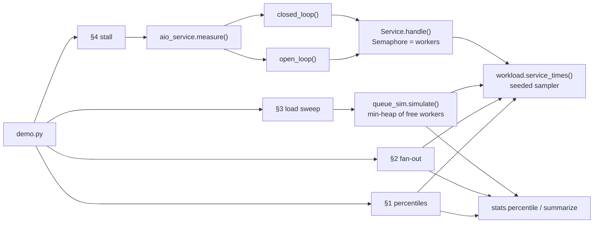

# Code walkthrough: Latency, Throughput & Percentiles

> Companion to [README.md](README.md). The README explains the *concept*; this file explains the
> *code*, file by file, so you can read it, change it, and rebuild it yourself.
> Line links (e.g. `queue_sim.py#L35`) point at the exact code.

## File map

| Read | File | Lines | Role |
|---|---|---|---|
| 1 | [`src/stats.py`](src/stats.py) | 50 | `percentile` (nearest rank), `summarize`, a log-scaled text `histogram` |
| 2 | [`src/workload.py`](src/workload.py) | 31 | `service_times`: a seeded sampler of fast-plus-tail service times; `mean_service_time` |
| 3 | [`src/queue_sim.py`](src/queue_sim.py) | 58 | `simulate`: c workers and one FIFO queue, event by event, with Little's Law measured |
| 4 | [`src/aio_service.py`](src/aio_service.py) | 81 | A real asyncio `Service`, `open_loop` and `closed_loop` load generators, and `measure` |
| 5 | [`src/demo.py`](src/demo.py) | 106 | Four experiments that print the README's "Expected output" |
| 6 | [`tests/test_latency.py`](tests/test_latency.py) | 65 | Seven tests, one per defining property |
| – | [`Makefile`](Makefile) | | `make run` = `uv run python -m src.demo`, `make test` = `uv run python -m pytest tests` |

## How the pieces fit



Everything draws service times from **one sampler**. The simulation (§3) and the real asyncio service (§4) model the
same server: `c` workers, one queue. One runs on a pretend clock, the other on the real event loop.

## `src/stats.py`, percentiles

### `percentile` ([L14](src/stats.py#L14))

```python
ordered = sorted(samples)
rank = max(1, math.ceil(p / 100 * len(ordered)))  # 1-based rank
return ordered[rank - 1]
```

**What it does:** the **nearest-rank** definition. For 100 samples, p99 is the 99th smallest. For 6 samples, p50 is
the ⌈3⌉ = 3rd smallest.

**Why this way:** it always returns a value that really occurred, never an interpolation between two samples. That
suits latency: "p99 = 637 ms" means a real request took 637 ms. **Line notes:** `max(1, …)` keeps p0 (or a tiny p on
few samples) from asking for rank 0. Other tools interpolate (NumPy's default is linear), so their p99 can differ
slightly on small samples. With thousands of samples, the definitions agree closely.

### `summarize` and `histogram` ([L34](src/stats.py#L34), [L39](src/stats.py#L39))

`summarize` packs the numbers the demo prints into a `Summary` dataclass. `histogram` counts samples per bucket and
draws bars on a **log scale**: `log10(count + 1)`. On a linear scale, the 86 and 137 slow requests would be invisible
next to 5,975 fast ones, and seeing that second hump is the point of section 1.

## `src/workload.py`, service times

```python
rng = random.Random(seed)

def sample() -> float:
    if rng.random() < slow_fraction:
        return rng.uniform(0.2, 1.0)
    return rng.lognormvariate(math.log(typical_ms / 1000), 0.4)
```

**What it does:** returns a function that yields service times in seconds. 98% come from a **log-normal** around 15 ms
(most near 15, some at 25 or 40), and 2% are slow, uniform between 200 and 1000 ms.

**Why this way:**
- **A mixture matches real services.** A single bell curve has no tail. Real latency has a fast body plus rare slow
  events (GC, cache misses, retries). That's what makes the mean and the percentiles disagree.
- **A closure over a seeded `Random`.** Each caller gets an independent, reproducible stream. Two simulations with
  the same seed see identical service times, which is why sections 1–3 print the same numbers every run.
- **`mean_service_time`** ([L28](src/workload.py#L28)) estimates the mean from 200,000 samples, giving the capacity
  `workers ÷ mean` that section 3 uses (143 req/s at 2%, 88 at 5%).

## `src/queue_sim.py`, the queue, event by event

### The loop ([L35](src/queue_sim.py#L35))

```python
free_at = [0.0] * workers  # min-heap: when each worker next becomes free
for _ in range(n):
    t += rng.expovariate(rate)
    start = max(t, heapq.heappop(free_at))
    work = service()
    heapq.heappush(free_at, start + work)
    latencies.append(start + work - t)
```

**What it does:** README "How it works", steps 1, 4 and 5, with no clock at all. For each request in arrival order,
it takes the worker that frees up soonest. The request starts at whichever is later, its arrival or that worker
being free. It finishes `work` seconds after starting.

**Why this way:**
- **One min-heap is the whole server.** With first-in-first-out service and identical workers, the next request
  always goes to the earliest-free worker. `heappop` gives that in O(log c). No event queue or real waiting is
  needed, so 20,000 requests take milliseconds.
- **`expovariate(rate)`** draws the gap to the next arrival. Exponential gaps mean a **Poisson process**: independent
  arrivals at an average of `rate` per second, with random bunching. That bunching is what creates queues below
  capacity.
- **Latency = `start + work - t`** = queue wait (`start - t`) + service time (`work`). In the trace below you can see
  both parts.

### Measuring L directly ([L54](src/queue_sim.py#L54))

```python
moments = [end * (i + 0.5) / 2000 for i in range(2000)]
inside = [bisect.bisect_right(arrivals, m) - bisect.bisect_right(finished_sorted, m) for m in moments]
```

**What it does:** at 2,000 evenly spaced moments, counts how many requests have arrived minus how many have finished.
That's the number inside (queued or in service), averaged into `in_system_measured`.

**Why this way:** Little's Law is *checked*, not assumed. `in_system_little = throughput × mean latency` is computed
separately, and the two columns of section 3 come from independent calculations: they agree at every load. Both lists
are sorted (arrivals by construction, finishes sorted explicitly), so `bisect` counts in O(log n).

## `src/aio_service.py`, the real thing

### `Service.handle` ([L30](src/aio_service.py#L30))

```python
async with self._slots:  # queue here when every worker is busy
    if self.stall and self.stall[0] <= loop.time() < self.stall[1]:
        await asyncio.sleep(self.stall[1] - loop.time())  # frozen: nothing gets served
    await asyncio.sleep(self._service())
```

**What it does:** an `asyncio.Semaphore(workers)` is the pool of workers. Callers beyond `workers` wait in the
semaphore's queue, the real-world version of the simulation's heap. Inside, the request "works" by sleeping its
service time, unless the service is in its stall window, in which case it waits for the stall to end first.

**Why this way:** a semaphore gives the same model as the simulation (c concurrent slots, FIFO waiting) with real
time and real concurrency. `asyncio.sleep` stands in for I/O-bound work (a database call), which is what async
services spend their time on.

### `open_loop` vs `closed_loop` ([L38](src/aio_service.py#L38), [L55](src/aio_service.py#L55))

```python
# open loop: schedule fixed in advance
while (intended := start + i / rate) < start + duration:
    await asyncio.sleep(max(0.0, intended - loop.time()))
    tasks.append(asyncio.create_task(one(intended)))
...
latencies.append(loop.time() - intended)  # from the planned send time

# closed loop: wait for the reply before sending again
while loop.time() < stop:
    sent = loop.time()
    await service.handle()
    latencies.append(loop.time() - sent)
```

**What it does:** the open loop launches request *i* at `start + i / rate` as an independent task, whether or not
earlier ones have finished. The closed loop has `clients` coroutines, each sending its next request only after the
previous reply.

**Why this way:**
- **This one difference is coordinated omission.** During the stall, the open loop keeps launching tasks: about 50
  more arrive in 500 ms, and all of them wait. The closed loop's 4 clients are each stuck inside `handle()`, so
  nothing new is sent and only 4 samples are slow.
- **Measuring from `intended`**, not from when the task actually started, keeps the open loop honest even if the
  load generator itself falls behind. That's the correction `wrk2` makes.
- **`create_task`** is what makes the open loop *open*: sending doesn't wait for replying.

### `measure` ([L69](src/aio_service.py#L69))

Builds a fresh `Service` inside a fresh event loop (`asyncio.run`), places the stall window relative to the loop's
start time, and runs one generator. One call per test means no state leaks between the open and closed runs.

## `src/demo.py`, making it visible

| Experiment | Line | Setup | What it measures | README output |
|---|---|---|---|---|
| 1. Percentiles | [L34](src/demo.py#L34) | 10,000 samples (seed 1) | Mean vs p50/p90/p99/p99.9/max; histogram | 29.1 ms mean vs 637.3 ms p99 |
| 2. Fan-out | [L48](src/demo.py#L48) | 10,000 pages × N calls (seed 2); the page latency is `max(calls)` | Page p50/p99, share of pages with a call ≥ 200 ms, vs 1 − (1 − p)ᴺ | 2% → 86.5% |
| 3. Load sweep | [L65](src/demo.py#L65) | `simulate` at 25–105% of capacity, 20,000 requests each | Throughput, utilization, p50/p99, L measured vs λ × W | The hockey stick |
| 4. Stall | [L81](src/demo.py#L81) | `measure` open and closed, 2 s, 500 ms stall at 0.75 s, no slow tail | p50/p90/p99, requests over 100 ms | 69 vs 4 |

**Details worth noticing:**
- **The fan-out page is `max(calls)`** ([L56](src/demo.py#L56)). "Waits for all of them" means the slowest one decides.
- **Section 4 sets `slow_fraction=0`**, so the stall is the only source of slowness. With random slow requests mixed
  in, a few hundred samples aren't enough for p99 to tell the two generators apart. p90 and the count of slow
  requests show it clearly.
- **`SLOW_PCT`** feeds every section except 4, so *Break it* changes the tail everywhere at once.

## Tests: what each one proves

| Test | Property it proves | Why that property matters |
|---|---|---|
| [`test_nearest_rank_percentiles`](tests/test_latency.py#L10) | On 1..100, p50 = 50, p99 = 99, p100 = 100; one sample is its own p99; no samples raises | The definition everything else rests on |
| [`test_mean_hides_the_tail`](tests/test_latency.py#L20) | p50 < mean, and p99 > 10 × mean | The mean misrepresents skewed distributions |
| [`test_fan_out_turns_a_rare_tail…`](tests/test_latency.py#L27) | Slow-page share ≈ 2% at N = 1, and ≈ 1 − 0.98¹⁰⁰ at N = 100 | Tail amplification follows 1 − (1 − p)ᴺ |
| [`test_latency_rises_sharply…`](tests/test_latency.py#L37) | p50 at 90% load > 5× p50 at 50%, and 95% > 2× 90% | Queueing makes latency non-linear in load |
| [`test_throughput_is_capped…`](tests/test_latency.py#L44) | At 130% offered load, throughput < 1.05 × capacity, utilization > 97% | Past capacity, more load only means more latency |
| [`test_littles_law_holds_at_every_load`](tests/test_latency.py#L51) | Measured L within 5% of λ × W at 25%, 75% and 95% load | Little's Law, checked independently |
| [`test_closed_loop_load_generator…`](tests/test_latency.py#L58) | The same stall: over 20% slow when open loop, under 5% when closed loop | Coordinated omission is real and large |

The simulation tests are exact and fast. The only real-time test is the last one: two 1.2 s load tests, with
thresholds loose enough (20% vs 5%) for scheduling jitter on any machine.

## Trace one run

Real values from replicating `simulate`'s loop for **2 workers, 6 requests, 60 req/s** (arrival seed 11, service
seed 12). The results match `simulate(60, 2, 6, service_times(12), seed=11)`: same p50 (16.9 ms) and max (29.9 ms).

| Request | Arrives | Earliest free worker | Starts | Service | Done | Latency (waited) |
|---|---|---|---|---|---|---|
| 0 | 10.0 ms | 0.0 | 10.0 | 20.7 | 30.8 | 20.7 (0.0) |
| 1 | 23.7 ms | 0.0 | 23.7 | 8.8 | 32.5 | 8.8 (0.0) |
| 2 | 66.7 ms | 30.8 | 66.7 | 29.9 | 96.6 | 29.9 (0.0) |
| 3 | 77.2 ms | 32.5 | 77.2 | 16.9 | 94.0 | 16.9 (0.0) |
| 4 | 89.0 ms | **94.0** | **94.0** | 14.3 | 108.3 | **19.3 (5.1)** |
| 5 | 103.7 ms | 96.6 | 103.7 | 12.4 | 116.2 | 12.4 (0.0) |

Request 4 is the one to watch. It arrived at 89.0 ms while both workers were busy (one until 94.0, the other until
96.6), so `heappop` returned 94.0 and it **waited 5.1 ms** before its 14.3 ms of service. That wait is queueing, and
at 90% load it's most of the latency. Sorted latencies: `[8.8, 12.4, 16.9, 19.3, 20.7, 29.9]`. Nearest-rank p50 is
rank ⌈0.5 × 6⌉ = 3, so **16.9 ms**.

## Python techniques used

| Technique | Where | Why it's used here |
|---|---|---|
| `heapq.heappop` / `heappush` | `simulate` | A min-heap of worker-free times: "earliest free worker" in O(log c) |
| `random.Random(seed)` + `expovariate`, `lognormvariate`, `uniform` | `workload.py`, `simulate` | Independent, reproducible streams for arrivals and service times |
| Closures (`def sample()` inside `service_times`) | `workload.py` | A sampler that carries its own seeded RNG |
| `bisect.bisect_right` | `simulate` | Count arrivals/finishes before a moment in O(log n) |
| `@dataclass` results | `Summary`, `SimResult` | Named fields for every number the demo prints |
| `asyncio.Semaphore` as a context manager | `Service.handle` | c concurrent slots with a FIFO wait queue |
| `asyncio.create_task` vs `await` in a loop | `open_loop` vs `closed_loop` | Fire-and-continue vs wait-for-reply: the whole difference between the generators |
| `loop.time()` | `aio_service.py` | The event loop's monotonic clock, consistent with its sleeps |
| Walrus in `while` (`while (intended := …) < …`) | `open_loop` | Compute the next send time and test it in one line |
| `asyncio.run` per measurement | `measure` | A fresh loop per test, nothing shared |
| `math.ceil`, log10 bar scaling | `percentile`, `histogram` | Nearest rank; making rare buckets visible |

## Design decisions & alternatives

| Decision | Alternative | Why this one, for learning |
|---|---|---|
| Simulate the queue (sections 1–3) | Real servers under real load | Exact, reproducible and instant: 6 × 20,000 requests in under a second, identical every run |
| One real asyncio test (section 4) | Simulate coordinated omission too | Showing it on a real event loop proves it isn't a simulation artefact |
| Nearest-rank percentiles on sorted lists | HdrHistogram or t-digest (fixed memory, mergeable) | Simple and exact. Histograms matter at production scale (exercise 2) |
| Mixture distribution (log-normal + uniform tail) | Pure exponential (textbook M/M/c) | Real services have a distinct slow mode; it's what makes p99 ≫ mean |
| Measure L by sampling | Compute L from the formula | Lets Little's Law be *tested*, not just restated |

## Change it yourself

### 1. Add p99.99 and a latency SLO check (easy)

**Goal:** print what fraction of requests in section 1 met an SLO of "99% under 300 ms", and add p99.99 to the table.
**Change:** `experiment_percentiles` in `src/demo.py`.
**Check:** with the default 2% slow tail, the SLO fails (p99 is 637 ms; only 98.0% are under 300 ms). With
`SLOW_PCT=0.5`, it should pass.

<details><summary>Hint</summary>

`met = sum(x < 0.3 for x in latencies) / len(latencies)` and `percentile(latencies, 99.99)`. Notice that with 10,000
samples, p99.99 is the slowest 1 sample: such a high percentile needs far more samples to be stable. Re-run with
different seeds and watch it jump.
</details>

### 2. A fixed-memory histogram that can be merged (medium)

**Goal:** implement `class LatencyHistogram` with log-spaced buckets (e.g. ×1.1 per bucket from 1 ms to 10 s),
`record(seconds)`, `percentile(p)` (walk the bucket counts) and `merge(other)`. That's the HdrHistogram and Prometheus
idea.
**Change:** a new class in `src/stats.py`, plus a test.
**Check:** a test that records section 1's 10,000 samples and asserts its p50 and p99 are within 10% (one bucket's
width) of the exact `percentile`. Then split the samples into two histograms, merge them, and get the same answer.
Contrast that with averaging two p99s, which is wrong.

<details><summary>Hint</summary>

Bucket index: `int(math.log(seconds / 0.001, 1.1))`, clamped to the range. For `percentile`, accumulate counts until
you reach `ceil(p/100 × total)`, then return that bucket's upper bound. Memory is fixed (about 100 buckets) however many
requests you record, which is why every metrics system stores histograms rather than raw samples.
</details>

### 3. Hedged requests (hard)

**Goal:** cut the fan-out tail. In section 2, for each backend call, if it hasn't finished by a hedge delay (say the
p95 of a single call), send a second copy and take whichever finishes first.
**Change:** a new experiment in `src/demo.py`. Model a call as `min(first, hedge_delay + second)` when
`first > hedge_delay`. Count the extra calls sent.
**Check:** at N = 100, hedging at a single call's p95 (31.4 ms) should bring page p50 from 720 ms to about 50 ms,
for about 5% extra calls (only calls slower than p95 get hedged).

<details><summary>Hint</summary>

```python
first = sample()
latency = first if first <= hedge else min(first, hedge + sample())
```

Hedging works because two independent draws are unlikely to *both* be slow (2% × 2% = 0.04%). The costs: extra load
(about 5% with a p95 hedge), and the requests must be safe to send twice, meaning idempotent reads. This is Google's
"hedged requests" from *The Tail at Scale*.
</details>
