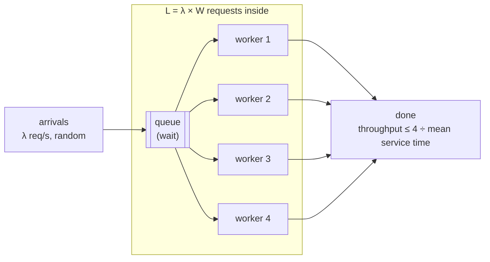

# Latency, Throughput & Percentiles (p50/p99)

> **Module:** 00 Foundations · **Difficulty:** ●●○○○ · **Time:** ~45 min · **Prereqs:** [HTTP, REST & Status Codes](../03-http-rest/README.md)

## TL;DR

**Latency** is how long one request takes; **throughput** is how many requests finish per second. Latency must be
judged by **percentiles** (p50, p99), not the mean, because the slow tail is what users and fan-out services feel.
And latency stays flat until load nears capacity, then explodes as requests queue.

## Explain like I'm 5

Think of a **supermarket**:

- **Latency** is how long *you* spend from joining a checkout line to walking out.
- **Throughput** is how many shoppers *all* the tills get through per hour.
- Most shoppers are done in 2 minutes. Now and then someone's coupon breaks and the till freezes for 20 minutes.
  "The average is 3 minutes" describes nobody: it's the frozen tills you remember.
- If your family splits up to shop and leaves only when the **last** person is done, one frozen till ruins the
  trip for everyone. The more people in your family, the more likely one of you hits a frozen till.
- When the store is half full, lines are short. When it's nearly full, lines suddenly get very long, even though
  the cashiers aren't working any slower.
- A store inspector who sends the next test shopper only when the previous one comes out will hardly notice a
  frozen till: they simply stop sending shoppers while it's stuck. Real shoppers keep coming anyway.

| In the story | In the system |
|---|---|
| Time from joining the line to leaving | **Latency** = time waiting in the queue + **service time** |
| Shoppers per hour, across all tills | **Throughput** (requests per second) |
| Tills | **Workers** (threads, processes, connections); all of them busy = **capacity** |
| "Most done in 2 minutes" | **p50**, the median: half of requests are faster than this |
| "1 in 100 waits 20 minutes" | **p99**: 99% are faster; the slowest 1% are the **tail** |
| "Average 3 minutes" | The **mean**: dragged up by the tail, typical of no one |
| The family leaving when the last one is done | **Fan-out**: a request waits for the slowest of N backend calls |
| Lines exploding when the store is nearly full | **Queueing**: latency rises steeply as **utilization** nears 100% |
| The inspector who waits before sending the next shopper | A **closed-loop** benchmark, which hides stalls (**coordinated omission**) |

**Real world:** **Amazon's Dynamo** paper (2007) says Amazon set its service-level agreements at the **99.9th
percentile**, not the mean, because the customers with the most activity, often the most valuable ones, are the ones
who hit the slow tail.

## Technical deep dive

### The problem

"Is the service fast enough?" has no good single-number answer. The mean hides the users who suffer; capacity
numbers say nothing about how slow requests get on the way there. And the obvious way to measure (a loop that sends
a request, waits, sends the next) can miss exactly the slowdowns you're looking for. You need the right
**statistics** (percentiles), the right **model** (queueing and Little's Law), and the right **measurement**
(open-loop load).

### How it works

1. **Latency = queue wait + service time.** **Service time** is the work itself (here mostly ~15 ms, with 2% of
   requests taking 200–1000 ms, like a garbage-collection pause or a cache miss). **Queue wait** is time spent
   waiting for a free worker. Users feel the sum.
2. **Percentiles describe the distribution.** Sort the latencies. **pN** is the value at rank ⌈N% × count⌉
   (nearest rank). p50 is the typical request; p99 and p99.9 measure the tail. Report several, never just the mean.
3. **Fan-out multiplies the tail.** If a page calls N backends in parallel and waits for all of them, it is slow
   whenever *any* of them is slow: P(slow page) = 1 − (1 − p)ᴺ. With p = 2%, 10 calls give 18%, and 100 calls give
   87%. A backend's p98 becomes the page's median.
4. **Capacity** = workers ÷ mean service time: 4 ÷ 28 ms ≈ **143 req/s** here. **Utilization** (ρ) is the fraction
   of that being used.
5. **Queueing makes latency non-linear in load.** Arrivals are random, so even below capacity requests sometimes
   bunch up and wait. Waiting time grows roughly like ρ ÷ (1 − ρ). It's small at 50% busy, about 10× bigger at 90%,
   and unbounded past 100%, where throughput is capped and the queue just grows.
6. **Little's Law:** L = λ × W. The average number of requests in the system (L) equals throughput (λ) times
   average latency (W), for *any* stable system. It turns two known numbers into the third. For example, 1,000
   req/s at 50 ms means about 50 requests in flight, so you need at least 50 workers or connections.
7. **Measure open-loop.** Real users arrive on their own schedule. A **closed-loop** load generator (send, wait for
   the reply, send again) slows down when the server does, so it doesn't send the requests that would have suffered.
   This is **coordinated omission** (a term from Gil Tene). Open-loop generators send on a fixed schedule, and
   measure from when each request *should* have been sent.



### Trade-offs

| Choice | Gain | Cost |
|---|---|---|
| Run at high utilization (85–95%) | Fewer machines per request | Latency near the cliff: p50 was 236 ms at 90% vs 17 ms at 50%; any burst tips it over |
| Keep headroom (≈50–70%) | Flat latency, room for bursts and failover | Pay for idle capacity |
| Watch p99 / p99.9 vs the mean | See what the unlucky users see; catch fan-out problems | Needs histograms rather than one number; more samples to be accurate |
| Fan out wide (many parallel backend calls) | Spread the work, use many machines | Tail amplification: 100 calls at 2% each make 87% of pages slow |
| Hedged requests (send a backup after a delay) | Cuts the tail: the faster of two copies wins | Extra load; only safe for idempotent reads ([HTTP methods](../03-http-rest/README.md)) |
| Open-loop load testing | Honest tail numbers under real arrival patterns | Can overload the server you're testing; harder to set up |

### Failure modes & gotchas

- **Dashboards that show the mean.** In section 1 the mean was 29 ms while 1 in 100 requests took 637 ms or more.
  A mean alert would stay green while the tail burns.
- **Averaging percentiles.** The p99 of a fleet is *not* the average of each server's p99. Percentiles don't add or
  average; you have to merge the underlying histograms (what HdrHistogram and Prometheus histograms are for).
- **Running near capacity.** Between 75% and 95% load, p50 went from 25 ms to 655 ms. Load spikes, deploys and a
  failed node all push you over the cliff. Past it (105%), p50 hit 6.2 s and kept growing.
- **A small tail eats capacity.** Raising the slow share from 2% to 5% barely moved p50 (15.2 → 15.5 ms), but cut
  capacity by 38% (*Break it*): slow requests occupy workers.
- **Coordinated omission.** The same 500 ms stall: the open-loop test saw 69 slow requests out of 200, the
  closed-loop test saw 4. Classic tools like `ab` and the original `wrk` loop this way; `wrk2` and HdrHistogram exist
  to correct it.
- **Ignoring Little's Law in sizing.** A connection pool of 10 in front of a service at 500 req/s and 100 ms average
  latency needs L = 50 connections. The other 40 requests queue in your client, invisibly adding latency.

### When NOT to use it

These are ideas rather than a technology, but the tools have limits:

- **Don't chase p99.9 with a few hundred samples.** It's the slowest 1 in 1,000, and you need many thousands of
  samples per window before that number means anything.
- **Don't use Little's Law on unstable systems.** It holds on average for systems in a steady state. During an
  overload (arrivals > capacity), L and W keep growing, and "average latency" depends on how long you measured.
- **Don't optimise for throughput alone when users are waiting on each request.** Batching and big queues raise
  throughput and wreck latency. They're the right choice for offline jobs, the wrong one for interactive APIs
  ([Batch vs Stream Processing](../../08-observability-and-architecture/10-batch-vs-stream/README.md)).

## Implementation

Four small files in [`src/`](src/), all standard library (the real-time part uses `asyncio`).

| File | What it holds |
|---|---|
| [`stats.py`](src/stats.py) | Nearest-rank `percentile`, `summarize`, and a log-scaled text histogram |
| [`workload.py`](src/workload.py) | Seeded service times: log-normal around 15 ms, plus a slow 200–1000 ms tail |
| [`queue_sim.py`](src/queue_sim.py) | An event-by-event simulation of c workers and one FIFO queue, with Little's Law measured directly |
| [`aio_service.py`](src/aio_service.py) | A real asyncio service (a semaphore of workers, a stall switch) plus open- and closed-loop load generators |

The key ideas in the code:

- **The simulation needs no clock**: one min-heap of "when is each worker free" decides when each request starts.
- **Little's Law is checked, not assumed**: L is measured by counting requests inside the system at 2,000 moments.
- **The open-loop generator measures from the *intended* send time**, so a stalled server can't hide its backlog.

**Full explanation of the code, with a traced simulation, Python techniques and exercises:
[CODE_WALKTHROUGH.md](CODE_WALKTHROUGH.md).**

## Run it

```bash
cd modules/00-foundations/05-latency-throughput
make up     # no infrastructure needed for this lesson
make run    # run the demo
make test   # prove the behaviour
make down
```

## Expected output

Sections 1–3 are simulated and identical on every run. Section 4 runs in real time and varies by a few
milliseconds.

```text
==============================================================================
 Latency, throughput & percentiles: tails, fan-out, queueing, measurement
==============================================================================

1) Averages hide the tail: 10,000 requests, 2% of them hit something slow
  mean     p50      p90      p99       p99.9     max
  -------  -------  -------  --------  --------  --------
  29.1 ms  15.2 ms  26.4 ms  637.3 ms  951.8 ms  994.2 ms

  latency histogram (log-scaled bars):
        0–10    ms   1,485  ██████████████████████████████████
       10–20    ms   5,975  ████████████████████████████████████████
       20–40    ms   2,242  ███████████████████████████████████
       40–100   ms      75  ████████████████████
      100–200   ms       0
      200–500   ms      86  █████████████████████
      500–1000  ms     137  ███████████████████████
  → the mean (29.1 ms) describes no real request: half finished within 15.2 ms, and 1 in 100 took 637.3 ms or more.

2) Fan-out: one page waits for N backend calls in parallel (each backend as in section 1)
  backends per page  page p50  page p99  pages hitting a slow call  1 − (1 − p)^N
  -----------------  --------  --------  -------------------------  -------------
  1                  15.1 ms   651.2 ms  2.0%                       2.0%
  10                 29.0 ms   957.5 ms  17.8%                      18.3%
  50                 449.1 ms  992.3 ms  62.9%                      63.6%
  100                720.2 ms  996.3 ms  86.5%                      86.7%
  → each backend is slow only 2% of the time, but most pages that need 50 or 100 of them are
    slow. A backend's rare tail becomes the *typical* experience of a page that fans out widely.

3) Latency vs load: 4 workers, mean service time 28.0 ms → capacity ≈ 143 req/s (simulated, 20,000 requests)
  offered req/s (load)  throughput  busy  p50         p99          L measured  λ × W
  --------------------  ----------  ----  ----------  -----------  ----------  -----
  36 (25%)              36          25%   15.3 ms     617.3 ms     1.0         1.0
  71 (50%)              71          51%   16.5 ms     711.2 ms     3.0         3.0
  107 (75%)             107         76%   25.4 ms     1,038.9 ms   12.4        12.4
  128 (90%)             128         91%   235.7 ms    1,624.5 ms   51.5        51.5
  136 (95%)             135         96%   655.3 ms    2,142.5 ms   99.9        99.9
  150 (105%)            140         99%   6,216.4 ms  10,492.4 ms  829.9       829.9
  → latency stays flat, then shoots up as load nears capacity: requests start queueing behind each
    other. Past 100% the queue grows without limit; throughput is capped, only latency keeps rising.
    And L = λ × W holds at every load (Little's Law): concurrency = throughput × latency.

4) A real asyncio service with 4 workers freezes once for 500 ms. Two load tests measure it
   (no random slow requests here, so the stall is the only source of slowness)
  load generator                                         requests  p50      p90       p99       slower than 100 ms
  -----------------------------------------------------  --------  -------  --------  --------  ------------------
  open loop: 100 req/s on a fixed schedule               200       25.1 ms  384.8 ms  496.3 ms  69 (34%)
  closed loop: 4 clients, next request after each reply  357       15.3 ms  27.2 ms   503.2 ms  4 (1%)
  → same server, same stall. The closed-loop clients stopped sending while it was frozen, so only
    the few requests already in flight saw it. Real users keep arriving, as the open loop does,
    and every one of them waited. Closed-loop benchmarks under-report the tail.
```

```text
uv run python -m pytest tests
.......                                                                  [100%]
7 passed in 2.89s
```

**What you're seeing:**

1. **The tail.** 98% of requests sit between 0 and 100 ms; the 2% slow ones form a second hump at 200–1000 ms. The
   mean (29.1 ms) lands between the humps, where almost no request actually is. p99 (637 ms) is in the slow hump.
2. **Fan-out.** The simulated share of slow pages matches 1 − (1 − p)ᴺ: 17.8% vs 18.3% at 10 calls, 86.5% vs 86.7%
   at 100. At 100 backends, the page's *median* (720 ms) is slower than a single backend's p99.
3. **Queueing.** Up to 50% load, p50 stays near the 15 ms service time. At 90% it's 236 ms, and at 95% it's 655 ms.
   Past capacity (105% offered), throughput stalls at 140 req/s and p50 reaches 6.2 s, and it would keep growing with
   a longer run. In every row, the measured number of requests inside equals throughput × mean latency.
4. **Coordinated omission.** Open loop: requests kept arriving during the 500 ms freeze and queued, so 34% were slow
   and p90 was 385 ms. Closed loop: the 4 clients were each stuck on one request, so only 4 samples (1%) saw the
   stall and p90 looked healthy at 27 ms. It's the same stall; only the measurement changed.

## Break it

**Experiment: make the tail heavier: 5% slow requests instead of 2%.**

```bash
SLOW_PCT=5 make run
```

```text
1) Averages hide the tail: 10,000 requests, 5% of them hit something slow
  mean     p50      p90      p99       p99.9     max
  -------  -------  -------  --------  --------  --------
  48.2 ms  15.5 ms  29.0 ms  849.1 ms  985.0 ms  999.2 ms

2) Fan-out: one page waits for N backend calls in parallel (each backend as in section 1)
  backends per page  page p50  page p99  pages hitting a slow call  1 − (1 − p)^N
  -----------------  --------  --------  -------------------------  -------------
  1                  15.4 ms   820.4 ms  5.0%                       5.0%
  10                 34.2 ms   981.5 ms  39.9%                      40.1%
  50                 779.1 ms  996.6 ms  92.3%                      92.3%
  100                890.2 ms  998.2 ms  99.5%                      99.4%

3) Latency vs load: 4 workers, mean service time 45.5 ms → capacity ≈ 88 req/s (simulated, 20,000 requests)
  offered req/s (load)  throughput  busy  p50         p99          L measured  λ × W
  --------------------  ----------  ----  ----------  -----------  ----------  -----
  22 (25%)              22          25%   15.5 ms     843.6 ms     1.0         1.0
  44 (50%)              44          50%   17.1 ms     861.1 ms     2.8         2.8
  66 (75%)              66          75%   28.7 ms     1,052.5 ms   10.3        10.3
  79 (90%)              79          90%   297.1 ms    2,001.0 ms   32.9        32.9
  84 (95%)              83          95%   686.8 ms    2,630.0 ms   69.0        69.0
  92 (105%)             87          99%   5,920.6 ms  13,482.5 ms  579.8       579.9
```

(The histogram, the "→" summary lines and section 4 are trimmed here; section 4 doesn't use the slow tail.)

Watch three things:

- **p50 barely moved** (15.2 → 15.5 ms). A dashboard showing only the median would say nothing changed.
- **Capacity dropped 38%**, from 143 to 88 req/s, because each slow request ties up a worker for 200–1000 ms. A small
  tail is a capacity problem, not just a latency problem.
- **Fan-out pages are now almost always slow:** 99.5% of 100-backend pages hit a slow call.

The usual fixes attack the tail directly: timeouts with retries on another replica, hedged requests, and removing the
causes (GC tuning, warm caches).

## Real-world systems

| System | How it uses this |
|---|---|
| Amazon Dynamo / DynamoDB | SLAs defined at p99.9 latency, not the mean |
| Google (*The Tail at Scale*) | Hedged and tied requests to cut tail latency in fan-out services such as search |
| HdrHistogram, `wrk2` | Record latency histograms accurately and load-test at a constant rate, correcting coordinated omission |
| Prometheus histograms | Bucketed latency per instance, merged across a fleet to compute fleet-wide percentiles |
| AWS Lambda / Kubernetes autoscalers | Scale on concurrency or utilization targets: Little's Law (concurrency = rate × duration) in practice |
| SRE practice (Google SRE book) | SLOs on latency percentiles, plus headroom targets so services don't run near the queueing cliff |

## Interview angle

**Q1. Why report p99 instead of the average latency?**
Latency distributions are skewed: most requests are fast and a few are very slow. The mean mixes them into a number
that describes no request (29 ms, when half took ≤ 15 ms and 1% took ≥ 637 ms). Percentiles show the typical case
(p50) and the tail (p99, p99.9). The tail matters because heavy users make many requests and will hit it, and because
fan-out turns one backend's tail into many pages' typical latency. Say also that percentiles can't be averaged across
servers; you merge histograms.

**Q2. Your service handles 2,000 req/s with an average latency of 50 ms. How many requests are in flight, and how
many worker threads would you run?**
Little's Law: L = λ × W = 2,000 × 0.05 = **100 in flight** on average. Size for peaks and headroom, not the average:
at 1.5× peak traffic and about 70% target utilization, roughly 100 × 1.5 ÷ 0.7 ≈ 215 workers. Check what the latency
is made of: if most of it is waiting on a database, async I/O can carry those 100+ in-flight requests on far fewer
threads.

**Q3. Latency is fine at 60% CPU but terrible at 90%, though the code didn't change. Why?**
Queueing. Arrivals are random, so requests sometimes bunch up and wait for a busy worker. The expected wait grows
roughly like ρ ÷ (1 − ρ): about 1.5 at 60%, 9 at 90%, unbounded at 100%. In this lab p50 went from 17 ms at 50% to
236 ms at 90%. Fixes: add capacity or headroom, smooth bursts, shed load early, and cut the slow tail, which inflates
both service time and queueing.

## Self-check quiz

1. A service's mean latency is 40 ms and its p99 is 900 ms. What does that tell you about the distribution? Which
   number would you put on an alert?
2. State Little's Law. What does it let you compute, and when doesn't it apply?
3. Your API page makes 20 parallel calls to backends whose p99 is 300 ms (and p50 is 10 ms). Roughly what fraction of
   page loads will take at least 300 ms?
4. A load test with 8 clients in a send-and-wait loop reports p99 = 40 ms. In production, users see a p99 of 1.2 s
   during GC pauses. How can both be true, and how would you fix the test?
5. Your team wants to run servers at 90% CPU to save money. What's the latency trade-off, and what would you propose
   instead?

<details>
<summary>Answers</summary>

1. The distribution has a long tail: most requests are fast (the median is probably well under 40 ms), and about 1% are
   more than 20× slower than the mean. Alert on the **p99** (or p99.9), plus an error rate. The mean can stay flat while
   the tail gets much worse, as the *Break it* run's median showed.
2. **L = λ × W**: average items in the system = throughput × average time each spends there. Given any two, you get the
   third, e.g. how many concurrent connections or workers a given rate and latency need. It holds for averages in a
   **stable** system (arrivals ≤ capacity over the measurement window). During an overload, the queue keeps growing
   and the "averages" depend on how long you measure.
3. Each call has a 1% chance of taking ≥ 300 ms, so P(at least one slow call) = 1 − 0.99²⁰ ≈ **18%** of page loads,
   nearly 1 in 5, even though each backend is "slow only 1% of the time".
4. Coordinated omission. Each of the 8 clients waits for its reply before sending again, so during a GC pause the test
   sends almost nothing, and records at most 8 slow samples. Real users keep arriving and pile up behind the pause.
   Fix: an **open-loop** generator at a constant rate (e.g. `wrk2`, or `open_loop` in this lab) that measures from the
   intended send time, recorded in an HdrHistogram.
5. Near 90% utilization, queueing delay is roughly 9× the service time and very sensitive to bursts: a small spike or a
   lost instance pushes the service over the cliff (p50 went 17 → 236 ms here, and past 100% it grows without bound).
   Propose a utilization target of around 60–70% for latency-sensitive services, autoscaling on concurrency or
   utilization, load shedding when overloaded, and fixing the slow tail (which also frees capacity). Run batch work at
   high utilization instead, where latency doesn't matter.

</details>

## Further reading

- Jeffrey Dean & Luiz André Barroso, [*The Tail at Scale*](https://doi.org/10.1145/2408776.2408794)
  (Communications of the ACM, 2013): fan-out amplification and hedged requests
- Gil Tene, [`wrk2` README](https://github.com/giltene/wrk2): coordinated omission explained, by the person who named
  it (see also his talk *How NOT to Measure Latency*)
- Google SRE Book, [*Monitoring Distributed Systems*](https://sre.google/sre-book/monitoring-distributed-systems/):
  the four golden signals and why to watch latency distributions
