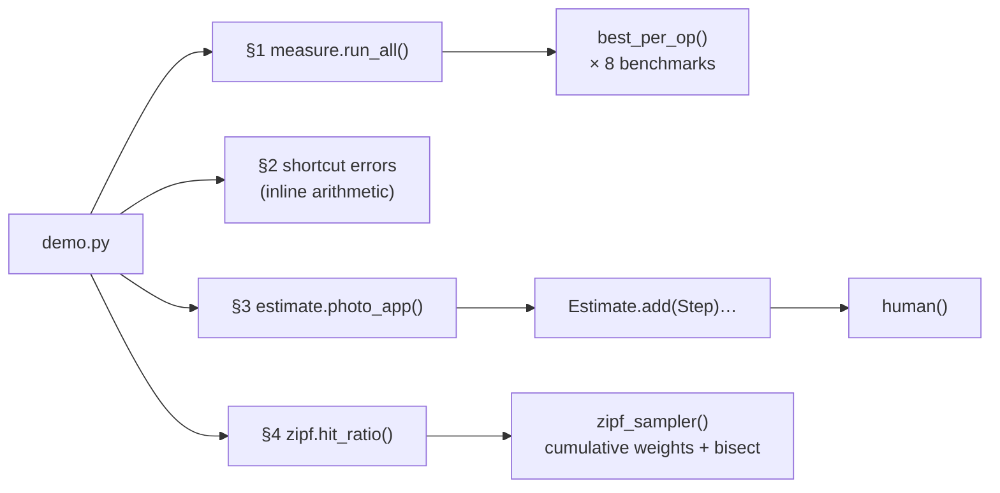

# Code walkthrough: Back-of-the-Envelope Estimation

> Companion to [README.md](README.md). The README explains the *concept*; this file explains the
> *code*, file by file, so you can read it, change it, and rebuild it yourself.
> Line links (e.g. `estimate.py#L49`) point at the exact code.

## File map

| Read | File | Lines | Role |
|---|---|---|---|
| 1 | [`src/estimate.py`](src/estimate.py) | 75 | `human()` rounding, `Step` / `Estimate`, and the worked `photo_app()` estimate |
| 2 | [`src/measure.py`](src/measure.py) | 123 | `best_per_op` and seven benchmarks for this machine's latency ladder |
| 3 | [`src/zipf.py`](src/zipf.py) | 28 | A seeded Zipf sampler and an ideal top-k cache's `hit_ratio` |
| 4 | [`src/demo.py`](src/demo.py) | 99 | Four experiments that print the README's "Expected output" |
| 5 | [`tests/test_estimation.py`](tests/test_estimation.py) | 51 | Seven tests: arithmetic, scaling, headroom, the peak trap, 80/20, the latency ladder |
| – | [`Makefile`](Makefile) | | `make run` = `uv run python -m src.demo`, `make test` = `uv run python -m pytest tests` |

## How the pieces fit



The three files are independent. `demo.py` combines them, and `estimate.py` is the one you'd reuse for your own
designs.

## `src/estimate.py`, estimates as code

### `human` ([L17](src/estimate.py#L17)): rounding is a feature

```python
prefixes = ["", "K", "M", "G", "T", "P"] if unit in ("B", "bit/s") else ["", "K", "M", "B", "T", "P"]
while abs(value) >= 1000 and i < len(prefixes) - 1:
    value, i = value / 1000, i + 1
text = f"{value:.2g}" if value < 10 else f"{value:.0f}"
```

**What it does:** divides by 1,000 until the number is below 1,000, then prints it with 1–2 significant figures plus
an SI prefix: `2e9` → `2 B`, `5.475e16` bytes → `55 PB`.

**Why this way:**
- **It's deliberately imprecise.** An estimate that prints 57.870370 suggests precision it doesn't have. Two
  significant figures say "about this much" honestly.
- **Decimal (1,000), not binary (1,024)**, because estimates use powers of ten. The 7% difference is noise
  (section 2).
- **Units pick the prefixes.** Bytes and bits get **G** (giga); counts get **B** (billion). `1.1 Tbit/s` and `2 B`
  views can't be confused.

### `Step`, `Estimate.add`, `__getitem__` ([L29](src/estimate.py#L29)–[L46](src/estimate.py#L46))

```python
def add(self, name, formula, value, unit=""):
    self.steps.append(Step(name, formula, value, unit))
    return value  # so steps chain: later steps use earlier values

def __getitem__(self, name):
    return next(s.value for s in self.steps if s.name == name)
```

**What it does:** records a named step together with the formula used to get it, and returns the value so the next
line can use it. `e["peak read QPS"]` looks up any step by name later.

**Why this way:** the formula string is the point of the exercise. A reviewer reads "views/day ÷ 86,400" and can
challenge it. A bare number can't be reviewed, only trusted. Returning `value` from `add` lets `photo_app` read like
the maths on an envelope, one line per step.

### `photo_app` ([L49](src/estimate.py#L49)): the worked example

```python
reads = e.add("photo views / day", "DAU × views per user", dau * views_per_user)
read_qps = e.add("avg read QPS", "views/day ÷ 86,400", reads / SECONDS_PER_DAY, "/s")
peak = e.add("peak read QPS", f"avg × peak factor {peak_factor:g}", read_qps * peak_factor, "/s")
...
per_server = server_rps * target_utilization
e.add("app servers at peak", f"peak QPS ÷ ({human(server_rps)} req/s × {target_utilization:.0%} busy), rounded up",
      -(-peak // per_server), "")
```

**What it does:** README "How it works" step 2, line by line. Every assumption is a keyword argument with a default
(`dau=50e6`, `photo_bytes=2e6`, `peak_factor=3`, …), so `photo_app(peak_factor=1)` is the *Break it* run, and
`photo_app(dau=20e6)` a sensitivity check.

**Why this way:**
- **Two cache steps on purpose.** "20% of a day's image bytes" comes to 800 TB, which can't be RAM. The second step,
  "20% of a day's *metadata*" at 500 B per view, gives 200 GB. Seeing both side by side teaches the design decision:
  CDN for images, memory cache for metadata.
- **A utilization target** ([L72](src/estimate.py#L72)). `per_server = server_rps × 0.6`, taken from the latency
  lesson's queueing cliff. Sizing at 100% gives a fleet that is exactly full at peak, which is no room at all.
- **Line notes:** [L74](src/estimate.py#L74): `-(-peak // per_server)` is ceiling division without `math.ceil`.
  Floor-divide the negative, then negate. You round *up*, because 57.9 servers means you need 58.

## `src/measure.py`, the latency ladder

### `best_per_op` ([L22](src/measure.py#L22))

```python
best = float("inf")
for _ in range(rounds):
    start = time.perf_counter()
    for _ in range(per_round):
        op()
    best = min(best, (time.perf_counter() - start) / per_round)
```

**What it does:** times `per_round` calls, `rounds` times, and keeps the *fastest* average.

**Why this way:** noise from other programs, CPU frequency changes and the garbage collector only ever makes things
*slower*. So the minimum is the best estimate of the operation's own cost; this is the approach Python's `timeit`
documentation recommends. Many calls per round spread the cost of `perf_counter` itself (tens of nanoseconds) thin
enough to measure a 40 ns dict lookup.

### The benchmarks ([L33](src/measure.py#L33)–[L105](src/measure.py#L105))

| Benchmark | What makes it a fair measurement |
|---|---|
| `dict_lookup` | A 100,000-entry table, so it's a real hash lookup and not a trivially optimised one |
| `json_encode_1kb`, `copy_1mb`, `sha256_1mb` | Fixed-size inputs, so you can scale them in your head: 1 MB → 1 GB is ×1,000 |
| `localhost_round_trip` ([L53](src/measure.py#L53)) | A real TCP echo server on a thread, with `TCP_NODELAY` (lesson 1's Nagle trap) |
| `fsync_4kb` ([L76](src/measure.py#L76)) | Write, flush, sync, and `full=True` swaps in `F_FULLFSYNC` |
| `sequential_read_mb` ([L94](src/measure.py#L94)) | A 64 MB file just written, so it's in the OS page cache: this measures the read path, not the SSD |

**Line notes:** [L87](src/measure.py#L87): `fcntl.F_FULLFSYNC` exists only on macOS. There, `os.fsync` returns once
the drive has the data, even if it's still in the drive's volatile cache. `F_FULLFSYNC` waits until it's on stable
storage. The benchmark list appends that row only if the constant exists ([L118](src/measure.py#L118)), so the
lesson still runs on Linux, where `fsync` already flushes the device.

## `src/zipf.py`, testing a rule of thumb

```python
weights = [1 / (k + 1) ** s for k in range(n_items)]
cumulative = list(itertools.accumulate(weights))
total, rng = cumulative[-1], random.Random(seed)
return lambda: bisect.bisect_left(cumulative, rng.random() * total)
```

**What it does:** item rank `k` (0 = most popular) gets weight `1/(k+1)^s`. The sampler draws a uniform number in
`[0, total)` and finds which item's slice of the cumulative weights it falls into. That's **inverse-CDF sampling**
(CDF: the cumulative distribution function).

**Why this way:** one `bisect` per draw (O(log n)) instead of scanning 100,000 weights. `random.choices` could do the
same, but writing it out shows exactly what "Zipf" means: popularity falls off as a power of rank. With `s = 0` every
weight is 1: uniform.

`hit_ratio` ([L24](src/zipf.py#L24)) models an **ideal** cache that holds exactly the top `cache_fraction` of
items: a hit is `draw() < cached`. Real caches (LRU) don't know the ranking in advance and do somewhat worse
(exercise 3), so the numbers here are an upper bound.

## `src/demo.py`, making it visible

| Experiment | Line | Setup | What it shows | README output |
|---|---|---|---|---|
| 1. Latency ladder | [L36](src/demo.py#L36) | `run_all()`; each row also as a multiple of the dict lookup | The spread from ns to ms, and the two fsyncs | 41 ns … 1.7 ms |
| 2. Shortcuts | [L48](src/demo.py#L48) | Exact vs rounded values, inline | Error of each mental shortcut | +16% worst |
| 3. Estimate | [L65](src/demo.py#L65) | `photo_app(peak_factor=PEAK)` plus a check against `TRUE_PEAK = 3` | The chain, and how busy the fleet would really be | 58 servers, 60% busy |
| 4. 80/20 | [L81](src/demo.py#L81) | `hit_ratio` for 5 skews, at 1% and 20% cache sizes | Where the rule holds and where it fails | 87% vs 20% |

**Details worth noticing:**
- **`TRUE_PEAK` is separate from `PEAK`.** `PEAK` is what the *estimator assumed*; `TRUE_PEAK` is what the traffic
  *really does*. The check line compares the two, which is how *Break it* exposes a wrong assumption.
- **Section 3's conclusion is built from the step values** (`human(e["peak egress bandwidth"], "bit/s")`), so it stays
  true when an environment variable changes the inputs.
- **The ×-multiple column in section 1** turns absolute times, which are machine-specific, into ratios that hold
  roughly anywhere.

## Tests: what each one proves

| Test | Property it proves | Why that property matters |
|---|---|---|
| [`test_human_formatting…`](tests/test_estimation.py#L9) | `2e9` → `2 B`, `5.475e16 B` → `55 PB`, `1.1e12 bit/s` → `1.1 Tbit/s` | Rounding and units are the presentation of every estimate |
| [`test_estimate_chains_its_steps_correctly`](tests/test_estimation.py#L17) | views/day, avg QPS, peak QPS and storage/day match the hand formulas | The chain does what its formula strings claim |
| [`test_estimates_scale_linearly_with_users`](tests/test_estimation.py#L25) | Doubling DAU doubles QPS, storage and bandwidth | Linear chains make sensitivity analysis trivial |
| [`test_servers_are_sized_for_headroom…`](tests/test_estimation.py#L31) | Fleet utilization at peak lands in (50%, 60%] | Capacity is sized to a target, not to 100% |
| [`test_forgetting_the_peak_overloads_the_fleet`](tests/test_estimation.py#L37) | Sized with peak factor 1, the real 3× peak means over 150% busy | The *Break it* failure, as a test |
| [`test_80_20_rule_holds_for_zipf…`](tests/test_estimation.py#L43) | A 20% cache gets over 80% at s = 1, about 20% at s = 0, and more skew means more hits | The rule of thumb is a property of the traffic |
| [`test_memory_is_orders_of_magnitude…`](tests/test_estimation.py#L49) | A dict lookup is under 10 µs, and a localhost round trip is more than 50 lookups | The ladder's ordering, with wide margins for any machine |

## Trace one run

Real values from `photo_app()` with its defaults, and from the Zipf sampler, printed while writing this.

**The estimate chain:**

| Step | Computation | Exact value | Printed |
|---|---|---|---|
| views/day | 50,000,000 × 40 | 2,000,000,000 | `2 B` |
| uploads/day | 50,000,000 ÷ 10 | 5,000,000 | `5 M` |
| avg read QPS | 2,000,000,000 ÷ 86,400 | 23,148.1… | `23 K/s` |
| avg write QPS | 5,000,000 ÷ 86,400 | 57.87… | `58 /s` |
| peak read QPS | 23,148.1 × 3 | 69,444.4… | `69 K/s` |
| servers | ceil(69,444.4 ÷ (2,000 × 0.6 = 1,200)) = ceil(57.87) | 58 | `58` |
| check | 69,444.4 ÷ (58 × 2,000) | 0.5987 | `60% busy` |

**The Zipf sampler**, for 5 items with s = 1.0:

```text
weights     1.0    0.5    0.333  0.25   0.2        (1/1, 1/2, 1/3, 1/4, 1/5)
cumulative  1.0    1.5    1.833  2.083  2.283      total = 2.283
```

`Random(1)` produced `0.134, 0.847, 0.764, 0.255, 0.495, 0.449`. Each is scaled by 2.283 and bisected into the
cumulative list, giving ranks **0, 3, 2, 0, 1, 1**. For example, 0.847 × 2.283 = 1.93 lands between 1.833 and 2.083,
so rank 3. `zipf_sampler(5, 1.0, 1)` returns the same six ranks. Item 0 alone holds 1.0 ÷ 2.283 = **43.8%** of the
probability: caching 1 item out of 5 (20%) catches 44% of reads here. With 100,000 items, the same falloff gives 87%
(section 4).

## Python techniques used

| Technique | Where | Why it's used here |
|---|---|---|
| f-string format specs `:.2g`, `:.0%`, `:+.1%`, `:,` | `human`, demo tables | 2 significant figures, percentages, signed errors, thousands separators |
| `-(-a // b)` | `photo_app` | Integer ceiling division without importing `math` |
| `@dataclass` + `__getitem__` | `Estimate` | Steps as data, and lookup by name: `e["peak read QPS"]` |
| `next(generator)` | `Estimate.__getitem__` | The first matching step, without building a list |
| `time.perf_counter`, best-of-N rounds | `best_per_op` | High-resolution timing, minimum to cut noise |
| `tempfile.NamedTemporaryFile`, `os.fsync`, `fcntl.F_FULLFSYNC` | `fsync_4kb` | Real durable writes on a throwaway file |
| `hasattr(fcntl, "F_FULLFSYNC")` | `BENCHMARKS` | Feature detection: the macOS-only row is added where it exists |
| `itertools.accumulate` + `bisect_left` | `zipf_sampler` | Inverse-CDF sampling in O(log n) per draw |
| A lambda closing over `rng` and `cumulative` | `zipf_sampler` | A ready-to-call sampler with its own seeded state |

## Design decisions & alternatives

| Decision | Alternative | Why this one, for learning |
|---|---|---|
| Estimates as a step list with formula strings | A spreadsheet, or one big expression | Readable, reviewable, testable, and re-runnable with new assumptions |
| Measure the latency ladder live | Copy the classic table | Your hardware and Python runtime, plus the macOS `fsync` surprise |
| An ideal top-k cache | Simulate LRU | Shows the rule's best case cleanly; LRU is exercise 3 |
| Decimal prefixes | Binary (KiB, MiB) | Estimates use powers of ten; the 7% difference doesn't matter (section 2) |

## Change it yourself

### 1. A sensitivity table (easy)

**Goal:** for each assumption of `photo_app`, double it and show which outputs change, and by how much.
**Change:** a new experiment in `src/demo.py` that calls `photo_app(**{name: 2 * default})` for each parameter.
**Check:** doubling `dau` doubles every rate and storage step. Doubling `peak_factor` changes only the peak-based
steps (peak QPS, egress, servers), not storage. `server_rps` shows up only in the server count.

<details><summary>Hint</summary>

`inspect.signature(photo_app).parameters` gives every name and default. Compare the steps by name:
`big[step] / base[step]`. Values of 2.0 (linear), 1.0 (unaffected) and 0.5 (inverse, e.g. `upload_every_days`)
tell you at a glance which assumption each number depends on. That's the "which assumption should I verify first?"
answer from quiz question 5.
</details>

### 2. Estimate another system (medium)

**Goal:** add `chat_app()`: 100 M DAU, 40 messages per user per day, 200 bytes per message, kept forever, 3 replicas,
a peak factor of 4 (evening spikes), and one WebSocket connection per online user (assume 20% of DAU online at
peak).
**Change:** a new function in `src/estimate.py`, plus a test.
**Check:** your test should assert roughly 46,000 messages/s on average, about 0.8 TB of new messages a day before
replication, and, using Little's Law from the previous lesson, about 20 M concurrent connections at peak.

<details><summary>Hint</summary>

Messages per day = 100 M × 40 = 4 B; ÷ 86,400 ≈ 46 K/s. Storage per day = 4 B × 200 B = 800 GB; × 365 × 3 ≈ 0.9 PB
per year. Connections are a *count*, not a rate: 100 M × 20% = 20 M open sockets, so the server count comes from
memory per connection (say 10 KB each, about 200 GB in total), not from requests per second. That's a different
bottleneck than the photo app's.
</details>

### 3. LRU instead of an ideal cache (hard)

**Goal:** measure how close a real LRU cache (least recently used: evict the item untouched for longest) gets to the
ideal top-k hit ratio of section 4.
**Change:** add `lru_hit_ratio(n_items, s, cache_fraction, requests, seed)` to `src/zipf.py`, using
`collections.OrderedDict`.
**Check:** with 100,000 items, a 20% cache and 200,000 requests, you should get about **78%** for LRU vs **87%** ideal
at s = 1, and about 57% vs 70% at s = 0.8. Those are the values this lesson's author measured while writing it.

<details><summary>Hint</summary>

On a hit, `cache.move_to_end(key)`. On a miss, insert, and if `len(cache) > capacity`, `cache.popitem(last=False)`
evicts the oldest. The gap has two causes: LRU starts cold (every first request is a miss), and it sometimes evicts a
popular item after a run of rare ones. Run more requests and the cold-start share shrinks. This is the subject of the
caching module's [Eviction Policies](../../02-caching/02-eviction-policies/README.md) lesson.
</details>
