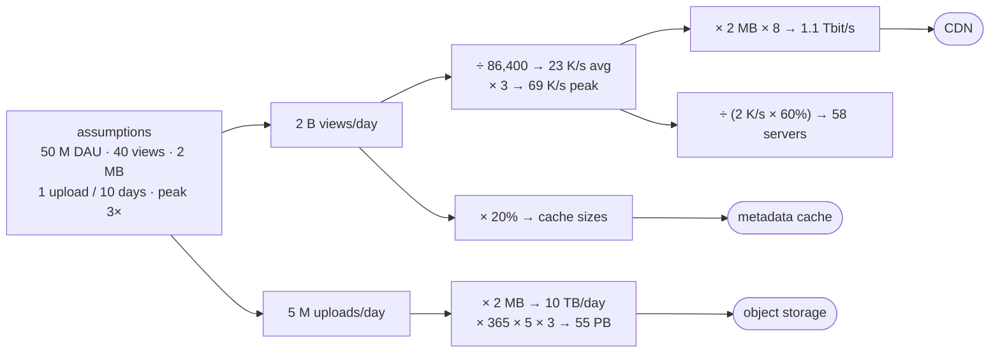

# Back-of-the-Envelope Estimation

> **Module:** 00 Foundations · **Difficulty:** ●●○○○ · **Time:** ~45 min · **Prereqs:** [Latency, Throughput & Percentiles](../05-latency-throughput/README.md)

## TL;DR

A back-of-the-envelope estimate turns a few stated assumptions (users, actions, sizes, peaks) into the numbers that
decide a design (requests per second, storage, bandwidth, cache size, servers), using rounded mental maths. The goal is
the right **order of magnitude** and visible reasoning, not precision. Most of the design follows from those numbers.

## Explain like I'm 5

You're planning a **birthday party** for your class.

- "30 kids, and each eats about 2 slices, so 60 slices. A pizza has 8 slices, so about 8 pizzas." You didn't count
  every crumb, but you know it's *8 pizzas, not 1 and not 100*.
- "Most kids arrive in the same 10 minutes, so I need enough cups ready **at once**, not just enough for the whole
  afternoon."
- "Everyone wants chocolate cake; almost nobody wants the fruit plate. Put chocolate near the door." A few favourites
  get most of the demand.
- If you had guessed "10 kids" when it's really 30, rounding 8 slices up or down wouldn't matter: the **wrong guess**
  would be the big mistake.

| In the story | In the system |
|---|---|
| 30 kids × 2 slices | Daily users × actions per user = requests per day |
| "8 pizzas, not 1 or 100" | **Order of magnitude**: the answer to within a factor of 2–3 |
| Everyone arriving in 10 minutes | **Peak traffic**: often 2–3× the daily average; you size for the peak |
| Cups ready at once | Capacity at the peak, plus **headroom** (from the [latency lesson](../05-latency-throughput/README.md)) |
| Chocolate cake near the door | **Skew**: a few hot items get most reads, so a small cache serves a lot |
| Guessing 10 kids instead of 30 | A wrong **assumption**, the error that actually hurts |

**Real world:** **Google's** interviews made this style famous, and Jeff Dean's talk *Designs, Lessons and Advice from
Building Large Distributed Systems* (2009) popularised the "latency numbers every programmer should know" table, so
that engineers could estimate a design's speed before building it.

## Technical deep dive

### The problem

Before writing code you must decide whether the job takes one server or a thousand, a database or object storage, a
cache or a CDN. Building and load-testing every option is too slow. An estimate gets you to the right **class** of
design in minutes, makes your assumptions explicit so others can challenge them, and gives you numbers to check
production against later.

### How it works

1. **Write down assumptions, with units.** For example: daily active users (DAU), actions per user per day, object
   size, read:write ratio, how long data is kept, replication factor, peak-to-average ratio.
2. **Chain small steps,** one multiplication or division each:
   - requests per day = DAU × actions per user
   - average QPS (queries per second) = per day ÷ 86,400 (≈ 10⁵)
   - peak QPS = average × peak factor
   - storage = writes per day × size × days × replicas
   - bandwidth = QPS × size × 8 (bits)
   - cache = hot fraction × daily read volume
   - servers = peak QPS ÷ (per-server capacity × target utilization)
3. **Round aggressively.** Keep 1–2 significant figures, and use powers of ten (2¹⁰ ≈ 10³; one day ≈ 10⁵ s; one year
   ≈ 3 × 10⁷ s). Rounding errors stay within about 25%; assumption errors are 10×.
4. **Know the latency ladder.** Memory, then hashing or copying a megabyte, then a network round trip, then a durable
   disk write. Each step is 10–1,000× the previous one, and the slowest step in a request's path dominates.
5. **Sanity-check and read the result as a design.** 55 PB means object storage. 1 Tbit/s of egress means a CDN. A
   200 GB hot set fits in a cache cluster. And size servers for a utilization target (around 60%), not 100%, or
   queueing will hurt.



### Trade-offs

| Choice | Gain | Cost |
|---|---|---|
| Round to powers of ten | Mental maths in seconds, easy to check | 5–25% error per shortcut (section 2) |
| Size for the peak, not the average | Survives the daily spike | Idle capacity off-peak; autoscaling can claw it back |
| A utilization target (~60%) | Headroom for bursts and a lost server, flat latency | About 1.7× the servers of "100% busy" |
| Use rules of thumb (80/20, 3× peak) | A starting number when you have no data | Can be badly wrong for your traffic (section 4: uniform access gets 20% hits, not 80%) |
| Use your own measurements over classic tables | Numbers that fit your hardware and runtime | Benchmarks lie too (best case, warm caches); treat them as lower bounds |

### Failure modes & gotchas

- **Sizing for the average.** With no peak factor, the estimate asks for 20 servers. At a real 3× peak they would be
  **174%** busy, which (as the latency lesson showed) means unbounded queues (*Break it*).
- **Bits vs bytes, and decimal vs binary.** Network bandwidth is quoted in bits (× 8); storage in bytes. A GiB (2³⁰)
  is 7% more than a GB (10⁹). The first is an 8× error; the second doesn't matter.
- **Forgetting replication and overhead.** Three copies triple storage. Indexes, metadata and free-space margins add
  more on top of that.
- **Trusting `fsync` on macOS.** Plain `fsync` took about 38 µs here because it only reaches the drive's volatile
  cache. A really durable write (`F_FULLFSYNC`) took about 1.7 ms, about 45× slower. Use the honest number when
  estimating commit throughput.
- **Applying 80/20 without checking skew.** Caching 20% of items served 87% of reads under Zipf (s = 1) traffic, but
  only 20% under uniform traffic. Measure the access distribution.
- **False precision.** "We need 57.87 servers" invites misplaced trust. Say "about 60", and list the assumption that
  would change it most.

### When NOT to use it

- **When you can measure cheaply.** If a one-hour load test or production metrics can answer the question, trust them
  over the envelope.
- **For final capacity commitments.** Estimates choose the architecture; buying hardware or signing contracts needs
  measured load, growth forecasts and a margin.
- **When the answer depends on non-linear effects** (cache hit ratios, contention, queueing near saturation). A simple
  linear chain misses them. Simulate or test instead, as sections 4 here and 3 of the latency lesson do.

## Implementation

Three small files in [`src/`](src/), plus [`demo.py`](src/demo.py). Standard library only.

| File | What it holds |
|---|---|
| [`estimate.py`](src/estimate.py) | `human()` formatting, and an `Estimate` made of named `Step`s; `photo_app()` is the worked example |
| [`measure.py`](src/measure.py) | Micro-benchmarks for this machine's latency ladder (best of several rounds) |
| [`zipf.py`](src/zipf.py) | A seeded Zipf sampler and the hit ratio of an ideal "top k%" cache |

The key ideas in the code:

- **An estimate is a list of named steps, each with its formula**, so the output shows *how*, not just *what*.
- **Every number gets rounded to 1–2 significant figures** with SI prefixes, on purpose.
- **Rules of thumb are tested, not trusted:** the 80/20 cache rule is simulated across Zipf skews.

**Full explanation of the code, with a traced estimate, Python techniques and exercises:
[CODE_WALKTHROUGH.md](CODE_WALKTHROUGH.md).**

## Run it

```bash
cd modules/00-foundations/06-back-of-envelope
make up     # no infrastructure needed for this lesson
make run    # run the demo
make test   # prove the behaviour
make down
```

## Expected output

Section 1 measures *your* machine, so its numbers will differ (these are from an Apple-silicon Mac). Sections 2–4 are
identical on every run.

```text
==============================================================================
 Back-of-the-envelope estimation: real latencies, shortcuts, a worked estimate, a rule tested
==============================================================================

1) This machine's latency numbers (measured now: best of several rounds)
  operation                                  measured  × a dict lookup  classic table (~2012)
  -----------------------------------------  --------  ---------------  -----------------------------------------------------
  Python dict lookup                         41.1 ns   1×               main memory reference: 100 ns
  json.dumps of a 1 KB object                3.52 µs   85×              compress 1 KB with Zippy: 3 µs
  copy 1 MB in memory                        16.5 µs   401×             read 1 MB sequentially from memory: 250 µs
  read 1 MB of a cached file                 63.8 µs   1,551×           read 1 MB sequentially from memory: 250 µs
  SHA-256 of 1 MB                            382 µs    9,277×           —
  localhost TCP round trip                   20.7 µs   504×             round trip within the same datacenter: 500 µs
  write 4 KB + fsync                         37.9 µs   921×             read 4 KB randomly from SSD: 150 µs; disk seek: 10 ms
  write 4 KB + F_FULLFSYNC (really durable)  1.7 ms    41,391×          disk seek: 10 ms
  → from 41.1 ns to 1.7 ms: a 41,391× spread. Estimates need only the order of
    magnitude, and which step dominates: one truly durable write costs as much as tens of thousands
    of in-memory lookups, so a design's disk and network steps decide its latency.

2) Mental-math shortcuts and how wrong they are
  quantity                      exact              shortcut  error
  ----------------------------  -----------------  --------  ------
  seconds per day               86,400             10^5      +15.7%
  seconds per year              31,536,000         3 × 10^7  -4.9%
  2^10 (KiB)                    1,024              10^3      -2.3%
  2^30 (GiB)                    1,073,741,824      10^9      -6.9%
  2^40 (TiB)                    1,099,511,627,776  10^12     -9.1%
  1 M requests/day, per second  11.57              10 /s     -13.6%
  → every shortcut is within 25%: harmless when the question is "1 server or 100?".
    Errors of 10× come from wrong assumptions (users, sizes, peaks), not from rounding.

3) A worked estimate: a photo-sharing app (50 M daily users, peak factor 3)
  step                              how                                            ≈
  --------------------------------  ---------------------------------------------  ----------
  photo views / day                 DAU × views per user                           2 B
  uploads / day                     DAU ÷ days between uploads                     5 M
  avg read QPS                      views/day ÷ 86,400                             23 K/s
  avg write QPS                     uploads/day ÷ 86,400                           58 /s
  peak read QPS                     avg × peak factor 3                            69 K/s
  new storage / day                 uploads × photo size                           10 TB
  storage, 5 years × 3 copies       per day × 365 × 5 × 3                          55 PB
  peak egress bandwidth             peak read QPS × photo size                     1.1 Tbit/s
  cache 20% of a day's image bytes  views/day × photo size × 0.2                   800 TB
  cache 20% of a day's metadata     views/day × 500 B × 0.2                        200 GB
  app servers at peak               peak QPS ÷ (2 K req/s × 60% busy), rounded up  58
  check: real traffic peaks at 3× average = 69 K/s → these servers would be 60% busy
  → what the numbers decide: 55 PB means object storage, not disks on app servers; 1.1 Tbit/s of egress
    and an image cache of 800 TB mean a CDN serves the photos; 200 GB of hot metadata fits in a small
    cache cluster; and a few dozen app servers are enough. The estimate *is* the architecture sketch.

4) Testing "cache 20% of items, serve 80% of reads" (100,000 items, 200,000 requests)
  Zipf exponent s                         hit ratio, cache 1%  hit ratio, cache 20%
  --------------------------------------  -------------------  --------------------
  1.2 (very skewed)                       85%                  96%
  1 (classic Zipf)                        62%                  87%
  0.8 (milder skew)                       34%                  70%
  0.5 (weak skew)                         10%                  45%
  0 (uniform: all items equally popular)  1%                   20%
  → the 80/20 rule holds for Zipf-like traffic (s ≈ 1), and fails completely when access is uniform.
    Measure your skew before you size a cache from a rule of thumb.
```

```text
uv run python -m pytest tests
.......                                                                  [100%]
7 passed in 0.38s
```

**What you're seeing:**

1. **The latency ladder.** A dict lookup (41 ns) is faster than the classic "main memory reference" because it hits CPU
   caches. A localhost round trip (21 µs) is a floor for any network call: a real datacenter hop adds wire and
   switch time. The two fsync rows are the striking pair. Plain `fsync` (38 µs) looks cheap because macOS doesn't
   force the drive to store the data; `F_FULLFSYNC` (1.7 ms) is the real cost, and the reason databases batch commits.
   Some classic entries are from 2012 hardware, so compare orders of magnitude, not digits.
2. **Shortcuts.** The worst is 86,400 ≈ 10⁵ at +16%. None changes a design decision.
3. **The estimate.** Ten steps from five assumptions. Each line names its formula, so anyone can challenge "40 views per
   user" and re-run. The 800 TB "cache 20% of image bytes" result isn't a mistake to fix: it's the estimate saying
   image bytes can't live in RAM, so a CDN must serve them, while 200 GB of metadata can.
4. **The 80/20 rule.** At s = 1, caching the top 20% of items catches 87% of reads, and even 1% catches 62%. At s = 0
   (uniform) a 20% cache catches exactly 20%. The rule is a fact about skew, not about caches.

## Break it

**Experiment: estimate from the average, and forget the peak.**

```bash
PEAK=1 make run
```

```text
3) A worked estimate: a photo-sharing app (50 M daily users, peak factor 1)
  step                              how                                            ≈
  --------------------------------  ---------------------------------------------  ----------
  photo views / day                 DAU × views per user                           2 B
  uploads / day                     DAU ÷ days between uploads                     5 M
  avg read QPS                      views/day ÷ 86,400                             23 K/s
  avg write QPS                     uploads/day ÷ 86,400                           58 /s
  peak read QPS                     avg × peak factor 1                            23 K/s
  new storage / day                 uploads × photo size                           10 TB
  storage, 5 years × 3 copies       per day × 365 × 5 × 3                          55 PB
  peak egress bandwidth             peak read QPS × photo size                     370 Gbit/s
  cache 20% of a day's image bytes  views/day × photo size × 0.2                   800 TB
  cache 20% of a day's metadata     views/day × 500 B × 0.2                        200 GB
  app servers at peak               peak QPS ÷ (2 K req/s × 60% busy), rounded up  20
  check: real traffic peaks at 3× average = 69 K/s → these servers would be 174% busy
  → what the numbers decide: 55 PB means object storage, not disks on app servers; 370 Gbit/s of egress
    and an image cache of 800 TB mean a CDN serves the photos; 200 GB of hot metadata fits in a small
    cache cluster; and a few dozen app servers are enough. The estimate *is* the architecture sketch.
```

Every step that depends on the *rate* got 3× smaller: 20 servers instead of 58, and 370 Gbit/s of egress instead of
1.1 Tbit/s. The steps that depend on *totals* (storage, the daily cache) didn't change at all. The check line shows the
consequence: at the real evening peak these 20 servers would be **174%** busy. From the latency lesson, past 100% the
queue grows without limit. The site would fall over every evening, even though "the maths was right". The arithmetic
was fine; the assumption was wrong. That's the failure mode estimates are prone to.

## Real-world systems

| System | How it uses this |
|---|---|
| Google | Jeff Dean's "latency numbers" and envelope reasoning for design reviews (*Designs, Lessons and Advice…*, 2009) |
| System design interviews | Estimation is usually the first step: QPS, storage, bandwidth, before any boxes are drawn |
| AWS / cloud capacity planning | Start from peak QPS, per-instance throughput and a utilization target, then autoscale around it |
| CDNs (Cloudflare, Akamai) | Exist because egress estimates for media services reach Tbit/s, far beyond origin servers |
| Caching tiers (Memcached at Facebook, Redis) | Sized from the hot working set, which depends on access skew, not on total data |
| Database commit batching (group commit in PostgreSQL, MySQL) | Durable writes cost milliseconds, so many transactions share one flush |

## Interview angle

**Q1. Estimate the storage a Twitter-like service needs for 5 years.**
State the assumptions first:
- 200 M DAU
- 2 tweets per user per day
- about 300 bytes per tweet, with metadata
- 10% of tweets carry a 500 KB image
- 3 replicas, kept for 5 years

The text is 200 M × 2 × 300 B ≈ 120 GB/day, and the images are 40 M × 500 KB ≈ 20 TB/day. Media dominates, and text is
noise. Over 5 years that's 20 TB × 1,825 ≈ 37 PB, × 3 replicas ≈ 110 PB. Conclusion: media goes in object storage with
a CDN, and text in a sharded database. Say which assumption you're least sure of (the image share), and how the
answer moves with it (linearly).

**Q2. How do you go from daily active users to the number of servers?**
1. Requests per day = DAU × requests per user.
2. Average QPS = that ÷ 86,400 (≈ 10⁵).
3. Peak QPS = average × peak factor (2–3×, more for event-driven apps).
4. Measure or assume per-server capacity (say 2,000 req/s), choose a utilization target (~60% for latency-sensitive
   services), then servers = peak ÷ (capacity × target), plus N+1 or a zone's worth of spare.

The target matters because of queueing: sizing to 100% puts you on the latency cliff.

**Q3. Which latency numbers do you keep in your head, and why do they matter?**
The ladder, in rough orders of magnitude:
- memory reference: ~100 ns
- 1 MB from memory: ~10–250 µs
- network round trip in a datacenter: ~0.5 ms
- durable SSD write: ~1 ms
- cross-continent round trip: ~100 ms

They tell you what dominates a request. Ten sequential database calls at 1 ms each cost 10 ms, so batch or parallelise
them. A cross-region call on the hot path costs 100 ms, so cache or co-locate. Durable commits at about 1 ms cap one
connection at about 1,000 transactions per second, so group commit.

## Self-check quiz

1. Why is "86,400 ≈ 10⁵" an acceptable shortcut, but "bits ≈ bytes" isn't?
2. An app has 10 M DAU who each make 30 requests a day, with a peak factor of 3. What's the peak QPS? How many servers
   do you need at 1,000 req/s each and a 60% utilization target?
3. You estimate a cache as "20% of daily read volume", and it comes to 400 TB. What does that tell you about the
   design?
4. A colleague sizes a fleet from the daily average and says the maths checks out. What happens at the evening peak,
   and what would you change?
5. Your service's estimate depends on four assumptions. How do you decide which to verify first?

<details>
<summary>Answers</summary>

1. 86,400 vs 100,000 is a 16% error: it never changes the order of magnitude or the design. Bits vs bytes is an
   **8×** error, enough to turn "one 10 Gbit link" into "eight". Shortcuts are fine; unit mistakes aren't.
2. 10 M × 30 = 300 M requests a day, ÷ 10⁵ ≈ 3,000 req/s average (3,472 exactly), × 3 ≈ **10,000 req/s** at peak.
   Servers = 10,400 ÷ (1,000 × 0.6) = 17.4, rounded up to **18**, plus spare capacity for a failure, so around 20.
3. 400 TB can't sit in RAM on a reasonable cluster. The rule is being applied to the wrong data: that's the bytes of
   large objects. Serve those from a CDN or object storage, and cache only small hot data (metadata, session state,
   computed results) in memory. Also question the 20%: under strong skew, a much smaller fraction catches most reads
   (1% caught 62% at s = 1).
4. Traffic at the peak is 2–3× the average, so the fleet runs at 200–300% of what it was sized for. From the latency
   lesson, past 100% the queue grows without bound, timeouts cascade and the service falls over (174% busy in *Break
   it*). Size for peak × a utilization target, and autoscale on load.
5. Sensitivity: check the assumption that moves the answer most and is least certain. In most chains every input is
   linear, so the one with the widest plausible range (e.g. "10% of tweets have images" might be 5% or 50%) matters
   most. Check it against data you already have (analytics, a similar product), then re-run the chain. Written-down
   steps make that a 2-minute job.

</details>

## Further reading

- Jeff Dean, *Designs, Lessons and Advice from Building Large Distributed Systems* (LADIS 2009 keynote): where the latency
  table comes from; an [interactive, year-adjusted version](https://colin-scott.github.io/personal_website/research/interactive_latency.html)
- Alex Xu, *System Design Interview: An Insider's Guide*, ch. 2 "Back-of-the-Envelope Estimation"
- Lee Breslau et al., *Web Caching and Zipf-like Distributions: Evidence and Implications* (IEEE INFOCOM 1999): why web traffic is skewed, and what that means for caches
