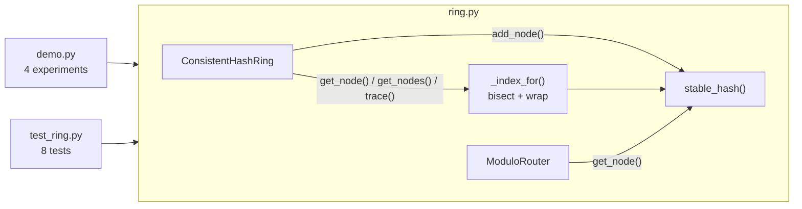

# Code walkthrough: Consistent Hashing

> Companion to [README.md](README.md). The README explains the *concept*; this file explains the
> *code*, file by file, so you can read it, change it, and rebuild it yourself.
> Line links (e.g. `ring.py#L87`) point at the exact code.

## File map

| Read | File | Lines | Role |
|---|---|---|---|
| 1 | [`src/ring.py`](src/ring.py) | 119 | The concept: `stable_hash`, the `ModuloRouter` baseline, and `ConsistentHashRing` |
| 2 | [`src/demo.py`](src/demo.py) | 109 | Four experiments that print the numbers in the README's "Expected output" |
| 3 | [`tests/test_ring.py`](tests/test_ring.py) | 86 | Eight tests, each pinning down one property that makes the hashing *consistent* |
| – | [`Makefile`](Makefile) | | `make run` = `uv run python -m src.demo`, `make test` = `uv run python -m pytest tests` |

Read `ring.py` top to bottom first. Everything else just calls it.

## How the pieces fit



Every road leads to two things: **`stable_hash`** (where something sits on the ring) and
**`_index_for`** (who owns that spot). If you understand those two functions, you understand
the lesson.

## `src/ring.py`, the concept

### `stable_hash` ([L19](src/ring.py#L19))

```python
RING_SIZE = 2**64

def stable_hash(value: str) -> int:
    return int.from_bytes(hashlib.md5(value.encode()).digest()[:8], "big")
```

**What it does:** turns any string into an integer between 0 and 2⁶⁴ − 1, which is a position on the ring.

**Why this way:**
- **Stable across processes.** MD5 of the same bytes is the same on every machine, forever. Python's
  built-in `hash()` is not (Break it, experiment 2), so it can't be used here.
- **Uniform spread.** MD5 output looks random, so keys and vnodes scatter evenly. We don't need
  cryptographic strength, only spread.
- **`[:8]` keeps 8 bytes = 64 bits**, which defines a ring of 2⁶⁴ positions (`RING_SIZE`,
  [L16](src/ring.py#L16)). It's big enough that collisions are practically impossible, and
  small enough to be a fast Python int.

**Line notes:** `value.encode()` converts `str` to `bytes` (hash functions work on bytes).
`"big"` means the first byte is the most significant, which is the standard way to read a hex
digest as a number.

### `ModuloRouter`, the baseline ([L30](src/ring.py#L30))

```python
def get_node(self, key: str) -> str:
    return self.nodes[stable_hash(key) % len(self.nodes)]
```

**What it does:** the naive approach, `hash % N`. It's here only so the demo and tests can compare.

**Why it fails on resize:** `len(self.nodes)` is part of every key's address. Change it from 4 to 5,
and `h % 4` vs `h % 5` disagree for about 80% of keys. In the trace below, `user:42` goes from
node-A to node-D just because a server was added.

### `ConsistentHashRing.__init__` ([L53](src/ring.py#L53))

```python
self.vnodes = vnodes
self._positions: list[int] = []                 # sorted ring positions of every vnode
self._owners: dict[int, tuple[str, int]] = {}   # position -> (physical node, vnode index)
self._weights: dict[str, int] = {}
```

These three structures *are* the ring:

| Structure | Holds | Used for |
|---|---|---|
| `_positions` | Every vnode's position, **always sorted** | Binary search: "first vnode at or after this key" |
| `_owners` | Position → `(node, vnode_index)` | Turning the found position into a server name. The index exists only so `trace()` can say `node-D#41` |
| `_weights` | Server → weight | Membership (`nodes` property, [L64](src/ring.py#L64)) and duplicate checks |

Keeping positions and owners separate means lookups do one binary search on a plain list of ints
(fast and cache-friendly), then one dict lookup.

### `add_node` ([L67](src/ring.py#L67)), placing the vnodes

```python
self._weights[node] = weight
for i in range(self.vnodes * weight):
    pos = stable_hash(f"{node}#{i}")
    if pos in self._owners:          # 64-bit collision: astronomically rare, skip it
        continue
    self._owners[pos] = (node, i)
    bisect.insort(self._positions, pos)
```

**What it does:** hashes `node-A#0`, `node-A#1`, … `node-A#149` and drops each result onto the ring.

**Why this way:**
- **Virtual nodes = many hashes of one server.** The suffix `#i` makes each hash different, so one
  physical server ends up in 150 scattered spots. That is the README's "many name cards around the
  table".
- **`weight` multiplies vnodes.** A server with weight 2 gets 300 spots, so it owns about twice the
  ring. The demo shows node-E at 32.1%, with 33.3% as the target.
- **`bisect.insort`** inserts each position at the right place, so `_positions` stays sorted at all
  times. That's what makes lookup a binary search.

**Line notes:** [L75](src/ring.py#L75) guards against two vnodes hashing to the same position. With
2⁶⁴ slots it essentially never happens, but if it did, silently overwriting the owner would steal
another server's spot.

### `remove_node` ([L80](src/ring.py#L80))

```python
del self._weights[node]
self._positions = [p for p in self._positions if self._owners[p][0] != node]
self._owners = {p: o for p, o in self._owners.items() if o[0] != node}
```

**What it does:** rebuilds both structures without the removed server's vnodes.

**Why this way:** filtering a list keeps it sorted, so no re-sort is needed. Nothing has to "move"
the dead server's keys: they hash to the same positions as before, and `_index_for` now simply
finds the *next* vnode clockwise. **Removing points is the whole failover mechanism.**

### `_index_for` ([L87](src/ring.py#L87)), the heart of the lesson

```python
return bisect.bisect_left(self._positions, stable_hash(key)) % len(self._positions)
```

**What it does:** finds the index of the first vnode at or after the key's position, wrapping
around to the start of the ring.

**This one line is the "walk clockwise" rule:**
1. `stable_hash(key)` gives the key's spot on the ring.
2. `bisect_left(sorted_list, x)` returns the index of the first element `>= x`, using binary search
   (about 10 comparisons for 750 vnodes).
3. If the key sits after the last vnode, `bisect_left` returns `len(list)`, which is one past the end.
   **`% len(...)` turns that into 0**: the walk continues past 360° and starts again at the
   first vnode. That's what makes a list behave like a circle.

**Why `bisect_left` and not `bisect_right`:** if a key hashes *exactly* onto a vnode, `bisect_left`
gives that vnode ("at or after"). `bisect_right` would skip to the next one. Either convention
works as long as every client uses the same one.

### `get_node` and `get_nodes` ([L93](src/ring.py#L93), [L96](src/ring.py#L96))

```python
def get_node(self, key):
    return self._owners[self._positions[self._index_for(key)]][0]

want = min(n, len(self._weights))
for step in range(len(self._positions)):
    node = self._owners[self._positions[(start + step) % len(self._positions)]][0]
    if node not in out:
        out.append(node)
        if len(out) == want:
            break
```

**`get_node`:** index → position → `(node, i)` → `node`. Three hops, read right to left.

**`get_nodes`** (replicas) keeps walking clockwise from the owner:
- **`if node not in out` skips repeats.** With vnodes, the next point clockwise is often another
  vnode of a server you already picked (`node-A#137` then `node-A#41` in the trace below). Two
  copies on one machine isn't replication.
- **`(start + step) % len`** is the same wrap-around trick, applied inside the loop.
- **`want = min(n, …)`** ([L100](src/ring.py#L100)): asking for 10 replicas on a 4-server ring returns
  4, not an infinite loop.

### `trace` and `distribution` ([L110](src/ring.py#L110), [L118](src/ring.py#L118))

Helpers for the demo. `trace` converts positions to degrees (`360 * pos / RING_SIZE`) so humans can
picture the ring. `distribution` counts keys per server with `Counter`.

## `src/demo.py`, making it visible

| Experiment | Line | Setup | What it measures | README output |
|---|---|---|---|---|
| 1. Scale out | [L37](src/demo.py#L37) | Place 100k keys on 4 servers, add node-E, place again | Keys whose owner changed (`moved()`, [L33](src/demo.py#L33)) and where they went | "79.9% vs 20.4%" table |
| 2. Failure | [L57](src/demo.py#L57) | 5 servers, remove node-C | That *only* node-C's keys moved, and how they spread over survivors | "went to" table |
| 3. Vnodes | [L76](src/demo.py#L76) | Same keys, rings with 1 … 500 vnodes | Busiest and quietest share | "44.0% … 20.4%" table |
| 4. Trace | [L87](src/demo.py#L87) | Look up `user:42` and `user:1337`; add a weight-2 node | One lookup step by step, the replica set, weighted shares | Degree lines |

**Details worth noticing:**
- **Keys are `user:0 … user:99999`** ([L14](src/demo.py#L14)), not random, so every run prints identical
  numbers and the README output stays true.
- **`VNODES` comes from an environment variable** ([L15](src/demo.py#L15)), which is how
  `VNODES=1 make run` breaks it without editing code.
- **"Before" and "after" placements are full dicts** (`{key: node}`), so "moved" is a plain
  comparison. That's slower than clever math, but obviously correct.
- **`table()`** ([L24](src/demo.py#L24)) sizes each column with `zip(headers, *rows)`, which turns rows
  into columns, then takes the longest cell in each.

## Tests: what each one proves

| Test | Property it proves | Why that property matters |
|---|---|---|
| [`test_lookup_is_deterministic`](tests/test_ring.py#L16) | Two separately built rings route all 20k keys identically | App servers agree on placement without talking to each other |
| [`test_adding_a_node_moves_about_one_over_n_keys…`](tests/test_ring.py#L21) | 15–25% of keys move (ideal 20%), **all** to the new node | The defining promise: minimal, targeted movement |
| [`test_modulo_hashing_moves_most_keys`](tests/test_ring.py#L31) | `% N` moves over 75% | Proves the problem is real, not hypothetical |
| [`test_removing_a_node_only_moves_that_nodes_keys`](tests/test_ring.py#L37) | Every moved key belonged to the removed node | Failures don't ripple into healthy servers |
| [`test_virtual_nodes_improve_balance`](tests/test_ring.py#L46) | Load spread drops from over 50% (1 vnode) to under 6% (500); busiest server under 1.15× fair from 200 vnodes up | Why vnodes exist. It also asserts the *trend*, because one layout is random (see README gotchas) |
| [`test_weight_scales_ownership`](tests/test_ring.py#L63) | Weight 2 gives 1.6–2.4× a normal server's keys | Heterogeneous hardware works |
| [`test_replicas_are_distinct_physical_nodes`](tests/test_ring.py#L70) | 3 replicas are 3 different servers; the first equals `get_node` | Replication survives a machine loss |
| [`test_errors`](tests/test_ring.py#L79) | Empty ring, duplicate add and unknown remove all raise | Fails loudly instead of misrouting |

The tests use **ranges, not exact numbers** (e.g. 0.15–0.25), because they test the *property*. The
demo's exact numbers live in the README.

## Trace one run

Real values from the 5-server, 150-vnode ring in the demo (750 vnodes in total).

**Lookup: `get_node("user:42")`**

| Step | Code | Value |
|---|---|---|
| 1 | `"user:42".encode()` | `b"user:42"` |
| 2 | `hashlib.md5(...).hexdigest()` | `56dadf1868c3ba340467c942a86c29de` |
| 3 | `.digest()[:8]` | `56dadf1868c3ba34` (first 8 bytes) |
| 4 | `int.from_bytes(..., "big")` | `6,258,559,928,114,592,308` |
| 5 | Position as a fraction of 2⁶⁴ | 0.3393, which is **122.14°** |
| 6 | `bisect_left(_positions, h)` | **index 250** of 750 |
| 7 | `250 % 750` | 250 (no wrap needed) |
| 8 | `_owners[_positions[250]]` | `("node-D", 41)` at **122.18°** |
| 9 | `[0]` | **`node-D`** |

The neighbours around the key show why index 250 wins:

```text
pos[249]  121.67°  node-A#26    ← just before the key (counter-clockwise)
           122.14°  user:42      ← the key
pos[250]  122.18°  node-D#41    ← first at-or-after → owner
pos[251]  122.36°  node-A#137
```

**Replicas: `get_nodes("user:42", 3)`**, walking clockwise from index 250:

```text
step 0  node-D#41   122.18°  take  → [node-D]
step 1  node-A#137  122.36°  take  → [node-D, node-A]
step 2  node-A#41   122.96°  skip  (node-A already chosen)
step 3  node-E#143  123.49°  take  → [node-D, node-A, node-E]  done
```

**Wrap-around: `get_node("user:3")`.** The key lands at **358.09°**, past the last vnode
(`node-D#127` at 357.77°). `bisect_left` returns **750**, one past the end. `750 % 750 = 0` gives
`_positions[0]`, which is `node-B#23` at **0.91°**, so the key is stored on **node-B**. The list
has become a circle.

**Same key with modulo:** `h % 4 = 0` → node-A, but `h % 5 = 3` → node-D. Adding one server
moved this key, along with about 80% of the others.

## Python techniques used

| Technique | Where | Why it's used here |
|---|---|---|
| `hashlib.md5(...).digest()` + `int.from_bytes(b, "big")` | `stable_hash` | Turns bytes into a big integer position |
| `bisect.bisect_left` / `bisect.insort` | `_index_for`, `add_node` | Binary search and sorted insert on a plain list: the whole ring in two stdlib calls |
| `x % len(list)` | `_index_for`, `get_nodes` | Wrap-around: makes a list behave like a circle |
| `dict[int, tuple[str, int]]` | `_owners` | O(1) position → owner lookup |
| `@property` | `nodes` | Read-only view; callers can't corrupt `_weights` |
| `collections.Counter` | `distribution` | Counts keys per server in one line |
| `from __future__ import annotations`, `Iterable`, `Counter[str]` | top of `ring.py` | Modern type hints that still run on Python 3.11 |
| Relative import `from .ring import ...` + `python -m src.demo` | `demo.py`, `Makefile` | `-m` runs the file as part of the `src` package, so relative imports work |
| `os.environ.get("VNODES", 150)` | `demo.py` | Lets you change a knob without editing code |
| `zip(headers, *rows)` | `table()` | Transposes rows into columns to measure widths |
| f-string format specs `:5.1f`, `:,` | `pct()`, demo output | `" 79.9%"` and `"100,000"`: aligned, readable numbers |
| `pytest.raises`, `statistics.pstdev` | tests | Assert errors, and measure balance as standard deviation |

## Design decisions & alternatives

| Decision | Alternative | Why this one, for learning |
|---|---|---|
| Sorted `list` + `bisect` | Balanced tree, or `sortedcontainers.SortedList` | Stdlib only, and readable. `insort` is O(V) per insert, but membership changes are rare while lookups (O(log V)) are constant. Real systems optimize the same way |
| MD5 truncated to 64 bits | MurmurHash3 / xxHash (faster, non-crypto) | No dependency. Speed isn't the lesson, stability and spread are |
| Store `(node, vnode_index)` | Store just `node` | Lets `trace()` show *which* vnode caught the key, which makes the concept visible |
| `remove_node` rebuilds lists | Track each node's positions for targeted deletes | Simpler and obviously correct. O(V) on a rare event is fine |
| Vnodes via `"node#i"` hashing | Cassandra-style explicitly assigned tokens | Zero configuration, and good balance at about 150+ vnodes (experiment 3) |

## Change it yourself

### 1. Swap the hash function (easy)

**Goal:** replace MD5 with BLAKE2b and check that balance stays as good.
**Change:** `stable_hash` in `src/ring.py`.
**Check:** `make test` still passes. Compare the experiment 3 table from `make run` with the README's.

<details><summary>Hint</summary>

`hashlib.blake2b(value.encode(), digest_size=8).digest()` returns exactly 8 bytes, so you can drop
the `[:8]`. Every position changes, so the exact numbers will differ, but the trends shouldn't.
That's a nice demonstration that the *algorithm*, not the specific hash, gives the guarantees.
</details>

### 2. Preview a migration (medium)

**Goal:** add `plan_add(self, node: str, keys: list[str]) -> dict[str, int]` that says, *before*
adding a server, how many keys each existing server would hand over to it. That's the migration plan
an operator reviews before scaling.
**Change:** a new method in `ConsistentHashRing`, and a new test in `tests/test_ring.py`.
**Check:** the plan's total equals the number of keys that actually move when you then call `add_node`.

<details><summary>Hint</summary>

Simplest correct version: `import copy`, then `future = copy.deepcopy(self)`, `future.add_node(node)`,
and count each key where `self.get_node(k) != future.get_node(k)`, grouped by `self.get_node(k)`.
For extra credit, avoid the copy: compute only the new vnode positions, and for each key check
whether the first position at or after it is one of them.
</details>

### 3. Consistent hashing with bounded loads (hard)

**Goal:** cap every server at `c × average` keys (e.g. `c = 1.25`). If a key's owner is full, keep
walking clockwise to the next server with room. This is the bounded-loads algorithm from Google Research
(Mirrokni, Thorup & Zadimoghaddam), which HAProxy
exposes as `hash-balance-factor`.
**Change:** add `assign(self, keys: list[str], c: float = 1.25) -> dict[str, str]`.
**Check:** with `vnodes=1`, the busiest server drops from 44% to at most `1.25 × 20% = 25%`. Add a
test for that bound.

<details><summary>Hint</summary>

```python
cap = math.ceil(c * len(keys) / len(self._weights))
load = Counter()
for k in keys:
    i = self._index_for(k)
    while True:
        node = self._owners[self._positions[i]][0]
        if load[node] < cap:
            load[node] += 1; result[k] = node; break
        i = (i + 1) % len(self._positions)
```

Think about the trade-off: you get balance, but placement now depends on *insertion order* and
current load, so it isn't a pure function of the key any more. That's why real systems use it for
routing *requests*, not for deciding where *data* lives.
</details>
