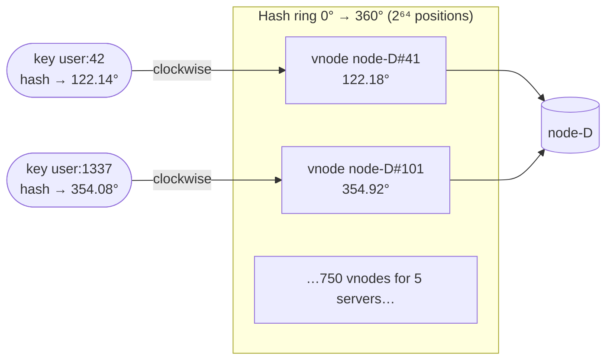

# Consistent Hashing

> **Module:** 03 Databases · **Difficulty:** ●●●○○ · **Time:** ~60 min · **Prereqs:** [Partitioning & Sharding](../10-sharding/README.md)

## TL;DR

A way to assign keys to servers so that adding or removing a server moves only about **1/N** of the keys,
not nearly all of them. Distributed caches and databases use it to scale out and survive failures
without a giant reshuffle.

## Explain like I'm 5

Imagine a **round table with a clock face** painted on it. Every toy gets a sticker with a time on it
(say 3:10), and every kid sits at some time around the table. A toy belongs to **the first kid sitting
clockwise from its time**.

When a new kid sits down at 4:00, they only take the toys between the previous kid and 4:00. Everyone
else keeps their toys. If a kid goes home, their toys slide to the next kid clockwise. Nobody else is
bothered.

Now the trick: instead of each kid sitting in one chair, each kid puts **lots of little name cards**
all around the table. Then everyone's share of the table ends up about the same. When a kid leaves,
their toys get shared by *all* the other kids instead of piling onto one neighbour.

| In the story | In the system |
|---|---|
| Clock-face table | The hash ring (all hash values 0 … 2⁶⁴, wrapped into a circle) |
| Time sticker on a toy | `hash(key)`: the key's position on the ring |
| Kid's chair | A server's position: `hash(server_name)` |
| "First kid clockwise" | Lookup rule: the first server position ≥ the key's position, wrapping at the end |
| Many name cards per kid | **Virtual nodes**: each server hashed at 100–500 positions |
| Kid goes home | Server failure: only its arcs move, and they spread across all survivors |

**Real world:** Amazon's **Dynamo** (and DynamoDB), **Apache Cassandra** and **Riak** partition data this
way. **Discord** routes chat messages to the right Elixir process with a hash ring. Memcached clients
(ketama) use it so adding a cache server doesn't wipe out most of the cache.

## Technical deep dive

### The problem

The obvious way to shard is `server = hash(key) % N`. It is perfectly balanced, but **N is baked into
every placement**. Going from 4 to 5 servers changes `% 4` to `% 5`, and roughly **80%** of keys land
somewhere else. For a cache, that's a cold-cache stampede on your database. For a database, it's
moving 80% of your data over the network.

### How it works

1. Hash every **server** onto a ring of 2⁶⁴ positions, many times each (`node-A#0`, `node-A#1`, …).
   These are **virtual nodes (vnodes)**.
2. Keep the vnode positions in a **sorted array**.
3. To find a key's owner, hash the key and **binary search** for the first vnode position ≥ that
   value. Past the end, wrap to index 0. That's O(log V), where V is the total number of vnodes.
4. **Add a server:** insert its vnodes. Each one takes over only the arc between itself and its
   counter-clockwise neighbour. Keys elsewhere don't move.
5. **Remove a server:** delete its vnodes. Each orphaned arc falls to the next vnode clockwise. With
   many vnodes, that's a different server for each arc.
6. **Replication:** keep walking clockwise past the owner, collecting the next *distinct physical*
   servers. With N=3, that's the key's replica set (Dynamo's "preference list").



Adding `node-E` inserts 150 new points. Each steals a thin slice from whichever server sat just
clockwise of it, so about 1/5 of the keys move, **all of them to node-E**.

### Trade-offs

| Choice | Gain | Cost |
|---|---|---|
| Consistent hashing vs `% N` | ~1/N keys move on resize instead of ~N/(N+1) | Lookup is O(log V) not O(1); ring state must be shared by all clients |
| More vnodes per server | Better balance; failures spread across all survivors | More memory, slower rebuilds, more token metadata to gossip |
| Weights (vnodes ∝ capacity) | Bigger machines take proportionally more | Must keep weights in sync everywhere |
| Ring vs [rendezvous hashing](https://en.wikipedia.org/wiki/Rendezvous_hashing) | Fast lookups, simple replica walk | Rendezvous needs no vnodes and balances naturally, but lookup is O(N) |
| Ring vs a directory/lookup table | No central coordinator in the read path | A directory allows arbitrary placement and easy rebalancing, at the cost of a lookup service |

### Failure modes & gotchas

- **Unstable hash function.** Python's `hash()` is randomised per process, so two app servers would
  route the same key differently (see *Break it*). Use a stable hash: MD5, MurmurHash3 or xxHash.
- **Too few vnodes means hot spots.** With 1 point per server, one server owned **44%** of keys and
  another **1.6%** in this lab.
- **Balance is statistical, not guaranteed.** More vnodes is better *on average*, but any one layout
  is random. In the tests, 4 servers × 200 vnodes came out *less* even than × 100 (11% vs 2% spread).
  Production systems measure real load and rebalance.
- **Hot keys aren't fixed by the ring.** It balances *key ranges*, not traffic. One celebrity key
  still hammers one server. Fix it with replication of hot keys, a local cache, or key salting.
- **Ring membership must agree.** If clients have different views of which servers exist, they route
  differently. Systems spread membership via gossip (Cassandra) or a coordinator (ZooKeeper/etcd).
- **Moving data isn't free.** The ring tells you *which* keys move. You still have to stream them,
  serve reads during the move, and handle writes that arrive mid-transfer.

### When NOT to use it

- The server count is **fixed** (or changes only during planned downtime): `% N` is simpler and perfectly balanced.
- You need **range scans** (`user:100…user:200`): hashing destroys key order. Use range partitioning
  (Bigtable, HBase, CockroachDB).
- You need **precise control** over placement (tenant isolation, data residency). Use a directory service.

## Implementation

[`src/ring.py`](src/ring.py) has everything, in about 100 lines.

**A stable hash, mapped onto a 2⁶⁴ ring:**

```python
def stable_hash(value: str) -> int:
    return int.from_bytes(hashlib.md5(value.encode()).digest()[:8], "big")
```

**Vnodes in a sorted array.** Each server is hashed `vnodes × weight` times:

```python
for i in range(self.vnodes * weight):
    pos = stable_hash(f"{node}#{i}")
    self._owners[pos] = (node, i)
    bisect.insort(self._positions, pos)
```

**Lookup = binary search + wrap-around.** This is the whole "clockwise" idea in one line:

```python
bisect.bisect_left(self._positions, stable_hash(key)) % len(self._positions)
```

**Replicas = keep walking, skipping repeat servers.** Several of a server's vnodes can sit next to
each other, so we de-duplicate by *physical* node:

```python
for step in range(len(self._positions)):
    node = self._owners[self._positions[(start + step) % len(self._positions)]][0]
    if node not in out: out.append(node)
```

[`src/demo.py`](src/demo.py) runs four experiments on 100,000 keys, comparing against a `ModuloRouter`
baseline. [`tests/test_ring.py`](tests/test_ring.py) pins down the defining properties: ≈1/N movement,
moved keys only go to the new node, removal only moves the dead node's keys, vnodes improve balance,
weights scale ownership, and replicas are distinct.

## Run it

```bash
cd modules/03-databases/11-consistent-hashing
make up     # no infrastructure needed for this lesson
make run    # run the demo
make test   # prove the behaviour
make down
```

## Expected output

```text
==============================================================================
 Consistent hashing — modulo vs ring, failures, virtual nodes, replicas
==============================================================================

1) Scale out: add a 5th server (100,000 keys, 150 vnodes/server)
  strategy         keys moved  share   moved keys that went to node-E
  ---------------  ----------  ------  ------------------------------
  hash % N         79,942       79.9%   25.1%
  consistent hash  20,442       20.4%  100.0%
  ideal (1/5)      20,000       20.0%  100.0%
  → modulo reshuffles ~80% of the cache/shards; the ring moves only what node-E must take.

2) Failure: node-C dies (5 → 4 servers)
  node-C owned 19,621 keys (19.6%). Ring moved 19,621; all of them were node-C's: True. Modulo would move 79.9%.
  node-C's keys went to  keys   share
  ---------------------  -----  ------
  node-A                 4,898   25.0%
  node-B                 5,736   29.2%
  node-D                 5,180   26.4%
  node-E                 3,807   19.4%
  → with vnodes the orphaned keys spread over ALL survivors, so no single neighbour gets swamped.

3) Why virtual nodes? Balance across 5 servers
  vnodes/server  busiest  quietest  busiest vs fair share
  -------------  -------  --------  ---------------------
  1               44.0%     1.6%    2.20×
  3               35.1%     6.7%    1.76×
  10              32.1%    11.3%    1.60×
  50              22.8%    17.7%    1.14×
  150             22.0%    18.3%    1.10×
  500             20.4%    19.5%    1.02×
  → one point per server leaves random, lopsided arcs; ~100+ vnodes gets within a few % of fair.

4) One lookup, step by step, plus replica placement (N=3)
  user:42    hashes to 122.14° → next vnode clockwise is node-D#41    at 122.18° → stored on node-D; replicas ['node-D', 'node-A', 'node-E']
  user:1337  hashes to 354.08° → next vnode clockwise is node-D#101   at 354.92° → stored on node-D; replicas ['node-D', 'node-C', 'node-A']

   Heterogeneous hardware: node-E is twice as big (weight=2)
   node-A: 19.2%  node-B: 17.5%  node-C: 15.8%  node-D: 15.4%  node-E: 32.1%   (fair: 16.7% each, E 33.3%)
```

```text
uv run python -m pytest tests
........                                                                 [100%]
8 passed in 0.22s
```

**What you're seeing:**

1. **Scale-out:** modulo moves 79.9% of keys, and most of them just shuffle between the *old* servers
   (only 25% of the movers went to node-E). The ring moves 20.4%, essentially the ideal 20%, and
   **every** moved key went to node-E.
2. **Failure:** only node-C's own keys moved, and they spread roughly evenly over all four survivors.
3. **Vnodes:** with 1 point per server, the busiest server holds 44% of the data (2.2× its fair share).
   At 150–500 vnodes it's within 2–10% of fair.
4. **Lookup:** `user:42` lands at 122.14°, and the very next point clockwise is vnode `node-D#41`. Its
   replicas are the next two *different* servers clockwise. Weight 2 gives node-E about twice the share.

## Break it

**Experiment 1: remove the virtual nodes.**

```bash
VNODES=1 make run
```

Watch experiment 1: adding node-E now moves **44%** of keys instead of 20%, because node-E happened to
land on a huge arc. Experiment 2 is worse:

```text
2) Failure: node-C dies (5 → 4 servers)
  node-C's keys went to  keys   share
  node-A                 1,606  100.0%
  node-B                 0        0.0%
```

**Every** orphaned key fell onto a single neighbour. In production, that neighbour gets the dead node's
entire traffic and may die too: a **cascading failure**. That's the real reason vnodes exist.

**Experiment 2: use Python's built-in `hash()`.**

```bash
for seed in 1 2 3; do PYTHONHASHSEED=$seed uv run python -c "print('PYTHONHASHSEED=$seed  user:42 -> node', 'ABCD'[hash('user:42') % 4])"; done
```

```text
PYTHONHASHSEED=1  user:42 -> node B
PYTHONHASHSEED=2  user:42 -> node C
PYTHONHASHSEED=3  user:42 -> node C
```

Three "app servers" disagree about where `user:42` lives. Every process gets a random seed by default,
so in production your cache hit rate would quietly collapse. That's why `stable_hash` uses MD5.

## Real-world systems

| System | How it uses this |
|---|---|
| Amazon Dynamo / DynamoDB | Ring with vnodes. Each key is stored on the next N distinct nodes clockwise (the preference list) |
| Apache Cassandra | Token ring. `num_tokens` (default 16 in 4.x) vnodes per node. Membership spread by gossip |
| Riak | Ring split into a fixed number of partitions, assigned to nodes; handoff on membership change |
| Memcached clients (ketama) | Client-side ring, so adding a cache server keeps most keys warm |
| Discord | Hash ring to route a guild's events to the process that owns it |
| Nginx / HAProxy | `hash $key consistent` / `hash-type consistent` for sticky upstream selection |

## Interview angle

**Q1. Why not just use `hash(key) % N`?**
Changing N remaps about N/(N+1) of keys. For a cache, that's a mass miss storm on the database; for
storage, a massive data migration. Consistent hashing bounds movement to about 1/N, and only the keys
next to the changed node move.

**Q2. What problem do virtual nodes solve, and what do they cost?**
With one point per server, arc sizes are random, so load is lopsided (44% vs 1.6% in this lab), and a
failed node's whole range dumps onto one neighbour. Many vnodes per server average out arc sizes and
spread a failure over all survivors. They also allow weights for heterogeneous hardware. Cost: more
metadata to store and gossip, and slower ring rebuilds.

**Q3. How do you pick replicas, and what can go wrong?**
Walk clockwise from the key's position and take the next N *distinct physical* nodes, skipping extra
vnodes of servers already chosen. Better still, make sure they're in different racks or availability
zones. Pitfalls: vnodes of the same server adjacent on the ring (hence de-duplication), clients with
inconsistent membership views, and hot keys, which the ring doesn't spread.

## Self-check quiz

1. You have 10 cache servers using consistent hashing and add an 11th. Roughly what fraction of keys move?
2. Why must the hash function be stable across processes? Give a concrete failure.
3. Server C crashes. With 1 vnode per server versus 200, where do C's keys go?
4. Your ring is perfectly balanced by key count, but one server is at 95% CPU. What's likely happening, and how do you fix it?
5. You need to run "all orders between two dates" queries efficiently. Is consistent hashing a good partitioning choice? Why or why not?

<details>
<summary>Answers</summary>

1. About **1/11 ≈ 9%**, and all of them move to the new server.
2. Every client must compute the same position for the same key. Python's `hash()` is salted per
   process, so two app servers route `user:42` to different nodes: cache misses, or reads that miss
   writes.
3. With 1 vnode, **all** of C's keys go to its single clockwise neighbour, which may then overload.
   With 200 vnodes they spread roughly evenly across all survivors.
4. A **hot key** (or a few). The ring balances key *ranges*, not request rates. Fixes: replicate or
   cache the hot key, split it into salted sub-keys (`key#1…key#k`), or add request-level load
   balancing for reads.
5. Usually **no**. Hashing scatters adjacent keys, so a range query must hit every partition. Use range
   partitioning (or a secondary index) on the date.

</details>

## Further reading

- DeCandia et al., [*Dynamo: Amazon's Highly Available Key-value Store*](https://www.allthingsdistributed.com/files/amazon-dynamo-sosp2007.pdf) (SOSP 2007), §4.2–4.3
- Karger et al., *Consistent Hashing and Random Trees* (STOC 1997), the original paper
- Martin Kleppmann, *Designing Data-Intensive Applications*, ch. 6 "Partitioning"
